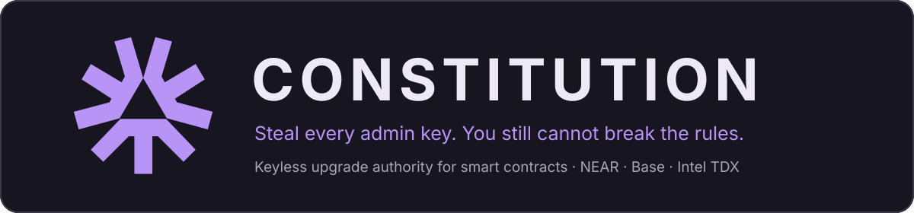
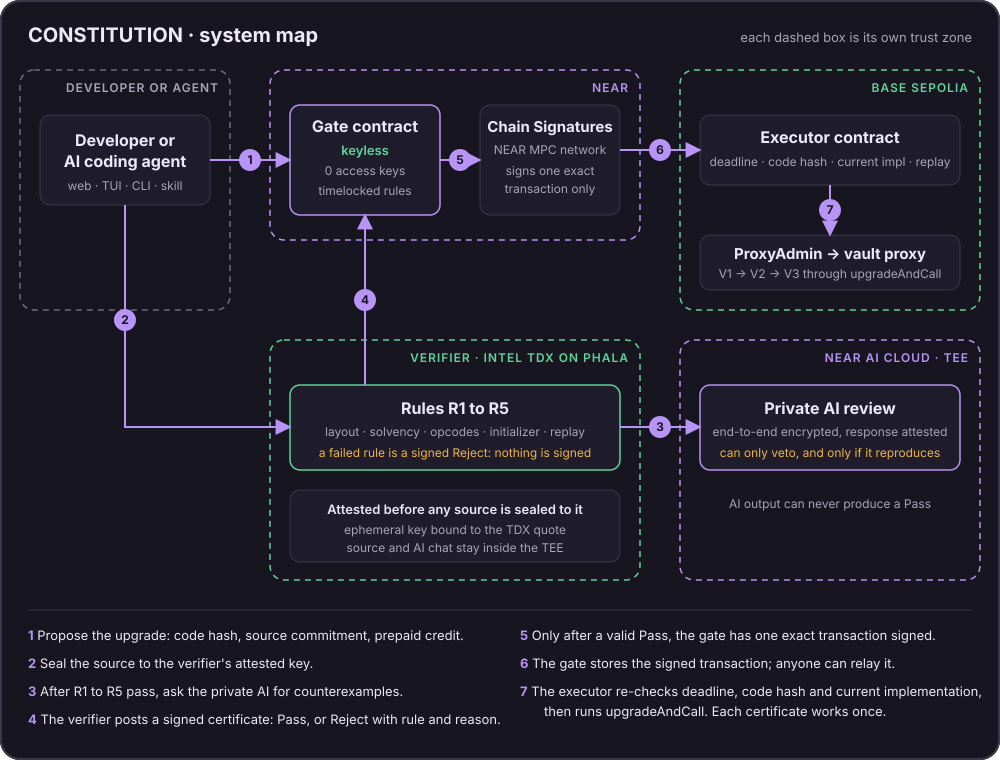
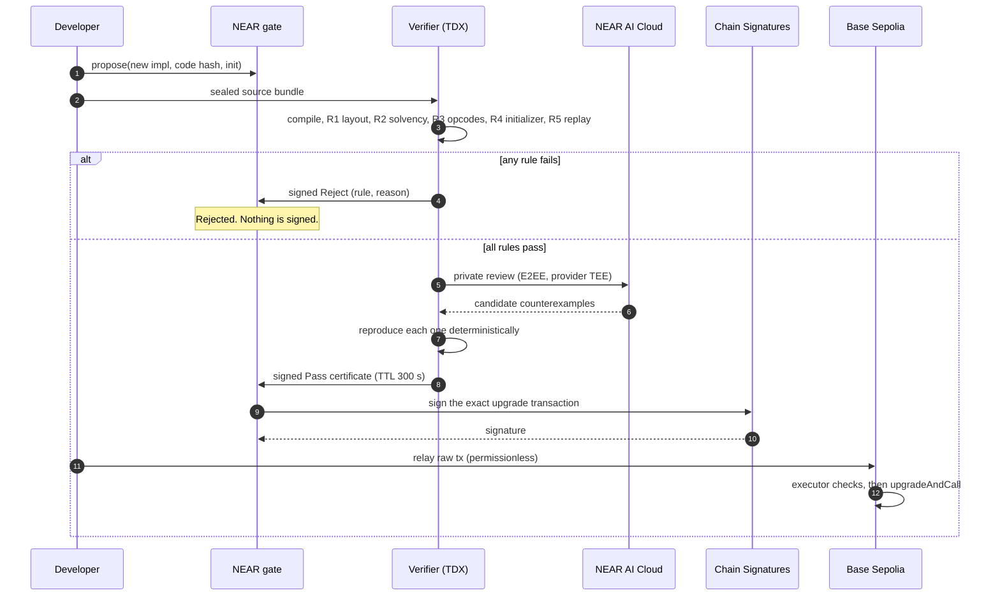

<div align="center">



<br>

### There is no key to steal, and no way to ship code that breaks the rules.

A keyless NEAR contract holds the upgrade authority of a Base Sepolia vault through Chain Signatures.<br>
It signs an upgrade only when an attested verifier certifies the new code against rules the owner committed in advance.<br>
A private AI review can veto an upgrade. Nothing can approve one past the rules.

[**Live site**](https://constitution-gate.pages.dev) · [**Try the attack**](https://constitution-gate.pages.dev/app) · [**User guide**](docs/GUIDE.md) · [**Agent skill**](skills/constitution/SKILL.md) · [**Evidence**](#proof-not-promises)

     

Built for the NEAR hackathon · **AI Security & Defense** · **Privacy & Private AI**

</div>

> [!WARNING]
> **Testnet only. Not independently audited.** Every result below was observed on NEAR testnet and Base Sepolia, or is labeled otherwise. Local tests are never presented as testnet evidence.

## In 30 seconds

| | |
| --- | --- |
| **What it protects** | The upgrade path of an upgradeable (proxy) smart contract, the path behind losses like Radiant and Zoth. |
| **What is new** | No person or key holds that power. A program does, and it signs only for code that passed rules you committed in advance. |
| **What exists today** | Two keyless gates on testnet. Rule-breaking upgrades refused with exact rule codes (nine on the demo gate alone), one honest upgrade shipped end to end, all linked below. |
| **Why it is credible** | Keylessness is checked on-chain by a command anyone can run, the verifier proves what code it runs through Intel TDX attestation, and the AI can only say no. |
| **Try it** | [In the browser](https://constitution-gate.pages.dev/app) in two minutes, or [in the terminal](#2-in-the-terminal) with `constitution`. |

## The problem

An upgradeable contract is only as safe as whoever can upgrade it. Multisigs and timelocks decide **who** may sign; they do not check **what** the new code does. When signers are compromised, a valid signature installs malicious code:

- **Radiant Capital, 16 Oct 2024, about USD 50 million.** Malware on at least three developer devices produced valid multisig signatures for an ownership transfer, followed by implementation upgrades and drains ([project post-mortem](https://medium.com/@RadiantCapital/radiant-post-mortem-fecd6cd38081)).
- **Zoth, 21 Mar 2025, about USD 8.4 million.** A compromised admin wallet called `upgradeToAndCall` to install a malicious implementation and withdrew the vault one minute later ([investigator report](https://research.blockscope.co/zoth-vault-breach), [upgrade tx](https://etherscan.io/tx/0xb2335f7bf58abbcaa006d0a2bed7db2c64a5dabed56fb1759260adc012c49abe)).

In both cases the key holder could ship any code.

> [!NOTE]
> This is a design argument, not a replay. We did not run those historical payloads through our rules, and our current rules target one demo vault, not Radiant's lending suite. CONSTITUTION does **not** protect against everything: the Bybit theft (Feb 2025, about USD 1.5 billion, [FBI](https://www.ic3.gov/PSA/2025/PSA250226)) was a signed Safe `delegatecall`, not a proxy upgrade through our executor, and frontend or signing-device compromise stays out of scope. See [limits](#guarantees-and-limits).

## The solution: remove the key, keep the rules

Upgrade security fails because upgrade authority is a **key**, and keys get stolen. CONSTITUTION turns that authority into a **program with no key**, and makes the program sign only for code that obeys the owner's rules.

1. **Remove the key.** The proxy's upgrade authority belongs to an address derived through [NEAR Chain Signatures](https://docs.near.org/chain-abstraction/chain-signatures) for a NEAR contract, the **gate**. The gate account's access keys are deleted, and the contract has no method to upgrade itself, add a key or sign a caller-supplied hash. The result is verifiable: `constitution audit` fails unless the gate has zero access keys.
2. **Replace the signer with a verifier.** A candidate upgrade is compiled and checked privately inside an Intel TDX enclave against rules the owner committed in advance (**R1 to R5**: storage layout, solvency, forbidden code, initializer, regression replay). The gate accepts only a certificate signed by that attested verifier for that rule set.
3. **Let the AI say no, never yes.** After the rules pass, a private model on NEAR AI Cloud hunts for counterexamples. A veto counts only if it reproduces deterministically. AI output can never produce a Pass.
4. **Make rule changes slow and public.** Changing the rules, the verifier or the authority waits out a public delay chosen at deployment. An early apply is refused on-chain.

What that changes when something goes wrong:

| If an attacker... | Today (multisig or EOA admin) | With CONSTITUTION |
| --- | --- | --- |
| Steals an admin or multisig key | Signs any upgrade | No upgrade key exists. The executor accepts only the gate's MPC-derived signer. |
| Compromises developer machines (Radiant pattern) | Valid signatures install malicious code | The machines hold no authority. Code must still pass R1 to R5. |
| Ships a "routine" upgrade with a hidden drain | Reviewers must spot it in bytecode | The verifier refuses it with a rule code. Observed on testnet: **R2/20**, nothing signed, proxy unchanged. |
| Tries to quietly weaken the rules | Nothing to weaken | A rule change waits out the public delay; an early apply was refused with `E53_TIMELOCK_NOT_ELAPSED`. |

## Why NEAR

The design needs a contract that holds **no key**, can still **sign for another chain**, and relies on **private, attested verification**. On an EVM chain alone that is impossible: an upgrade authority there is always an address someone controls. NEAR provides each piece natively.

| NEAR capability | Role here | Proof |
| --- | --- | --- |
| **Zero-key accounts** | The gate's access keys are deleted; it has no code-upgrade, add-key or delete-account method. | Key deletions: [final gate](https://testnet.nearblocks.io/txns/FugUyo9Xa8VLTm9qM5vovYUpJU5DAqNjTUriYkmKEhn8), [demo gate](https://testnet.nearblocks.io/txns/8xzaoDru5ashVSXMf7aqs1xEPL8MzG2MgBmbCWPiaEjj) |
| **Chain Signatures (MPC)** | The gate derives one Base address (`v1.signer-prod.testnet`, path `constitution/base-sepolia/v1`) and signs only an EIP-1559 transaction it built itself, never a caller-supplied hash. | [Honest upgrade, Base tx `0xe323d9b9…01da2`](https://sepolia.basescan.org/tx/0xe323d9b9c0169174e2b3895b8bdc41dc81e8e83c1e8cb62fcd51e8f708601da2) |
| **Function-call keys as session keys** | One wallet confirmation prepays credit and adds a key to *your* account that can call only `propose` on the demo gate (0.25 NEAR gas allowance, no transfers, removable any time). The verifier relay's key is limited to `submit_verdict` (5 NEAR allowance), so a leaked CVM secret can only submit verdicts, whose validity rests on the certificate signature. | [Session key code](web/src/lib/session-key.ts); [relay key tx](https://testnet.nearblocks.io/txns/DaLXGPHnxwwdD4LqnmKyRTEtfzqppHQ9GMxXJQXoCkX1); a restricted governor key was refused on other methods, deposits and transfers on testnet, then deleted ([record](docs/technical/SMART-CONTRACT.md)) |
| **Storage staking and prepaid credit** | No operator pays for storage, so each proposal prepays its own permanent record; unfunded growth fails closed (`E12_STORAGE_INSOLVENT`). `propose` takes no attached deposit, which is what lets a restricted key spend credit. | [Contract spec](docs/technical/SMART-CONTRACT.md) |
| **Reproducible wasm** | The on-chain code hash equals the committed `cargo near build reproducible-wasm` output; both gates run the same wasm. | `audit` passes `gate_code_is_committed_build` |
| **Contract-enforced time** | Rule changes wait a 1 to 30 day delay set at deployment, on the NEAR clock. | [Early apply refused](https://testnet.nearblocks.io/txns/AvHkJNNzU7zQvQmncDSUhsXTWM8F5bciHVhZSRDBuHP) |
| **NEAR AI Cloud** | Private, end-to-end encrypted counterexample search that can only veto. | Real review in the honest upgrade: 419 s, none reproduced |

The residual trust is in [limits](#guarantees-and-limits): the MPC network, the TEE vendor and the AI provider remain assumptions.

## Ecosystem integration

| Technology | How CONSTITUTION uses it |
| --- | --- |
| **NEAR Chain Signatures** | The MPC network owns the executor's authority through a key derived for the gate. `crates/gate/src/evm.rs` builds the exact transaction and is pinned by test vectors. |
| **NEAR AI Cloud** | Model `z-ai/glm-5.3-flash`, end-to-end encrypted, no model aliasing, response attested as `provider_tee`. Up to four candidate counterexamples within 600 s; each must reproduce deterministically before it can veto. AI output can never produce a Pass. |
| **Phala Cloud (dstack, Intel TDX)** | Hosts the verifier. The CLI appraises the TDX quote with `dcap-qvl` against Intel's root, replays RTMR3 and pins the compose hash before any source is sealed to it. |
| **NEAR protocol** | `near-sdk` 5.29.1, Borsh state, reproducible wasm, prepaid proposal credit, function-call session keys and a 1 to 30 day governance timelock. Details in [Why NEAR](#why-near). |
| **Base Sepolia and OpenZeppelin 5.6.1** | Unmodified Transparent proxy. The executor owns the ProxyAdmin and enforces deadline, current implementation, code hash and replay checks before `upgradeAndCall`. |

## Proof, not promises

> [!IMPORTANT]
> **Two keyless gates, real refusals, one real upgrade.** All observed on testnet; follow any link to check it yourself.

| Claim | Evidence | Observed |
| --- | --- | --- |
| **Nobody holds a key to either gate** | Final gate key deleted in [`FugUyo9X…KEhn8`](https://testnet.nearblocks.io/txns/FugUyo9Xa8VLTm9qM5vovYUpJU5DAqNjTUriYkmKEhn8); demo gate key deleted in [`8xzaoDru…aEjj`](https://testnet.nearblocks.io/txns/8xzaoDru5ashVSXMf7aqs1xEPL8MzG2MgBmbCWPiaEjj). Both `constitution audit` runs exit 0 with `gate_has_no_access_keys` PASS ([demo output](deployments/demo-receipts/audit-keyless-2026-11-12.txt)). | 2026-11-10, 2026-11-12 |
| **Rule-breaking upgrades are refused** | Demo gate proposals 0–3 (lead, CLI) and 5–8 (founder's own wallet on `/app`): drain **R2/20**, storage shuffle **R1/10**, self-destruct **R3/30**, forbidden initializer **R4/41**. Nothing signed, proxy unchanged ([receipts](deployments/demo-receipts/)). Final gate proposal 0, drain: **R2/20** ([verdict tx](https://testnet.nearblocks.io/txns/7CmP3rRa3WYNuBa7Me3qJ5BrCBpKTX893GTVueCRJzWv)). | 2026-11-10 to 11-12 |
| **Honest upgrades still ship** | Final gate proposal 1: R1–R5 pass, private AI review verified as `provider_tee` with no reproduced counterexample, MPC signature, then [Base Sepolia tx `0xe323d9b9…01da2`](https://sepolia.basescan.org/tx/0xe323d9b9c0169174e2b3895b8bdc41dc81e8e83c1e8cb62fcd51e8f708601da2) moved the vault from V1 to V2. | 2026-11-10 |
| **Rule changes wait in public** | Governance change 0 scheduled with a 3-day delay; an early apply was refused with `E53_TIMELOCK_NOT_ELAPSED` ([tx](https://testnet.nearblocks.io/txns/AvHkJNNzU7zQvQmncDSUhsXTWM8F5bciHVhZSRDBuHP)). ETA 2026-11-13T16:56:01Z. | 2026-11-10 |
| **The verifier is the code it claims** | Phala Intel TDX appraisal passed all seven checks: Intel DCAP chain, TCB up to date, RTMR3 replay, compose hash, report data, release hash. Final CVM re-appraised right before its retirement ([snapshot](deployments/final-verifier-retired/)); demo CVM appraised at registration and again on 2026-11-12. | 2026-11-10 to 11-12 |

### Verify it yourself in about a minute

These three read-only commands ran on 2026-11-12 against the live demo gate; the output below is what they printed. They need the [local build](#build-and-test-locally) (`constitution` is the CLI binary, `forge build --root contracts` provides the executor artifact).

```sh
constitution audit --deployment deployments/demo.json --manifest rules/demo/manifest.json \
  --executor-artifact contracts/out/ConstitutionExecutor.sol/ConstitutionExecutor.json \
  --near-rpc https://near-testnet.drpc.org --evm-rpc https://sepolia.base.org
```

```text
PASS gate_has_no_access_keys: constitution-demo.testnet has 0 access key(s); must be 0, any key could redeploy the gate
PASS gate_code_is_committed_build: code hash GjPz45TdYvvuVX5k2NtSKDm8gdBt3gvdF7WpUJXZvLGP (committed GjPz45TdYvvuVX5k2NtSKDm8gdBt3gvdF7WpUJXZvLGP)
PASS executor_owns_proxy_admin: ProxyAdmin.owner() is 0xd1a7633669f6f1a08a168479798d04a40e0f2483
PASS active_rule_set_is_committed_manifest: gate rule_set_hash 0xa988551688a3c7a7c61faa25591b933a419d1233779ce6e5bac38456474d8cc8 vs manifest 0xa988551688a3c7a7c61faa25591b933a419d1233779ce6e5bac38456474d8cc8
… 11 more checks …
audit passed: 15 named checks/information lines          (exit 0)
```

```sh
constitution receipt 0 --gate constitution-demo.testnet --network testnet --json \
  --near-rpc https://near-testnet.drpc.org --evm-rpc https://sepolia.base.org
```

```text
"state": "Rejected", "verdict": { "kind": "Reject", "rule_id": 2, "reason_code": 20 },
"evm": { "status": "not_signed" }, "proxy": { "implementation_after": "0x48879e18…1457" }
```

```sh
constitution verifier appraise https://db06dd366642c074483472e3afcb330ff72e4954-8787.dstack-pha1-prod5.phala.network \
  --expect-compose-hash 0xf7571e2688238dd87217f2210789e395c505e3e8eecb3ef026c62051feebe79e
```

```text
PASS identity · PASS dcap_signature_chain · PASS tcb_up_to_date · PASS rtmr3_replay
PASS compose_hash · PASS report_data · PASS release_hash                       (exit 0)
```

## Deployed contracts and services

Two gates run the same wasm. The **final gate** is permanent evidence. The **demo gate** is live so judges can attack it repeatedly.

| | Final gate (permanent evidence) | Demo gate (live, for judges) |
| --- | --- | --- |
| NEAR gate | [`constitution-gate.testnet`](https://testnet.nearblocks.io/address/constitution-gate.testnet) | [`constitution-demo.testnet`](https://testnet.nearblocks.io/address/constitution-demo.testnet) |
| Vault proxy (Base Sepolia) | [`0x0b54b582…5e74`](https://sepolia.basescan.org/address/0x0b54b582dc5486677622c6fde431716767165e74) | [`0xc24a9b7b…ec91`](https://sepolia.basescan.org/address/0xc24a9b7b139af4e458df40a2644229a4ca5fec91) |
| Executor | [`0xf997a78d…b67b`](https://sepolia.basescan.org/address/0xf997a78d8c84dd07637409bfaf46b627d35ab67b) | [`0xd1a76336…2483`](https://sepolia.basescan.org/address/0xd1a7633669f6f1a08a168479798d04a40e0f2483) |
| MPC-derived signer | [`0x3b20f468…7e94`](https://sepolia.basescan.org/address/0x3b20f46860d27d81917a45221c594fc051af7e94) | [`0x6e6568bc…0132`](https://sepolia.basescan.org/address/0x6e6568bc88e937b84d739c94a1127304d1160132) |
| Governance delay | 3 days | 1 day |
| Verifier | CVM `cvm_2eakrQwn`, retired 2026-11-12 | CVM `cvm_VKZRaXKr`, [live endpoint](https://db06dd366642c074483472e3afcb330ff72e4954-8787.dstack-pha1-prod5.phala.network) |
| Gate deploy and init | [NEAR tx](https://testnet.nearblocks.io/txns/HtRC4WcD9wr9bhsZVBxLd58VnFk5wR8iPEM7sRbEHt1H) | [record](deployments/demo.json) |

### Hashes

| Item | Final gate | Demo gate |
| --- | --- | --- |
| Gate code hash (same wasm) | `GjPz45TdYvvuVX5k2NtSKDm8gdBt3gvdF7WpUJXZvLGP` | `GjPz45TdYvvuVX5k2NtSKDm8gdBt3gvdF7WpUJXZvLGP` |
| Reproducible wasm SHA-256 | `e9bbaf8364b7102f474dd9f7b2cebe4bac303aa3f4ee84d28d57905c3bc2c0f0` | same |
| Rule-set hash | `0x1efe635ac3eb0eb59b0df0d56c7243b2728922898b55487bc5cf8063db94a410` ([v1](rules/manifest.json)) | `0xa988551688a3c7a7c61faa25591b933a419d1233779ce6e5bac38456474d8cc8` ([v2 lineage](rules/demo/manifest.json)) |
| CVM compose hash | `0x0fa62de4b208959b1acb02efc04949d6495046d9bd1905280d49cdd244f9d81a` | `0xf7571e2688238dd87217f2210789e395c505e3e8eecb3ef026c62051feebe79e` |
| Verifier release hash | `0x0bf3f730e77f94ac0aebb6bf5b02c606b235e87fa8864c6c87b0189966bdc98a` | `0xfe5ca64ccd11b9ecfd29d0a2ba5553bafd6d642d7f7fc8db4528117daaacea5b` |

The final gate's verifier CVM was retired by founder decision to keep the demo verifier funded through judging, so the final gate certifies nothing new. The demo gate runs the same wasm against its own vault, manifest and CVM. Full records: [`deployments/`](deployments/README.md).

## Architecture

<p align="center"></p>

| Piece | Role | Holds a key? |
| --- | --- | --- |
| **Gate** (`crates/gate`, NEAR) | Stores proposals, checks certificates, requests MPC signatures for one exact transaction, enforces the governance delay | No. Access keys deleted; no code-upgrade, add-key or "sign this hash" method |
| **Verifier** (`crates/verifier`, Phala CVM) | Runs the committed rules on sealed source; signs verdicts with an ephemeral key bound to its TDX quote | Ephemeral, inside the TEE only |
| **AI review** (NEAR AI Cloud) | Searches privately for counterexamples after R1–R5 pass | Can only veto, and only when its counterexample reproduces |
| **Executor** (`contracts/`, Base Sepolia) | Owns the ProxyAdmin; accepts only gate-signed upgrades with a live deadline, the expected current implementation and code hash | No. Only the gate's MPC-derived signer can call it, and each certificate works once |

## How it works

One upgrade, start to finish. A failed rule ends the run with a signed rejection and nothing is signed for Base.



### The rules

| Rule | What it checks (demo vault policy) | Refusal codes |
| --- | --- | --- |
| **R1** Storage layout | New layout is append-only compatible with the current one (OpenZeppelin upgrades-core 1.47.0) | 10, 11 |
| **R2** Solvency | Total deposits never exceed the vault's token balance and the implementation slot is preserved, across bounded symbolic (Halmos) and seeded fuzz sequences | 20 symbolic, 21 fuzz, 22 AI counterexample reproduced, 23 incomplete |
| **R3** Runtime filter | No `SELFDESTRUCT`, `CALLCODE` or `DELEGATECALL`; no ERC-1967 slot or cheatcode literals | 30, 31 |
| **R4** Initializer schema | Init calldata is empty or exactly `initializeV2(uint256)` with a value up to 2^128−1 | 40, 41 |
| **R5** Regression replay | A committed transaction corpus replays identically on old and new code at a pinned block | 50, 51 |
| **AI** | Private review; a reproduced counterexample becomes R2/22. Incomplete review withholds a certificate | veto only |

Every code with its meaning and fix: [refusals reference](skills/constitution/references/refusals.md).

## Privacy

Verifying upgrades should not mean publishing unreleased code. CONSTITUTION keeps the analysis private and the verdict public.

| | What | How |
| --- | --- | --- |
| **Private** | Your source code, comments and tests | Sealed (libsodium sealed box) to an X25519 key that exists only inside the verifier's TDX enclave and is bound to its attestation quote. The CLI appraises that quote before it seals anything. Only the SHA-256 commitment goes on-chain. |
| **Private** | The AI conversation | NEAR AI Cloud private inference, end-to-end encrypted, with the response verified as `provider_tee`. |
| **Private** | Compiler and solver intermediates | Stay inside the enclave. The evidence manifest carries hashes; plaintext is released only if the proposer opts in. |
| **Public** | What anyone can check | Proposer account, implementation address, code hash, source commitment, init calldata, the verdict with its rule and reason code, the certificate hash, the evidence root and the rule set. |
| **Public** | Deployed bytecode | Once an implementation is deployed on Base it is public by nature. Privacy covers the source before and beside deployment. |

Receipts and CLI evidence files never contain source bundles or wallet secrets. Limits: you trust Intel TDX, Phala's hosting and the AI provider's TEE not to leak what they process; the gate checks the verifier's signature, while attestation is appraised at registration. See [limits](#guarantees-and-limits).

## How it compares

| Approach | Who decides | Checks what the code does? | What you still trust |
| --- | --- | --- | --- |
| Single admin key (EOA) | The key holder | No | One key |
| Multisig (for example Safe) | M of N signers | Only if signers read bytecode | M signers and their devices (the Radiant pattern) |
| Multisig plus timelock | The same signers, after a delay | Only if someone watches the queue | The same signers, plus monitoring |
| Audit before upgrade | Auditors, once | Yes, at one point in time | That the audited code is what gets deployed |
| **CONSTITUTION** | Committed rules, checked by an attested verifier, executed through a keyless gate | Yes, mechanically, for every upgrade, within the bounds of R1 to R5 | The MPC network, the TEE vendor and the rules' bounds |

## Try it

### 1. In the browser, about two minutes

Open **[constitution-gate.pages.dev/app](https://constitution-gate.pages.dev/app)**, connect a NEAR testnet wallet, approve one confirmation (credit deposit plus a `propose`-only session key), then pick any of the four attacks. Watch the verifier refuse it live, rule by rule. Attacks are repeatable; the final gate is never touched.

### 2. In the terminal

One binary, two faces. Run `constitution` with no arguments for the interactive TUI; use subcommands for scripts and CI.

```sh
# Linux or WSL2, from the repository root
cargo build --locked --release -p constitution-cli
forge build --root contracts
./target/release/constitution            # opens the TUI
```

The TUI shows the gate at a glance (keyless or not, rule hash, verifier, proxy implementation, timelock), browses proposals and receipts, runs the audit, and walks you through a run with a live stepper for each stage, from proposal to Base receipt. The **Demo gate** profile is interactive; the **Final gate** profile is read-only. Full tour and keys: [user guide](docs/GUIDE.md#tui-tour).

What the Overview screen looks like (text capture of the real screen against live testnet state, 2026-11-12, 160 columns; colors are not preserved in text):

```text
◆ CONSTITUTION   DEMO · writable   constitution-demo.testnet                                                                   ● KEYLESS   observed 05:21:22 UTC
 1 Overview   2 Proposals   3 Run   4 Audit   5 Receipt
────────────────────────────────────────────────────────────────────────────────────────────────────────────────────────────────────────────────────────────────
╭ Access keys ─────────────────────────╮╭ Proposals ───────────────────────────╮╭ Vault runs ──────────────────────────╮╭ Rule set ────────────────────────────╮
│             0  ✓ keyless             ││             9 · 9 refused            ││             V1 (initial)             ││          ✓ matches manifest          │
╰──────────────────────────────────────╯╰──────────────────────────────────────╯╰──────────────────────────────────────╯╰──────────────────────────────────────╯
╭ Authority ─────────────────────────────────────────────────────────────────╮  ╭ Verifier ──────────────────────────────────────────────────────────────────╮
│ Gate           constitution-demo.testnet                                   │  │ Status          ONLINE                                                     │
│ Access keys     0 KEYLESS  nobody can sign for this gate                   │  │ identity endpoint observed, NOT an attestation appraisal                   │
│ Delay          1 day(s) on governance changes                              │  │ Source         live endpoint · 05:21:22 UTC                                │
│ Explorer       testnet.nearblocks.io/address/constitution-demo.testnet     │  │ Cert key       0x2411cb1631e76179c75595679127843dd6f74…00acfc924bcad698af1 │
╰────────────────────────────────────────────────────────────────────────────╯  │ Release        0xfe5ca64ccd11b9ecfd29d0a2ba5553bafd6d6…8db4528117daaacea5b │
╭ Rules ─────────────────────────────────────────────────────────────────────╮  │ Compose        0xf7571e2688238dd87217f2210789e395c505e…ef026c62051feebe79e │
│ Active         0xa988551688a3c7a7c61faa25591b933a419d1…6e5bac38456474d8cc8 │  │                                                                            │
│ Committed      0xa988551688a3c7a7c61faa25591b933a419d1…6e5bac38456474d8cc8 │  │  a  appraise against the pinned compose hash                               │
│ Binding         MATCH                                                      │  ╰────────────────────────────────────────────────────────────────────────────╯
│                                                                            │  ╭ Timelock queue ────────────────────────────────────────────────────────────╮
│ R1 storage layout · R2 solvency · R3 forbidden code · R4 initializer · R5  │  │ ✓ No pending governance changes.                                           │
│ replay                                                                     │  ╰────────────────────────────────────────────────────────────────────────────╯
╰────────────────────────────────────────────────────────────────────────────╯  ╭ What the gate guarantees ──────────────────────────────────────────────────╮
╭ Vault · Base Sepolia ──────────────────────────────────────────────────────╮  │ No key can upgrade the vault. The gate signs only for a certificate from   │
│ Runs           V1 (initial)                                                │  │ the attested verifier, issued against the committed rules R1–R5. The       │
│ Implementation 0x48879e182efbf2db3633088073017e8239eb1457                  │  │ private AI reviewer can only veto.                                         │
│ Explorer       sepolia.basescan.org/address/0xc24a9b7b139af4e458df40a2644… │  ╰────────────────────────────────────────────────────────────────────────────╯
╰────────────────────────────────────────────────────────────────────────────╯
 a  appraise    r  refresh    v  raw    p  profile    Tab  screens    ?  help    q  back
```

The Run screen adds a scenario list, a review step before anything is written, and a ten-stage pipeline in which a refusal reads as the system working: *REFUSED at Rules R1–R5, no signature produced, proxy unchanged*.

### 3. Write your own upgrade

Read **[Write an upgrade that passes](docs/GUIDE.md#write-an-upgrade-that-passes)**. Coding agents can load the **[CONSTITUTION skill](skills/constitution/SKILL.md)**: copy `skills/constitution/` into your agent's skills folder (for Claude Code, `.claude/skills/constitution/`) and ask it to *"write an upgrade for a CONSTITUTION-protected proxy"* or *"explain why my proposal was refused R2/20"*.

### For AI agents and coding assistants

Everything an agent needs is machine-readable and checkable:

- **[`/llms.txt`](https://constitution-gate.pages.dev/llms.txt)** summarizes the product, the evidence, the limits and the commands in plain text.
- **[The skill](skills/constitution/SKILL.md)** and its [refusals reference](skills/constitution/references/refusals.md) are also served at `/skills/constitution/` on the site.
- **`constitution receipt <id> --json`** emits `constitution.receipt/1` assembled from public state, so a claim can be checked instead of trusted.
- **[Verify it yourself](#verify-it-yourself-in-about-a-minute)** lists commands with expected output; all three exit 0 against live testnet.

## Guarantees and limits

What holds, on the protected proxy, once its authority is migrated:

- No person or key can upgrade it outside the gate. Changing rules, verifiers or authority waits out a public delay.
- An upgrade executes only with a valid certificate from an allowlisted verifier, an MPC signature over that exact transaction, and executor checks on Base.
- A refusal, timeout, unavailable service or incomplete AI review never produces a signature.

What does **not** hold:

- Keys, approvals and contracts outside the gate; frontend supply chain; signing-device malware; proxies whose authority was never migrated.
- R1–R5 are bounded, vault-specific checks, not formal verification or an audit. R2 proves aggregate solvency at committed bounds, not every depositor's withdrawal. Computed-slot writes and untested entry points can escape.
- The gate verifies the verifier's signature, not Intel DCAP evidence on-chain; appraisal happens at registration. Chain Signatures, the TEE vendor and the AI provider remain trust assumptions. A stolen verifier signing key could forge check results.
- The guardian can pause and cancel; a hostile guardian can halt signing. Signed transactions cannot be revoked; the executor deadline bounds them.
- Gate code limits that cannot be patched after key deletion are recorded in the [PRD risks](docs/PRD.md#risks-and-guarantees).

## Where this goes next

CONSTITUTION aims to become a core security and privacy layer for upgradeable contracts: the place where a protocol's upgrade promises are enforced rather than trusted. Everything below is **planned, not built**.

| Horizon | Work | Why it matters |
| --- | --- | --- |
| **Next** | **Rule packs** for lending markets and DEXs, plus a builder for owner-specific rules | The demo rules target one vault; real protocols need their own invariants |
| **Next** | **Onboarding** for existing Transparent and UUPS proxies | A team should migrate authority without redeploying |
| **Next** | **CI integration**: a GitHub Action that runs the verifier on every upgrade pull request | Catch a refusal before the proposal, in the developer's own workflow |
| **Next** | **Assisted repair**: when a proposal is refused, a private AI drafts a fix the developer reviews before resubmitting | Turn a refusal into a path forward |
| **Then** | **Agent tooling**: an MCP server so coding agents can check and propose upgrades | Agents already write upgrades; they should get the same guarantees |
| **Then** | **Verifier redundancy**: several attested verifiers with threshold certification, and on-chain quote verification | Removes the single-verifier and registration-time trust assumptions |
| **Then** | **A public registry of certified upgrades** | Users and integrators can see which implementations passed which rules |
| **Later** | **Independent audit and a bug bounty** before any mainnet use | Testnet evidence is not an assurance |
| **Later** | **More chains** through Chain Signatures, then DAO treasuries and tokenized real-world assets | The same keyless authority applies wherever Chain Signatures can sign |

## Build and test locally

Linux or Ubuntu WSL2, not a native Windows shell.

- Rust via rustup; `rust-toolchain.toml` pins **1.99.1** with rustfmt, clippy and `wasm32-unknown-unknown`.
- [Foundry](https://getfoundry.sh/) **1.8.6**. Contracts use Solidity **0.8.38**, EVM `prague`, `ffi = false`.
- `build-essential`, `pkg-config`, `libssl-dev`, `ca-certificates`, `git`, `curl`, `make`, `python3`.
- Docker, only for verifier containers and reproducible gate builds. `cargo-near` **0.22.0** for gate wasm.

```sh
sudo apt-get update
sudo apt-get install -y build-essential pkg-config libssl-dev ca-certificates git curl make python3
curl --proto '=https' --tlsv1.2 -sSf https://sh.rustup.rs | sh -s -- -y --default-toolchain none
curl -L https://foundry.paradigm.xyz | bash && foundryup --install 1.8.6
```

```sh
git clone --recurse-submodules https://github.com/Dylansius11/constitution.git
cd constitution
cargo build -p constitution-cli --locked
forge build --root contracts
./target/debug/constitution rules hash rules/manifest.json   # 0x1efe635a…db94a410

cargo test -p constitution-types                              # encoding vectors (needs python3)
cargo test -p constitution-gate --lib --locked -- --test-threads=1
forge test --root contracts --offline
```

`make test` runs the full workspace suite; some verifier tests need Docker and the pinned tool image, and R2 is resource-intensive. See [integration setup](docs/technical/INTEGRATIONS.md) and [verifier local operations](crates/verifier/src/LOCAL.md). Offline local verifier mode is unattested and **cannot issue a Pass**.

## Repository map

| Path | Purpose |
| --- | --- |
| `crates/constitution-types` | Canonical certificate, proposal, manifest and bundle bytes |
| `crates/gate` | Keyless NEAR authority, governance and the only EVM transaction encoder |
| `crates/verifier`, `verifier-image` | Rule pipeline, private AI integration, TEE packaging |
| `crates/cli` | `constitution` CLI and TUI: audit, status, receipt, propose, relay, appraise, demo runs |
| `contracts` | Executor, demo vaults (honest and rule-breaking), Foundry tests |
| `rules`, `vectors`, `fixtures` | Committed rule sets, encoding oracles, labeled inputs |
| `web` | Landing page, live attack app and docs |
| `skills/constitution` | Agent skill for writing and checking upgrades |
| `docs` | [PRD](docs/PRD.md), [architecture](docs/technical/ARCHITECTURE.md), [contract spec](docs/technical/SMART-CONTRACT.md), [build plan](docs/BUILD-PLAN.md), [decisions](docs/OPEN-DECISIONS.md), [demo script](docs/DEMO-SCRIPT.md) |

## Project notes

- Application code was written during the hackathon window, which opened 2026-11-01; planning and research came earlier.
- **AI-tool disclosure:** AI coding assistants helped with planning, code, documentation and review. Named checks and on-chain receipts, not model assurances, support every result above. Project-side private inference is provided by NEAR AI Cloud as described.
- **License:** [Apache-2.0](LICENSE). The gate wasm on testnet was built before the license file was added; the license applies from that commit onward.
