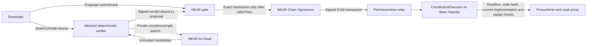

# CONSTITUTION

**An upgrade authority governed by committed rules, not an admin's approval.**

CONSTITUTION protects upgradeable vaults on Base Sepolia with a NEAR gate and Chain Signatures. Each gate is designed to request a signature only for an exact upgrade transaction backed by an allowlisted verifier's certificate. Rule and authority changes require a public deployment-selected, immutable delay of 1–30 whole days (3 on the final gate, 1 on the separate demo gate); ordinary certified vault upgrades do not wait for it.

The verifier runs deterministic checks inside an attested TEE. NEAR AI Cloud privately searches for counterexamples using encrypted inference and a verified `provider_tee` response. This review is bounded and nondeterministic: reproduced counterexamples can veto, but AI cannot authorize an upgrade.

## Current status

**Testnet only; not independently audited.** [V, exercised on testnet 2026-11-10] The final gate, `constitution-gate.testnet`, had its only access key deleted in [transaction `FugUyo9Xa8VLTm9qM5vovYUpJU5DAqNjTUriYkmKEhn8`](https://testnet.nearblocks.io/txns/FugUyo9Xa8VLTm9qM5vovYUpJU5DAqNjTUriYkmKEhn8), block 277098815, at 2026-11-10T17:35:22.910Z. The final-finality access-key list returned 0 keys.

[V, deployed 2026-11-11] The [public page](https://constitution-gate.pages.dev) now includes a separate [live attack app](https://constitution-gate.pages.dev/app) (PR #25). The [build plan](docs/BUILD-PLAN.md) tracks remaining work. Optional proposal repair is not implemented.

### Live demo gate

[V, exercised on testnet 2026-11-11] **This is a separate deployment, not the final gate's permanent evidence.** The lead ran all four gallery attacks from the CLI against `constitution-demo.testnet`; each was rejected by a different deterministic rule, with no signing record and no proxy implementation change:

| Attack | Demo proposal | Refusal | Receipt |
| --- | --- | --- | --- |
| Hidden drain | 0 | R2, reason 20 | [JSON](deployments/demo-receipts/attack-drain.json) |
| Storage shuffle | 1 | R1, reason 10 | [JSON](deployments/demo-receipts/attack-storage-shuffle.json) |
| Self-destruct | 2 | R3, reason 30 | [JSON](deployments/demo-receipts/attack-self-destruct.json) |
| Forbidden initializer | 3 | R4, reason 41 | [JSON](deployments/demo-receipts/attack-forbidden-init.json) |

[I, delivered interaction; founder wallet rehearsal pending] Open [/app](https://constitution-gate.pages.dev/app), connect a **NEAR testnet wallet**, then approve one confirmation that deposits credit and adds a `propose`-only session key. Select an attack and inspect the actual rejection and receipts; the four attacks are repeatable. [U, 2026-11-11] The founder has not yet exercised these wallet flows against the live demo gate. The CLI observations above do not prove the browser wallet path. Runs took 35–117 s on one warm CVM; this is historical latency, not a promise. AI runs only after R1–R5 pass, so these four attacks never call NEAR AI.

[V, exercised on testnet 2026-11-10/11] Deployment identities and purposes:

| Property | Final gate | Live demo gate |
| --- | --- | --- |
| Account | `constitution-gate.testnet` | `constitution-demo.testnet` |
| Manifest | [v1](rules/manifest.json) | [v2 lineage](rules/demo/manifest.json) |
| Manifest hash | `0x1efe635ac3eb0eb59b0df0d56c7243b2728922898b55487bc5cf8063db94a410` | `0xa988551688a3c7a7c61faa25591b933a419d1233779ce6e5bac38456474d8cc8` |
| Governance delay | 3 days | 1 day |
| CVM | `cvm_2eakrQwn` (retired 2026-11-12; [snapshot](deployments/final-verifier-retired/)) | `cvm_VKZRaXKr` |
| Verifier URL | none (final CVM deleted) | [Demo CVM (prod5)](https://db06dd366642c074483472e3afcb330ff72e4954-8787.dstack-pha1-prod5.phala.network) |
| CVM compose hash | `0x0fa62de4b208959b1acb02efc04949d6495046d9bd1905280d49cdd244f9d81a` | `0xf7571e2688238dd87217f2210789e395c505e3e8eecb3ef026c62051feebe79e` |
| Purpose | Permanent recorded proofs; keyless audit passed 2026-11-10 | Repeatable judge attacks; keyless audit passed 2026-11-12 |

[V, exercised on testnet 2026-11-11] Demo Base Sepolia proxy: `0xc24a9b7b139af4e458df40a2644229a4ca5fec91`; executor: `0xd1a7633669f6f1a08a168479798d04a40e0f2483`; derived signer: `0x6e6568bc88e937b84d739c94a1127304d1160132`. The demo Phala `tdx.small` CVM passed Intel-chain, TCB `UpToDate`, RTMR3 replay, compose, report-data and release-hash appraisal. Its [compose file](verifier-image/compose.phala.demo.yaml) selects `VERIFIER_MANIFEST=rules/demo/manifest.json`; service image: `sha256:ec1f56b018840430ff02977d928e71f218d2d2587073e4134e03465828ec1f3a`. **Both gates use identical gate wasm** (`GjPz45TdYvvuVX5k2NtSKDm8gdBt3gvdF7WpUJXZvLGP`); lineage is verifier policy data, not new gate code. The final compose files are unchanged.

[V, identity fetched and appraised 2026-11-11] The demo endpoint above belongs to Phala app `db06dd366642c074483472e3afcb330ff72e4954`; verifier public key `0x2411cb1631e76179c75595679127843dd6f74877ac14f00acfc924bcad698af1`, release hash `0xfe5ca64ccd11b9ecfd29d0a2ba5553bafd6d642d7f7fc8db4528117daaacea5b`. Endpoint availability and identity must be rechecked before private-source submission; a historical appraisal is not an uptime promise.

Read-only demo audit, after the [local quickstart](#local-quickstart), from the repository root:

```sh
./target/debug/constitution audit \
  --deployment deployments/demo.json --manifest rules/demo/manifest.json \
  --executor-artifact contracts/out/ConstitutionExecutor.sol/ConstitutionExecutor.json \
  --near-rpc https://near-testnet.drpc.org --evm-rpc https://sepolia.base.org
```

[V, exercised on testnet 2026-11-12] The founder's wallet runs on `/app` (demo proposals 5–8) were all Rejected. With fresh founder authorization the demo gate's only key was deleted (NEAR tx `8xzaoDru5ashVSXMf7aqs1xEPL8MzG2MgBmbCWPiaEjj`) and this audit then **exited 0** with `gate_has_no_access_keys` PASS: [output](deployments/demo-receipts/audit-keyless-2026-11-12.txt). Audit compares public state with trusted local records/artifacts; it does not appraise the CVM. [Deployment ceremony](deployments/README.md#separate-live-demo-deployment) and [gallery observations](deployments/demo-gallery.json) retain the operational evidence.

[I, planned testnet recording] The founder records honest V1→V2→V3 upgrades **from the CLI**, not a web upgrade button; neither upgrade has yet run on this demo gate. Only local lineage checks passed. The manifest recognizes those current implementations so attacks can still be checked after upgrades; post-upgrade attack coverage is locally tested, not yet testnet evidence. Anyone can submit honest upgrades via the permissionless CLI and consume a demo version; free demo credit and available versions can be burned. See the [recording flow](docs/DEMO-SCRIPT.md#live-demo-gate-recording-flow).

**Roadmap — [I, planned, not built]:** rule-pack presets and a rule-pack builder. The only active rule set is **Vault pack**. There is no TUI.

### Final gate, permanent evidence

[V] Observed on NEAR testnet and Base Sepolia on 2026-11-10; these are historical final-gate observations, not demo-gate results or a promise of current service availability:

| Item | Observed value |
| --- | --- |
| NEAR gate / code hash | `constitution-gate.testnet` / `GjPz45TdYvvuVX5k2NtSKDm8gdBt3gvdF7WpUJXZvLGP` |
| Reproducible gate wasm SHA-256 | `e9bbaf8364b7102f474dd9f7b2cebe4bac303aa3f4ee84d28d57905c3bc2c0f0` |
| Gate deploy and init | [NEAR transaction](https://testnet.nearblocks.io/txns/HtRC4WcD9wr9bhsZVBxLd58VnFk5wR8iPEM7sRbEHt1H) |
| Executor / proxy | `0xf997a78d8c84dd07637409bfaf46b627d35ab67b` / `0x0b54b582dc5486677622c6fde431716767165e74` |
| ProxyAdmin / MPC-derived signer | `0x7125d3f0f815f646fb3f6a743813a15c6f6b97d0` / `0x3b20f46860d27d81917a45221c594fc051af7e94` |
| VaultV1 / honest V2 / drain V2 | `0xcc6af96372b6cb6c46ff56afef1b87ea4f984c37` / `0x30f885f098f0cc2980308680795ef4bea0603a42` / `0x4130c667923dbba6e7c0d92bf356dcbacd39fb15` |
| Rule-set hash | `0x1efe635ac3eb0eb59b0df0d56c7243b2728922898b55487bc5cf8063db94a410` |
| Verifier public key (base64) | `8oZcQEC13CJkXPXs+iP1wh4/EgeEtHvUGSXi76tqKIE=` |
| Verifier release hash | `0x0bf3f730e77f94ac0aebb6bf5b02c606b235e87fa8864c6c87b0189966bdc98a` |
| CVM compose hash | `0x0fa62de4b208959b1acb02efc04949d6495046d9bd1905280d49cdd244f9d81a` |

The single verifier instance was a Phala `tdx.small` CVM. Its appraisal passed the Intel DCAP chain, TCB `UpToDate`, RTMR3, compose hash, report-data and release-hash checks, at registration and again immediately before the founder-approved deletion on 2026-11-12 ([snapshot and appraisal](deployments/final-verifier-retired/)). Its endpoint no longer exists.

| Recorded testnet run | Result and receipts |
| --- | --- |
| Drain, proposal 0 | R1 Pass, R2 solvency Fail (reason 20); signed Reject, gate Rejected, no signature requested and proxy remained on V1. Verifier run: 62.6 s. [Propose](https://testnet.nearblocks.io/txns/23jnKgx7pQK3TvW3EKTCXSR8oRcLYtebs3NMYnNmAZec) · [verdict](https://testnet.nearblocks.io/txns/7CmP3rRa3WYNuBa7Me3qJ5BrCBpKTX893GTVueCRJzWv) |
| Governance, change 0 | F11 `SetParams` scheduled with ETA **2026-11-13T16:56:01Z**; early apply refused `E53_TIMELOCK_NOT_ELAPSED`. [Schedule](https://testnet.nearblocks.io/txns/2mn9jrjBzAuBHBgc5ExWJMeYLfTdDpvMEUhVfPC5vA6P) · [early apply](https://testnet.nearblocks.io/txns/AvHkJNNzU7zQvQmncDSUhsXTWM8F5bciHVhZSRDBuHP). No matured apply is claimed. |
| Honest upgrade, proposal 1 | R1–R5 Pass; private AI review verified `provider_tee`, four candidates, none reproduced (419 s). The signed Pass led to an MPC signature and [successful Base Sepolia transaction](https://sepolia.basescan.org/tx/0xe323d9b9c0169174e2b3895b8bdc41dc81e8e83c1e8cb62fcd51e8f708601da2), block 57042237, 105,099 gas; V1 changed to honest V2. Total run: 515.8 s. [Propose](https://testnet.nearblocks.io/txns/6XqKZ2ptbcJhBooJMdLfstmKMP1e61DxzU3UKsGRyDwo) · [verdict](https://testnet.nearblocks.io/txns/cMJQU3T4r2jHmvGc3mkYytT2Lah2hV316CNQEaPd9X1) |

[V, exercised on testnet 2026-11-10] The post-deletion audit exited 0 with 16 named check/information lines, including `gate_has_no_access_keys` PASS (0 access keys). This is not an independent security audit.

**The live attack cannot be repeated on this final proxy under the current rule set.** The final manifest references VaultV1, but that proxy now runs honest V2: a new proposal encounters rule 0 `current source runtime mismatch` before R2. Use its recorded drain receipts, not a new final-gate run, to inspect the R2 refusal. A subsequent final-gate upgrade needs a new rule set and verifier release through governance. The separate demo gate above uses a different manifest and proxy.

## Verify it yourself

**Final gate only:** the commands below inspect `deployments/testnet.json`, not the separate live demo.

These are read-only commands, run from the repository root in Linux or WSL2 after the [local quickstart](#local-quickstart) builds the CLI and executor artifact. They require reachable public RPCs, not a signing key or paid AI inference. If an RPC fails or rate-limits, select another trusted testnet endpoint; do not treat an unavailable observation as a pass.

```sh
export NEAR_RPC_URL=https://test.rpc.fastnear.com
export BASE_SEPOLIA_RPC_URL=https://sepolia.base.org

./target/debug/constitution audit \
  --deployment deployments/testnet.json --manifest rules/manifest.json \
  --executor-artifact contracts/out/ConstitutionExecutor.sol/ConstitutionExecutor.json \
  --near-rpc "$NEAR_RPC_URL" --evm-rpc "$BASE_SEPOLIA_RPC_URL"

./target/debug/constitution status 0 --gate constitution-gate.testnet \
  --near-rpc "$NEAR_RPC_URL" --evm-rpc "$BASE_SEPOLIA_RPC_URL" --network testnet
./target/debug/constitution receipt 0 --json --gate constitution-gate.testnet \
  --near-rpc "$NEAR_RPC_URL" --evm-rpc "$BASE_SEPOLIA_RPC_URL" --network testnet
./target/debug/constitution status 1 --gate constitution-gate.testnet \
  --near-rpc "$NEAR_RPC_URL" --evm-rpc "$BASE_SEPOLIA_RPC_URL" --network testnet
./target/debug/constitution receipt 1 --json --gate constitution-gate.testnet \
  --near-rpc "$NEAR_RPC_URL" --evm-rpc "$BASE_SEPOLIA_RPC_URL" --network testnet
```

For the recorded testnet state, expect audit exit 0 with 16 named check/information lines, including `gate_has_no_access_keys` PASS, proposal 0 Rejected without an EVM signature, and proposal 1 Signed with the included Base transaction. State can change; read the output. Gate-only receipts do not reconstruct verifier stages or the private AI review: include `--verifier "$VERIFIER_URL" --run "$RUN_ID"` only when you have the matching retained verifier run id and available evidence. A missing evidence manifest is incomplete, not a pass.

Audit compares public state with the local deployment record, manifest and executor artifact; it does not independently establish their provenance or appraise the CVM. For independent verifier appraisal and the irreversible key-deletion procedure, see the [activation checklist](scripts/activate.md). The [demo script](docs/DEMO-SCRIPT.md) maps the recorded evidence to a three-minute presentation.

Application code was built during the hackathon window, which opened 2026-11-01; project planning and research predated it. The testnet receipts above are separate from local tests and earlier spikes.

## How the authority works



The governor can schedule changes, not bypass the delay. The guardian can pause signing, cancel pending changes or remove a verifier, but cannot immediately add authority. [I] Guardian liveness is a risk (F3): a compromised or hostile guardian can halt signing and prevent its own replacement by repeatedly pausing and cancelling governance actions. The gate has no code-upgrade method; changing the selected delay requires a new gate and the existing timelocked authority migration. The final gate's access key was deleted after fresh founder authorization, as recorded above.

A rejection leaves the proxy unchanged. An honest upgrade still needs all committed checks, the required verified AI review, a valid certificate, MPC signing and successful EVM execution. A timeout or unavailable service is incomplete, never a pass.

## Local quickstart

Run from Linux or Ubuntu WSL2, not a native Windows shell. These commands build and inspect local artifacts. They do not deploy contracts, load `.env`, send transactions or call paid inference.

### Prerequisites

- Git and GNU Make; repository access while the remote is private.
- Rustup. `rust-toolchain.toml` pins Rust **1.99.1**, rustfmt, clippy and `wasm32-unknown-unknown`.
- [Foundry](https://getfoundry.sh/) **1.8.6**, including `forge` and `anvil`. The project pins Solidity **0.8.38**, EVM target `prague`, and `ffi = false`. A first build may download the pinned compiler.
- C/C++ build tools, pkg-config and OpenSSL development headers for native Rust dependencies. On Ubuntu, install the system packages `build-essential`, `pkg-config`, `libssl-dev`, `ca-certificates` and `git` if missing.
- Docker's Linux engine, reachable by the WSL user, **only** for verifier/tool containers and reproducible gate builds. Docker socket access is privileged.
- `cargo-near` **0.22.0** for gate wasm builds. Near-workspaces tests require the local NEAR sandbox binary and may download it on first use; `NEAR_SANDBOX_BIN_PATH` can select an existing binary.

On Ubuntu, install the system prerequisites with an administrator account, then
install the user-scoped toolchains as the user who will build the project:

```sh
sudo apt-get update
sudo apt-get install -y build-essential pkg-config libssl-dev ca-certificates git curl make python3
curl --proto '=https' --tlsv1.2 -sSf https://sh.rustup.rs | sh -s -- -y --default-toolchain none
export PATH="$HOME/.cargo/bin:$HOME/.foundry/bin:$PATH"
curl -L https://foundry.paradigm.xyz | bash
foundryup --install 1.8.6
```

Rustup installs the pinned Rust toolchain automatically when Cargo is first run
inside this checkout. The first CLI build and recursive submodule checkout need
network access and can take considerable time and disk space.

The CLI-only checks below do not need Docker, a Phala account, an AI API key or a wallet. Their dependency compilation can still exceed a small VPS's available memory. A 500 MB free-RAM host has not been qualified for building or running the full verifier.

```sh
git clone --recurse-submodules https://github.com/Dylansius11/constitution.git
cd constitution
# For an existing clone, populate the committed dependency revisions:
git submodule update --init --recursive
export PATH="$HOME/.cargo/bin:$HOME/.foundry/bin:$PATH"

cargo build -p constitution-cli --locked -j 1
forge build --root contracts

./target/debug/constitution --help
./target/debug/constitution rules hash rules/manifest.json
./target/debug/constitution executor-runtime-hash \
  --executor-artifact contracts/out/ConstitutionExecutor.sol/ConstitutionExecutor.json
```

If `CARGO_TARGET_DIR` is set, use its `debug/constitution` binary instead. The manifest hash is:

```text
0x1efe635ac3eb0eb59b0df0d56c7243b2728922898b55487bc5cf8063db94a410
```

The executor helper prints a **masked local runtime hash**, not an instance address or a transaction hash. It excludes only the compiler-declared immutable regions; see [deployment records](deployments/README.md). Neither helper proves a live deployment is safe.

### Proportionate local checks

```sh
cargo test -p constitution-gate --lib --locked -j 1 -- --test-threads=1
forge test --root contracts --offline --match-contract ExecutorTest
```

The shared-type encoding and independent Python-oracle tests can also be run
with `cargo test -p constitution-types`; they require `python3`.

For the actual local CLI audit integration, first build the gate:

```sh
(cd crates/gate && cargo near build non-reproducible-wasm)
cargo test -p constitution-cli --locked -j 1 --test audit_anvil -- --test-threads=1
```

That integration launches disposable near-sandbox and Anvil networks and runs the actual CLI against the real gate/executor. Only the MPC derivation view is an explicitly labeled offline double. It does not use founder keys or prove fresh MPC signing, AI review or TEE attestation. The local wasm build is not deployable reproducible-build evidence.

`make test` runs the **full Rust workspace suite**, not a lightweight smoke. Some verifier tests require Docker and the pinned tool image; the real R2 checks are resource-intensive. The six independent encoding vectors are run with `make vectors`, which also needs the pinned Node/pnpm environment. See [integration setup](docs/technical/INTEGRATIONS.md) and [verifier local operations](crates/verifier/src/LOCAL.md) before selecting those paths.
### Build storage

`target/` is ignored by Git: compiled dependencies, test executables and incremental caches
never belong in a commit or push. The dev profile keeps line tables for project backtraces
and omits dependency debug information. Reuse one checkout path in WSL so Cargo can reuse
its artifacts. Run affected checks after code changes; do not rebuild the workspace for
documentation-only changes.

When space is needed, `target/debug/incremental/` is regenerable. Removing it preserves
the remaining compiled outputs but loses incremental compilation state. `cargo clean`
removes build outputs more broadly and makes subsequent checks rebuild; preserve any local
wasm needed for sandbox tests or rebuild it before testing. Neither cleanup changes source,
but do not clean while builds or tests are running.


## Read public state without a signing key

Use actual deployment values, not the spike addresses. These commands are read-only, but need reachable RPCs. Shell variables below must be set explicitly for the deployment being inspected. Do not put credentials in filenames or paste provider URLs into shared logs.

```sh
./target/debug/constitution status "$PROPOSAL_ID" \
  --gate "$GATE_ACCOUNT" --near-rpc "$NEAR_RPC" \
  --evm-rpc "$EVM_RPC" --network testnet

./target/debug/constitution receipt "$PROPOSAL_ID" --json \
  --gate "$GATE_ACCOUNT" --near-rpc "$NEAR_RPC" \
  --evm-rpc "$EVM_RPC" --network testnet

make audit DEPLOYMENT="$DEPLOYMENT_RECORD" NEAR_RPC="$NEAR_RPC" EVM_RPC="$EVM_RPC"
```

For local networks, pass their loopback RPCs and `--network local`. The network flag labels evidence; it does not restrict endpoints. `make audit` has no network flag.

To include verifier stages and evidence, add `--verifier "$VERIFIER_URL" --run "$RUN_ID"` to status/receipt. A requested but unavailable or mismatched evidence manifest fails rather than silently dropping evidence. The receipt is an observation assembled from public state, not a replacement for independently checking the certificate and deployment.

Audit exits nonzero on failed preconditions. Governance warnings alone can exit zero: inspect the named warnings and ETAs, not just the exit status. The deployment record must explicitly commit `governance_delay_days`; audit compares it with the observed gate config. Audit compares observed state with **trusted local build artifacts and the committed deployment record**; it does not appraise the CVM or independently establish those inputs' provenance. The post-deletion testnet audit recorded above exited 0; re-read current state rather than assuming it is unchanged.

## Run an attack or honest-upgrade demonstration

**These are write paths, not setup tests.** On the recorded final deployment, the current rule-set reference no longer matches the upgraded proxy, so these commands cannot reproduce the recorded R2 attack or honest upgrade there. Use the separate [live demo gate](#live-demo-gate) for judge attacks and the [founder CLI recording flow](docs/DEMO-SCRIPT.md#live-demo-gate-recording-flow) for its planned honest upgrades. Write paths require an appropriate deployed implementation, gate, executor and selected verifier. A funded verifier may spend inference credits. Testnet signing, spending and deployment need the founder's separate authorization.

The [demo runner instructions](docs/technical/ARCHITECTURE.md#demo-runner-operation) define all required inputs for `make attack` and `make upgrade`. The runner:

- Requires explicit RPCs, source, implementation, signer, verifier and a new output directory. It does not source `.env`.
- Retains the accepted proposal id and NEAR transaction before requesting verification. Recovery files are create-only; rerunning with the same output path refuses to overwrite them or submit again.
- Never automatically reproposes or retries an uncertain submission. Inspect the retained evidence and chain state first.
- Accepts an attack result only after an observed rejection, no signing record and unchanged implementation. Unexpected attack signing is an error, never relayed by this runner.
- Relays an honest upgrade only after Signed state and validates inclusion plus implementation-slot readback. Incomplete or withheld verification remains an error.

Proposal storage is paid from prepaid credit, not an attached deposit. Fund at least the refundable reservation plus `get_proposal_fee` (and the entry fee for a new credit account). The CLI can top up with an authorized full-access account; a method-restricted demo key must already have sufficient credit and never needs transfer permission.

**Appraise the verifier before sharing private source.** The [current CLI contract](docs/technical/ARCHITECTURE.md#demo-runner-operation) requires `EXPECT_COMPOSE_HASH` pinned to the owner-approved compose before proposing or retrying and appraises the exact identity used for sealing. Use `constitution verifier appraise` for an explicit inspection; the [activation checklist](scripts/activate.md) remains the authority for registration and key deletion. Merely fetching a transport key or sealing source to an endpoint does not establish trust.

## Verifier deployment and trust limits

Start with [local verifier operations](crates/verifier/src/LOCAL.md) for the service/tool image split, Compose variants and exact environment names. Copying `.env.example` does not configure a working deployment, and the CLI does not automatically load it.

Offline local mode is explicitly unattested: **it cannot issue Pass or submit a chain verdict**. An ordinary VPS is not a TEE. The testnet path used the appraised Phala CVM described above; availability must be checked live.

Important limits:

- The gate verifies the allowlisted certificate signature and bindings, **not Intel DCAP evidence on-chain**. Appraisal and initial registration are operator responsibilities. A stolen verifier signing key can forge check results; a gate signature check cannot detect that lie.
- R2 is bounded aggregate solvency plus implementation-slot preservation, not full formal verification or per-depositor withdrawability. R3 literal filters are not a general storage-write proof. Rules do not cover every possible bug or entry point.
- Chain Signatures, TEE vendors, provider attestation and the declared rule coverage remain trust assumptions. Proxy storage can change between verification and execution.
- Pausing or removing a verifier does not revoke an already signed EVM transaction. Its executor deadline remains load-bearing.
- Each gate has one verifier CVM with an ephemeral certificate key. Restarting it changes the key; registering a replacement needs a timelocked `AddVerifier` (three days on the final gate, one on the demo gate). Continued availability through judging is not established; deleting the final CVM requires founder re-confirmation, not an inference from the separate demo deployment.
- The trusted service's Docker socket is root-equivalent host access. The untrusted compilation/tool sandbox must not receive that socket, the dstack socket or signing keys. Running the service on a VPS does not reproduce CVM isolation.
- Repair is optional planned stretch work for a **rejected proposal**, with explicit developer approval before resubmission. It is not active-vault repair and is not implemented yet.

The full guarantee boundaries and residual risks are in [PRD](docs/PRD.md#risks-and-guarantees). No production security claim follows from this repository's tests.

## Project map and delivery

| Path | Purpose |
| --- | --- |
| `crates/constitution-types` | Canonical certificate, proposal, manifest and bundle bytes |
| `crates/gate` | Immutable NEAR authority, governance and exact EVM encoder |
| `contracts` | Executor, protected demo vaults, deployment script and Foundry tests |
| `crates/verifier`, `verifier-image` | Verification, private-AI integration and runtime packaging |
| `crates/cli` | Proposal, read paths, verified relay, appraisal, audit and demo runner |
| `vectors`, `rules`, `fixtures` | Encoding oracles, committed checks and labeled demo inputs |
| `docs/technical/SMART-CONTRACT.md` | Protocol interfaces and recorded local/spike deployment evidence |
| `docs/BUILD-PLAN.md`, `docs/OPEN-DECISIONS.md` | Acceptance evidence, remaining work and founder gates |

The recorded testnet results and current limitations are above. Recording the video, publishing the X post and submission require founder action; do not infer their completion from the hosted page.

**AI-tool disclosure:** AI coding assistants have been used for planning, code, documentation and scoped review. Named checks and observed receipts, not model assurances, support the recorded results. Project-side private inference is separately provided by NEAR AI Cloud as described above.

**License:** [Apache-2.0](LICENSE) (founder decision, 2026-11-10), declared as `license = "Apache-2.0"` in the Cargo workspace. The gate wasm deployed on testnet was built before this declaration; the license applies to this repository's source from the commit that adds `LICENSE`. Some source files and dependencies carry their own license notices.
