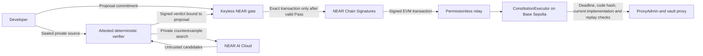

# CONSTITUTION

**An upgrade authority governed by committed rules, not an admin's approval.**

CONSTITUTION protects one upgradeable vault on Base Sepolia. A keyless NEAR gate controls its EVM upgrade authority through Chain Signatures. The gate requests a signature only for an exact upgrade transaction backed by an allowlisted verifier's certificate. Rule and authority changes require a public seven-day timelock.

The intended verifier runs deterministic checks inside an attested TEE. NEAR AI Cloud privately searches for counterexamples. AI can veto through a reproduced counterexample; it cannot authorize an upgrade.

## Current status

This is a hackathon project, **testnet only, not independently audited**. The final protected deployment has not been activated.

| Surface | Observed status | Still required |
| --- | --- | --- |
| Gate, executor, verifier pipeline and CLI | Exercised locally with near-sandbox, Anvil and Docker; evidence in the build plan | Final deployment and integrated testnet receipts |
| Chain Signatures | Real NEAR MPC signatures executed upgrades in a Base Sepolia **spike** | Final gate/executor ceremony, not reuse of the spike |
| Private AI | Verified `provider_tee` responses and a saved candidate replay exercised locally | Completed production-policy drain rehearsals, measured find rate and actual campaign cost; new paid calls need approval |
| Verifier hosting | Local service/tool images built; offline isolation and fail-closed paths exercised | Real CVM appraisal, isolation checks, resource measurements and uptime budget |
| Public page | Implemented and checked locally; attack and honest run cards remain locked pending activation | Browser flows against the final testnet deployment, demo key and hosting |
| Optional proposal repair | Approved stretch scope, not implemented | Core gate completion before S1 implementation |

The authoritative progress and evidence are in [BUILD-PLAN](docs/BUILD-PLAN.md). Local tests are not CVM evidence. A spike transaction is not proof that the final gate is keyless or activated. There is intentionally no `deployments/testnet.json` until the ceremony records observed values.

## How the authority works



The governor can schedule changes, not bypass the delay. The guardian can pause signing, cancel pending changes or remove a verifier, but cannot immediately add authority. The gate has no code-upgrade method; activation requires deleting every access key on its account.

A rejection leaves the proxy unchanged. An honest upgrade still needs all committed checks, the required verified AI review, a valid certificate, MPC signing and successful EVM execution. A timeout or unavailable service is incomplete, never a pass.

## Local quickstart

Run from Linux or Ubuntu WSL2, not a native Windows shell. These commands build and inspect local artifacts. They do not deploy contracts, load `.env`, send transactions or call paid inference.

### Prerequisites

- Git and GNU Make; repository access while the remote is private.
- Rustup. `rust-toolchain.toml` pins Rust **1.99.1**, rustfmt, clippy and `wasm32-unknown-unknown`.
- [Foundry](https://getfoundry.sh/) **1.8.6**, including `forge` and `anvil`. The project pins Solidity **0.8.38**, EVM target `prague`, and `ffi = false`. A first build may download the pinned compiler.
- C/C++ build tools, pkg-config and OpenSSL development headers for native Rust dependencies. On Ubuntu, install the system packages `build-essential`, `pkg-config`, `libssl-dev`, `ca-certificates` and `git` if missing.
- Docker's Linux engine, reachable by the WSL user, **only** for verifier/tool containers and reproducible gate builds. Docker socket access is privileged.
- `cargo-near` **0.22.0** for gate wasm builds. Near-workspaces tests require the local NEAR sandbox binary and may download it on first use; `NEAR_SANDBOX_BIN_PATH` can select an existing binary.

The CLI-only checks below do not need Docker, a Phala account, an AI API key or a wallet. Their dependency compilation can still exceed a small VPS's available memory. A 500 MB free-RAM host has not been qualified for building or running the full verifier.

```sh
git clone --recurse-submodules https://github.com/Dylansius11/constitution.git
cd constitution
# For an existing clone, populate the committed dependency revisions:
git submodule update --init --recursive
export PATH="$HOME/.cargo/bin:$HOME/.foundry/bin:$PATH"

cargo build -p constitution-cli --locked -j 1
forge build --root contracts

./target/debug/constitution --help
./target/debug/constitution rules hash rules/manifest.json
./target/debug/constitution executor-runtime-hash \
  --executor-artifact contracts/out/ConstitutionExecutor.sol/ConstitutionExecutor.json
```

If `CARGO_TARGET_DIR` is set, use its `debug/constitution` binary instead. The manifest hash is:

```text
0xa8a4bfb14f17a60b8dac20aaba63dfda2f89152fe7b7d4829f9d33edbb2cbf93
```

The executor helper prints a **masked local runtime hash**, not an instance address or a transaction hash. It excludes only the compiler-declared immutable regions; see [deployment records](deployments/README.md). Neither helper proves a live deployment is safe.

### Proportionate local checks

```sh
cargo test -p constitution-gate --lib --locked -j 1 -- --test-threads=1
forge test --root contracts --offline --match-contract ExecutorTest
```

For the actual local CLI audit integration, first build the gate:

```sh
(cd crates/gate && cargo near build non-reproducible-wasm)
cargo test -p constitution-cli --locked -j 1 --test audit_anvil -- --test-threads=1
```

That integration launches disposable near-sandbox and Anvil networks and runs the actual CLI against the real gate/executor. Only the MPC derivation view is an explicitly labeled offline double. It does not use founder keys or prove fresh MPC signing, AI review or TEE attestation. The local wasm build is not deployable reproducible-build evidence.

`make test` runs the **full Rust workspace suite**, not a lightweight smoke. Some verifier tests require Docker and the pinned tool image; the real R2 checks are resource-intensive. The six independent encoding vectors are run with `make vectors`, which also needs the pinned Node/pnpm environment. See [integration setup](docs/technical/INTEGRATIONS.md) and [verifier local operations](crates/verifier/src/LOCAL.md) before selecting those paths.

## Read public state without a signing key

Use actual deployment values, not the spike addresses. These commands are read-only, but need reachable RPCs. Shell variables below must be set explicitly for the deployment being inspected. Do not put credentials in filenames or paste provider URLs into shared logs.

```sh
./target/debug/constitution status "$PROPOSAL_ID" \
  --gate "$GATE_ACCOUNT" --near-rpc "$NEAR_RPC" \
  --evm-rpc "$EVM_RPC" --network testnet

./target/debug/constitution receipt "$PROPOSAL_ID" --json \
  --gate "$GATE_ACCOUNT" --near-rpc "$NEAR_RPC" \
  --evm-rpc "$EVM_RPC" --network testnet

make audit DEPLOYMENT="$DEPLOYMENT_RECORD" NEAR_RPC="$NEAR_RPC" EVM_RPC="$EVM_RPC"
```

For local networks, pass their loopback RPCs and `--network local`. The network flag labels evidence; it does not restrict endpoints. `make audit` has no network flag. A missing activation record is a prerequisite failure, not a reason to fabricate one.

To include verifier stages and evidence, add `--verifier "$VERIFIER_URL" --run "$RUN_ID"` to status/receipt. A requested but unavailable or mismatched evidence manifest fails rather than silently dropping evidence. The receipt is an observation assembled from public state, not a replacement for independently checking the certificate and deployment.

Audit exits nonzero on failed preconditions. Governance warnings alone can exit zero: inspect the named warnings and ETAs, not just the exit status. Audit compares observed state with **trusted local build artifacts and the committed deployment record**; it does not appraise the CVM or independently establish those inputs' provenance.

## Run an attack or honest-upgrade demonstration

**These are write paths, not setup tests.** They require an already deployed implementation, gate, executor and selected verifier. A funded verifier may spend inference credits. Testnet signing, spending and deployment need the founder's separate authorization.

The [demo runner instructions](docs/technical/ARCHITECTURE.md#demo-runner-operation) define all required inputs for `make attack` and `make upgrade`. The runner:

- Requires explicit RPCs, source, implementation, signer, verifier and a new output directory. It does not source `.env`.
- Retains the accepted proposal id and NEAR transaction before requesting verification. Recovery files are create-only; rerunning with the same output path refuses to overwrite them or submit again.
- Never automatically reproposes or retries an uncertain submission. Inspect the retained evidence and chain state first.
- Accepts an attack result only after an observed rejection, no signing record and unchanged implementation. Unexpected attack signing is an error, never relayed by this runner.
- Relays an honest upgrade only after Signed state and validates inclusion plus implementation-slot readback. Incomplete or withheld verification remains an error.

Proposal storage is paid from prepaid credit, not an attached deposit. Fund at least the refundable reservation plus `get_proposal_fee` (and the entry fee for a new credit account). The CLI can top up with an authorized full-access account; a method-restricted demo key must already have sufficient credit and never needs transfer permission.

**Appraise the verifier before sharing private source.** `propose`, `verifier run` and the demo runner fetch its transport key but do not perform DCAP appraisal automatically. Use `constitution verifier appraise` with the independently committed expected compose hash; the [activation checklist](scripts/activate.md) is the authority for registration and key deletion. Merely sealing source to an endpoint does not establish that the endpoint is trusted.

## Verifier deployment and trust limits

Start with [local verifier operations](crates/verifier/src/LOCAL.md) for the service/tool image split, Compose variants and exact environment names. Copying `.env.example` does not configure a working deployment, and the CLI does not automatically load it.

Offline local mode is explicitly unattested: **it cannot issue Pass or submit a chain verdict**. An ordinary VPS is not a TEE. The intended activated path requires a compatible, appraised CVM and the currently integrated Phala/dstack mechanisms.

Important limits:

- The gate verifies the allowlisted certificate signature and bindings, **not Intel DCAP evidence on-chain**. Appraisal and initial registration are operator responsibilities. A stolen verifier signing key can forge check results; a gate signature check cannot detect that lie.
- R2 is bounded aggregate solvency plus implementation-slot preservation, not full formal verification or per-depositor withdrawability. R3 literal filters are not a general storage-write proof. Rules do not cover every possible bug or entry point.
- Chain Signatures, TEE vendors, provider attestation and the declared rule coverage remain trust assumptions. Proxy storage can change between verification and execution.
- Pausing or removing a verifier does not revoke an already signed EVM transaction. Its executor deadline remains load-bearing.
- The certificate key is ephemeral. Restarting the activated CVM loses that key; a replacement normally needs the seven-day verifier registration delay. Demo-only uptime is not equivalent to the planned judging service.
- The trusted service's Docker socket is root-equivalent host access. The untrusted compilation/tool sandbox must not receive that socket, the dstack socket or signing keys. Running the service on a VPS does not reproduce CVM isolation.
- Repair is optional planned stretch work for a **rejected proposal**, with explicit developer approval before resubmission. It is not active-vault repair and is not implemented yet.

The full guarantee boundaries and residual risks are in [PRD](docs/PRD.md#risks-and-guarantees). No production security claim follows from this repository's tests.

## Project map and delivery

| Path | Purpose |
| --- | --- |
| `crates/constitution-types` | Canonical certificate, proposal, manifest and bundle bytes |
| `crates/gate` | Immutable NEAR authority, governance and exact EVM encoder |
| `contracts` | Executor, protected demo vaults, deployment script and Foundry tests |
| `crates/verifier`, `verifier-image` | Verification, private-AI integration and runtime packaging |
| `crates/cli` | Proposal, read paths, verified relay, appraisal, audit and demo runner |
| `vectors`, `rules`, `fixtures` | Encoding oracles, committed checks and labeled demo inputs |
| `docs/technical/SMART-CONTRACT.md` | Protocol interfaces and recorded local/spike deployment evidence |
| `docs/BUILD-PLAN.md`, `docs/OPEN-DECISIONS.md` | Acceptance evidence, remaining work and founder gates |

Final activation addresses and attack/upgrade/governance receipts will be recorded only after they are observed. The video, public hosting, license decision and submission are not complete. The local public page is not evidence of an activated service.

**AI-tool disclosure:** AI coding assistants have been used for planning, code, documentation and scoped review. Named checks and observed receipts, not model assurances, support the recorded results. Project-side private inference is separately provided by NEAR AI Cloud as described above.

**License:** the workspace currently declares `UNLICENSED`; the founder has not selected a project-wide license. Some source files and dependencies carry their own license notices. Repository visibility alone grants no project-wide open-source license.
