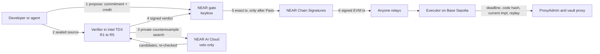
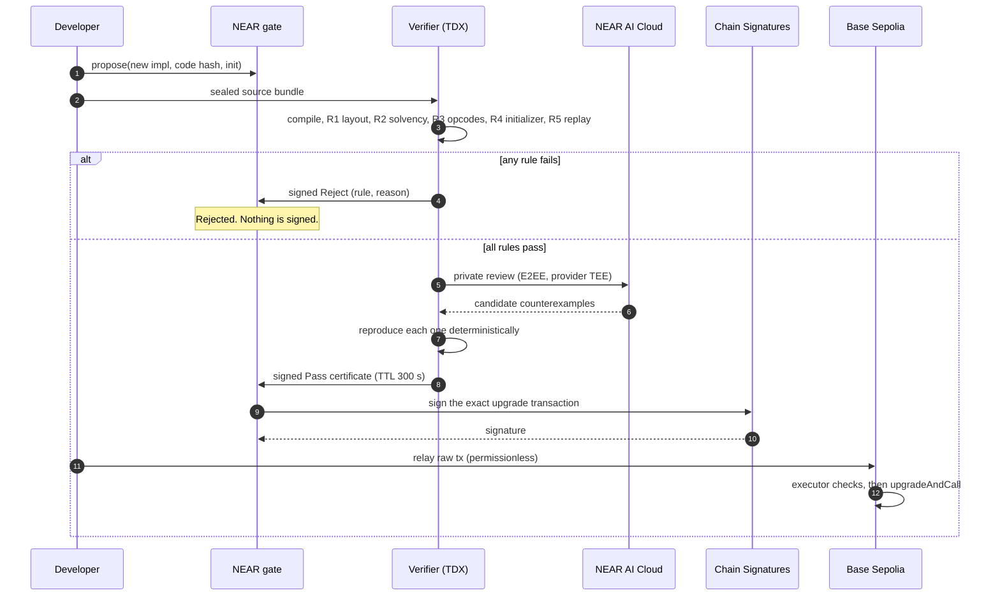

<div align="center">

# CONSTITUTION

### Steal every admin key. You still cannot ship an upgrade that breaks the rules.

A keyless NEAR contract holds the upgrade authority of a Base Sepolia vault through Chain Signatures.<br>
It signs an upgrade only when an attested verifier certifies the new code against rules the owner committed in advance.<br>
A private AI review can veto an upgrade. Nothing can approve one past the rules.

[**Live site**](https://constitution-gate.pages.dev) · [**Try the attack**](https://constitution-gate.pages.dev/app) · [**User guide**](docs/GUIDE.md) · [**Agent skill**](skills/constitution/SKILL.md) · [**Evidence**](#proof-not-promises)

    

</div>

> [!WARNING]
> **Testnet only. Not independently audited.** Every result below was observed on NEAR testnet and Base Sepolia, or is labeled otherwise. Local tests are never presented as testnet evidence.

## The problem

An upgradeable contract is only as safe as whoever can upgrade it. Multisigs and timelocks decide **who** may sign; they do not check **what** the new code does. When signers are compromised, a valid signature installs malicious code:

- **Radiant Capital, 16 Oct 2024, about USD 50 million.** Malware on at least three developer devices produced valid multisig signatures for an ownership transfer, followed by implementation upgrades and drains ([project post-mortem](https://medium.com/@RadiantCapital/radiant-post-mortem-fecd6cd38081)).
- **Zoth, 21 Mar 2025, about USD 8.4 million.** A compromised admin wallet called `upgradeToAndCall` to install a malicious implementation and withdrew the vault one minute later ([investigator report](https://research.blockscope.co/zoth-vault-breach), [upgrade tx](https://etherscan.io/tx/0xb2335f7bf58abbcaa006d0a2bed7db2c64a5dabed56fb1759260adc012c49abe)).

In both cases the key holder could ship any code. CONSTITUTION removes that power: after the upgrade authority is migrated, **there is no key to steal**. The only path to an upgrade is code that passes the owner's committed rules inside an attested verifier.

> [!NOTE]
> This is a design argument, not a replay. We did not run those historical payloads through our rules, and our current rules target one demo vault, not Radiant's lending suite. CONSTITUTION does **not** protect against everything: the Bybit theft (Feb 2025, about USD 1.5 billion, [FBI](https://www.ic3.gov/PSA/2025/PSA250226)) was a signed Safe `delegatecall`, not a proxy upgrade through our executor, and frontend or signing-device compromise stays out of scope. See [limits](#guarantees-and-limits).

## Proof, not promises

> [!IMPORTANT]
> **Two keyless gates, real refusals, one real upgrade.** All observed on testnet; follow any link to check it yourself.

| Claim | Evidence | Observed |
| --- | --- | --- |
| **Nobody holds a key to either gate** | Final gate key deleted in [`FugUyo9X…KEhn8`](https://testnet.nearblocks.io/txns/FugUyo9Xa8VLTm9qM5vovYUpJU5DAqNjTUriYkmKEhn8); demo gate key deleted in [`8xzaoDru…aEjj`](https://testnet.nearblocks.io/txns/8xzaoDru5ashVSXMf7aqs1xEPL8MzG2MgBmbCWPiaEjj). Both `constitution audit` runs exit 0 with `gate_has_no_access_keys` PASS ([demo output](deployments/demo-receipts/audit-keyless-2026-11-12.txt)). | 2026-11-10, 2026-11-12 |
| **Rule-breaking upgrades are refused** | Demo gate proposals 0–3 (lead, CLI) and 5–8 (founder's own wallet on `/app`): drain **R2/20**, storage shuffle **R1/10**, self-destruct **R3/30**, forbidden initializer **R4/41**. Nothing signed, proxy unchanged ([receipts](deployments/demo-receipts/)). Final gate proposal 0, drain: **R2/20** ([verdict tx](https://testnet.nearblocks.io/txns/7CmP3rRa3WYNuBa7Me3qJ5BrCBpKTX893GTVueCRJzWv)). | 2026-11-10 to 11-12 |
| **Honest upgrades still ship** | Final gate proposal 1: R1–R5 pass, private AI review verified as `provider_tee` with no reproduced counterexample, MPC signature, then [Base Sepolia tx `0xe323d9b9…01da2`](https://sepolia.basescan.org/tx/0xe323d9b9c0169174e2b3895b8bdc41dc81e8e83c1e8cb62fcd51e8f708601da2) moved the vault from V1 to V2. | 2026-11-10 |
| **Rule changes wait in public** | Governance change 0 scheduled with a 3-day delay; an early apply was refused with `E53_TIMELOCK_NOT_ELAPSED` ([tx](https://testnet.nearblocks.io/txns/AvHkJNNzU7zQvQmncDSUhsXTWM8F5bciHVhZSRDBuHP)). ETA 2026-11-13T16:56:01Z. | 2026-11-10 |
| **The verifier is the code it claims** | Phala Intel TDX appraisal passed all seven checks: Intel DCAP chain, TCB up to date, RTMR3 replay, compose hash, report data, release hash. Final CVM re-appraised right before its retirement ([snapshot](deployments/final-verifier-retired/)); demo CVM appraised at registration. | 2026-11-10 to 11-12 |

<details>
<summary><b>Every address and hash</b></summary>

| Item | Final gate (permanent evidence) | Demo gate (live, for judges) |
| --- | --- | --- |
| NEAR gate | `constitution-gate.testnet` | `constitution-demo.testnet` |
| Gate code hash (same wasm) | `GjPz45TdYvvuVX5k2NtSKDm8gdBt3gvdF7WpUJXZvLGP` | `GjPz45TdYvvuVX5k2NtSKDm8gdBt3gvdF7WpUJXZvLGP` |
| Reproducible wasm SHA-256 | `e9bbaf8364b7102f474dd9f7b2cebe4bac303aa3f4ee84d28d57905c3bc2c0f0` | same |
| Governance delay | 3 days | 1 day |
| Base Sepolia proxy | `0x0b54b582dc5486677622c6fde431716767165e74` | `0xc24a9b7b139af4e458df40a2644229a4ca5fec91` |
| Executor | `0xf997a78d8c84dd07637409bfaf46b627d35ab67b` | `0xd1a7633669f6f1a08a168479798d04a40e0f2483` |
| MPC-derived signer | `0x3b20f46860d27d81917a45221c594fc051af7e94` | `0x6e6568bc88e937b84d739c94a1127304d1160132` |
| Rule-set hash | `0x1efe635ac3eb0eb59b0df0d56c7243b2728922898b55487bc5cf8063db94a410` ([v1](rules/manifest.json)) | `0xa988551688a3c7a7c61faa25591b933a419d1233779ce6e5bac38456474d8cc8` ([v2 lineage](rules/demo/manifest.json)) |
| Verifier CVM | `cvm_2eakrQwn`, retired 2026-11-12 | `cvm_VKZRaXKr`, [endpoint](https://db06dd366642c074483472e3afcb330ff72e4954-8787.dstack-pha1-prod5.phala.network) |
| CVM compose hash | `0x0fa62de4b208959b1acb02efc04949d6495046d9bd1905280d49cdd244f9d81a` | `0xf7571e2688238dd87217f2210789e395c505e3e8eecb3ef026c62051feebe79e` |
| Verifier release hash | `0x0bf3f730e77f94ac0aebb6bf5b02c606b235e87fa8864c6c87b0189966bdc98a` | `0xfe5ca64ccd11b9ecfd29d0a2ba5553bafd6d642d7f7fc8db4528117daaacea5b` |
| Gate deploy and init | [NEAR tx](https://testnet.nearblocks.io/txns/HtRC4WcD9wr9bhsZVBxLd58VnFk5wR8iPEM7sRbEHt1H) | [record](deployments/demo.json) |

The final gate stays as permanent evidence; its verifier CVM was retired by founder decision to keep the demo verifier funded through judging, so it certifies nothing new. The demo gate runs the same wasm against its own vault, manifest and CVM so anyone can attack it repeatedly. Full records: [`deployments/`](deployments/README.md).

</details>

## How it works





| Piece | Role | Holds a key? |
| --- | --- | --- |
| **Gate** (`crates/gate`, NEAR) | Stores proposals, checks certificates, requests MPC signatures for one exact transaction, enforces the governance delay | No. Access keys deleted; no code-upgrade, add-key or "sign this hash" method |
| **Verifier** (`crates/verifier`, Phala CVM) | Runs the committed rules on sealed source; signs verdicts with an ephemeral key bound to its TDX quote | Ephemeral, inside the TEE only |
| **AI review** (NEAR AI Cloud) | Searches privately for counterexamples after R1–R5 pass | Can only veto, and only when its counterexample reproduces |
| **Executor** (`contracts/`, Base Sepolia) | Owns the ProxyAdmin; accepts only gate-signed upgrades with a live deadline, the expected current implementation and code hash | No. Only the gate's MPC-derived signer can call it, and each certificate works once |

### The rules

| Rule | What it checks (demo vault policy) | Refusal codes |
| --- | --- | --- |
| **R1** Storage layout | New layout is append-only compatible with the current one (OpenZeppelin upgrades-core 1.47.0) | 10, 11 |
| **R2** Solvency | Total deposits never exceed the vault's token balance and the implementation slot is preserved, across bounded symbolic (Halmos) and seeded fuzz sequences | 20 symbolic, 21 fuzz, 22 AI counterexample reproduced, 23 incomplete |
| **R3** Runtime filter | No `SELFDESTRUCT`, `CALLCODE` or `DELEGATECALL`; no ERC-1967 slot or cheatcode literals | 30, 31 |
| **R4** Initializer schema | Init calldata is empty or exactly `initializeV2(uint256)` with a value up to 2^128−1 | 40, 41 |
| **R5** Regression replay | A committed transaction corpus replays identically on old and new code at a pinned block | 50, 51 |
| **AI** | Private review; a reproduced counterexample becomes R2/22. Incomplete review withholds a certificate | veto only |

Every code with its meaning and fix: [refusals reference](skills/constitution/references/refusals.md).

## Try it

### 1. In the browser, about two minutes

Open **[constitution-gate.pages.dev/app](https://constitution-gate.pages.dev/app)**, connect a NEAR testnet wallet, approve one confirmation (credit deposit plus a `propose`-only session key), then pick any of the four attacks. Watch the verifier refuse it live, rule by rule. Attacks are repeatable; the final gate is never touched.

### 2. In the terminal

One binary, two faces. Run `constitution` with no arguments for the interactive TUI; use subcommands for scripts and CI.

```sh
# Linux or WSL2, from the repository root
cargo build --locked --release -p constitution-cli
forge build --root contracts
./target/release/constitution            # opens the TUI
```

The TUI shows the gate at a glance (keyless or not, rule hash, verifier, proxy implementation, timelock), browses proposals and receipts, runs the audit, and walks you through a run with a live stepper for each stage, from proposal to Base receipt. The **Demo gate** profile is interactive; the **Final gate** profile is read-only. Full tour and keys: [user guide](docs/GUIDE.md#tui-tour).

Check the keyless claim without the TUI:

```sh
./target/release/constitution audit \
  --deployment deployments/demo.json --manifest rules/demo/manifest.json \
  --executor-artifact contracts/out/ConstitutionExecutor.sol/ConstitutionExecutor.json \
  --near-rpc https://near-testnet.drpc.org --evm-rpc https://sepolia.base.org
```

### 3. Write your own upgrade

Read **[Write an upgrade that passes](docs/GUIDE.md#write-an-upgrade-that-passes)**. Coding agents can load the **[CONSTITUTION skill](skills/constitution/SKILL.md)**: copy `skills/constitution/` into your agent's skills folder (for Claude Code, `.claude/skills/constitution/`) and ask it to *"write an upgrade for a CONSTITUTION-protected proxy"* or *"explain why my proposal was refused R2/20"*.

## Ecosystem integration

| Technology | How CONSTITUTION uses it |
| --- | --- |
| **NEAR Chain Signatures** | The gate derives one secp256k1 address from `v1.signer-prod.testnet` (path `constitution/base-sepolia/v1`). That address owns the executor's authority. The gate builds the exact EIP-1559 transaction itself (`crates/gate/src/evm.rs`, pinned by test vectors) and never signs a caller-supplied hash. |
| **NEAR AI Cloud** | Private, end-to-end encrypted review with `z-ai/glm-5.3-flash`, no model aliasing, and a response attested as `provider_tee`. Up to four candidate counterexamples within 600 s; each must reproduce deterministically before it can veto. AI output can never produce a Pass. |
| **Phala Cloud (dstack, Intel TDX)** | Hosts the verifier. The CLI appraises the quote with `dcap-qvl` against Intel's root, replays RTMR3, and pins the compose hash before any source is sealed to it. |
| **NEAR protocol** | `near-sdk` 5.29.1 contract with Borsh state, reproducible wasm from `cargo near build reproducible-wasm`, prepaid proposal credit, and a 1–30 day governance timelock fixed at deployment. |
| **Base Sepolia and OpenZeppelin 5.6.1** | Unmodified Transparent proxy; the executor owns the ProxyAdmin and enforces deadline, current implementation, code hash and replay checks before `upgradeAndCall`. |

## Guarantees and limits

What holds, on the protected proxy, once its authority is migrated:

- No person or key can upgrade it outside the gate. Changing rules, verifiers or authority waits out a public delay.
- An upgrade executes only with a valid certificate from an allowlisted verifier, an MPC signature over that exact transaction, and executor checks on Base.
- A refusal, timeout, unavailable service or incomplete AI review never produces a signature.

What does **not** hold:

- Keys, approvals and contracts outside the gate; frontend supply chain; signing-device malware; proxies whose authority was never migrated.
- R1–R5 are bounded, vault-specific checks, not formal verification or an audit. R2 proves aggregate solvency at committed bounds, not every depositor's withdrawal. Computed-slot writes and untested entry points can escape.
- The gate verifies the verifier's signature, not Intel DCAP evidence on-chain; appraisal happens at registration. Chain Signatures, the TEE vendor and the AI provider remain trust assumptions.
- The guardian can pause and cancel; a hostile guardian can halt signing. Signed transactions cannot be revoked; the executor deadline bounds them.

Full analysis: [PRD guarantees and risks](docs/PRD.md#risks-and-guarantees).

## Where this goes next

CONSTITUTION aims to become a core security layer for upgradeable DeFi: the place where a protocol's upgrade promises are enforced rather than trusted. Planned, **not built**:

- **Rule packs** for lending markets and DEXs beyond the vault pack, plus a builder for owner-specific rules.
- **Generic onboarding** for existing Transparent and UUPS proxies.
- **Assisted repair:** when a proposal is refused, a private AI drafts a fix the developer approves before resubmitting.
- **Verifier redundancy:** several attested verifiers with threshold certification, and on-chain quote verification.
- **More chains** through Chain Signatures, then DAO treasuries and tokenized real-world assets.

## Build and test locally

<details>
<summary><b>Prerequisites</b></summary>

Linux or Ubuntu WSL2, not a native Windows shell.

- Rust via rustup; `rust-toolchain.toml` pins **1.99.1** with rustfmt, clippy and `wasm32-unknown-unknown`.
- [Foundry](https://getfoundry.sh/) **1.8.6**. Contracts use Solidity **0.8.38**, EVM `prague`, `ffi = false`.
- `build-essential`, `pkg-config`, `libssl-dev`, `ca-certificates`, `git`, `curl`, `make`, `python3`.
- Docker, only for verifier containers and reproducible gate builds. `cargo-near` **0.22.0** for gate wasm.

```sh
sudo apt-get update
sudo apt-get install -y build-essential pkg-config libssl-dev ca-certificates git curl make python3
curl --proto '=https' --tlsv1.2 -sSf https://sh.rustup.rs | sh -s -- -y --default-toolchain none
curl -L https://foundry.paradigm.xyz | bash && foundryup --install 1.8.6
```

</details>

```sh
git clone --recurse-submodules https://github.com/Dylansius11/constitution.git
cd constitution
cargo build -p constitution-cli --locked
forge build --root contracts
./target/debug/constitution rules hash rules/manifest.json   # 0x1efe635a…db94a410

cargo test -p constitution-types                              # encoding vectors (needs python3)
cargo test -p constitution-gate --lib --locked -- --test-threads=1
forge test --root contracts --offline
```

`make test` runs the full workspace suite; some verifier tests need Docker and the pinned tool image, and R2 is resource-intensive. See [integration setup](docs/technical/INTEGRATIONS.md) and [verifier local operations](crates/verifier/src/LOCAL.md). Offline local verifier mode is unattested and **cannot issue a Pass**.

## Repository map

| Path | Purpose |
| --- | --- |
| `crates/constitution-types` | Canonical certificate, proposal, manifest and bundle bytes |
| `crates/gate` | Keyless NEAR authority, governance and the only EVM transaction encoder |
| `crates/verifier`, `verifier-image` | Rule pipeline, private AI integration, TEE packaging |
| `crates/cli` | `constitution` CLI and TUI: audit, status, receipt, propose, relay, appraise, demo runs |
| `contracts` | Executor, demo vaults (honest and rule-breaking), Foundry tests |
| `rules`, `vectors`, `fixtures` | Committed rule sets, encoding oracles, labeled inputs |
| `web` | Landing page and live attack app |
| `skills/constitution` | Agent skill for writing and checking upgrades |
| `docs` | [PRD](docs/PRD.md), [architecture](docs/technical/ARCHITECTURE.md), [contract spec](docs/technical/SMART-CONTRACT.md), [build plan](docs/BUILD-PLAN.md), [decisions](docs/OPEN-DECISIONS.md), [demo script](docs/DEMO-SCRIPT.md) |

## Project notes

- Application code was written during the hackathon window, which opened 2026-11-01; planning and research came earlier.
- **AI-tool disclosure:** AI coding assistants helped with planning, code, documentation and review. Named checks and on-chain receipts, not model assurances, support every result above. Project-side private inference is provided by NEAR AI Cloud as described.
- **License:** [Apache-2.0](LICENSE). The gate wasm on testnet was built before the license file was added; the license applies from that commit onward.
