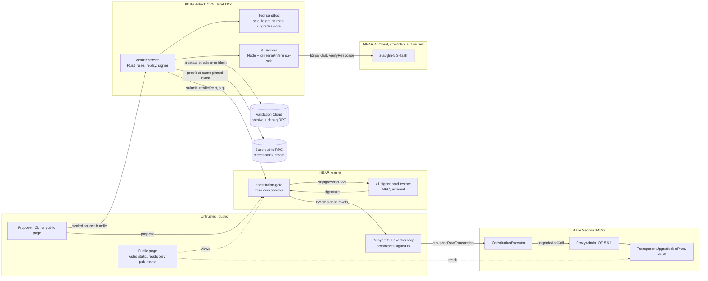
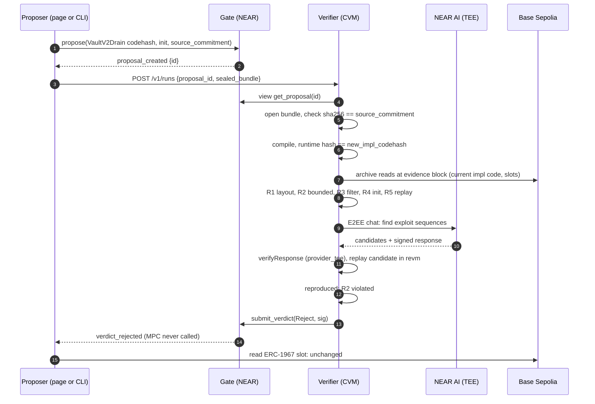
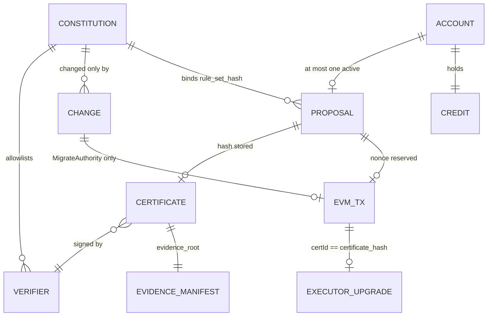

# CONSTITUTION: architecture

## TL;DR and approval

- [V] Stack approved by the founder on 2026-10-26: **Option C**, Phala Cloud dstack Intel TDX CVM verifier + Rust-first operations + Astro static page (OPEN-DECISIONS D1). Verifier host D2, spam control D3, attestation appraisal D5 resolved the same day.
- [I] Core invariant, conditional on implementations not writing arbitrary proxy storage: the Base Sepolia proxy changes implementation through `ConstitutionExecutor`, which accepts transactions signed by the MPC key derived for the keyless NEAR gate; the gate requests an upgrade signature only for the exact executor call bound to a valid certificate over the active rule set. Computed-slot writes are a stated limit (PRD G1).
- [V, exercised on testnet 2026-11-10] The final gate, verifier and Base Sepolia executor/proxy were deployed; the gate became keyless at block 277098815. The final keyless audit exited 0. Deployment evidence is in SMART-CONTRACT; versions below were initially researched on 2026-10-26.
- Exact contract interfaces: `docs/technical/SMART-CONTRACT.md`. Setup and accounts: `docs/technical/INTEGRATIONS.md`. Scope: `docs/PRD.md`.

## System diagram and responsibilities



Trust boundaries [I]: NEAR consensus and the MPC network are trusted for signing; the verifier is trusted only through its measured release and allowlisted key; the AI is trusted for nothing except producing candidates that the verifier must reproduce; proposers, relayers, the page, its host, RPC providers and every human key are untrusted for safety.

| Component | Inputs | Outputs | Owned state | Path |
| --- | --- | --- | --- | --- |
| Gate | `propose`, `submit_verdict`, governance calls | MPC sign requests, NEP-297 events, signed raw transactions | Constitution, proposals, changes, credit, EVM nonce | `crates/gate` |
| Shared types | none (library) | Borsh/JSON types, canonical hashing, ABI and transaction encoders, reason codes | none | `crates/constitution-types` |
| Verifier service | Sealed bundle, proposal id, archive RPC, AI sidecar | Signed certificate or rejection, evidence manifest, run status | In-memory runs; ephemeral keys | `crates/verifier`, `verifier-image/` |
| AI sidecar | Source, rule descriptions, nonce | Candidate exploit sequences + verification receipt | none | `verifier-image/ai-sidecar/` |
| Executor | Calls from derived EOA | `upgradeAndCall` on ProxyAdmin | `signer`, `currentImplementation`, used ids | `contracts/src/ConstitutionExecutor.sol` |
| Demo vault | User deposits/withdrawals | Token movements | ERC-7201 vault storage | `contracts/src/demo/` |
| CLI `constitution` | Commands, local keys from NEAR keychain / `.env` | NEAR txs, sealed bundles, relayed EVM txs, receipts, audit report | Local config only | `crates/cli` |
| Public page | Public RPC views, verifier status | Rendered state and receipts; public demo key not published | none | `web/` |

## Data flow

### Drain proposal (never-cut demo step 2 to 3)



[V, exercised on testnet 2026-11-10] The recorded drain was rejected at R2 reason 20 before AI review; this diagram describes the design flow, not the exact observed run. The demo key was deleted unpublished and the final V1-specific rule set cannot repeat the V1-to-V2 upgrade.

### Honest proposal (step 4)

Steps 1 to 8 as above; all rules pass, AI candidates do not reproduce (recorded), verdict `Pass` with `AiReview::Clean{signature_kind=1}`. Then:

1. Gate validates the certificate (SMART-CONTRACT check order), assigns nonce, builds the EIP-1559 transaction to the executor, emits `sign_requested`, calls MPC `sign`.
2. MPC resumes the gate callback with the signature; gate stores the raw signed transaction and emits `signed {raw_tx, tx_hash}`.
3. Any relayer recovers the sender, confirms it equals the derived EOA, and sends `eth_sendRawTransaction` to `https://sepolia-sequencer.base.org`.
4. Executor checks run and `upgradeAndCall` executes; the proxy emits `Upgraded(VaultV2Honest)`; receipt shows the Base Sepolia transaction.

### Governance (step 5)

`schedule_change` by the governor key creates a change with `eta = now + Config.governance_delay_days` whole days (1–30, default 3, immutable after initialization); an immediate `apply_change` fails `E53_TIMELOCK_NOT_ELAPSED`. A refusal is testnet evidence only once observed. The matured apply (F11, P1) is shown only if it really matured. Ordinary certified vault upgrades do not wait for governance; changing the selected delay requires a new gate and timelocked authority migration.

## Approved tech stack

All rows observed 2026-10-26. "Index" = official crates.io sparse index (`https://index.crates.io/...`, latest published non-yanked stable line); the crates.io JSON API returned HTTP 403 to the research agents, so the index and docs.rs manifests are the registry evidence.

| Layer | Choice | Exact stable version | Source | Why / compatibility |
| --- | --- | --- | --- | --- |
| Rust toolchain | rustc | 1.99.1 (2026-10-13); fallback 1.94.1 | static.rust-lang.org stable channel | Meets near-sdk 1.93, revm 1.91.0, alloy 1.94.1 minimums; deployed gate built in cargo-near reproducible image (D15) |
| Gate SDK | near-sdk | 5.29.1 | index; docs.rs manifest | Protocol version 84 build path removes old 1.86 ceiling [V cargo-near source] |
| Gate build | cargo-near | 0.22.0 | GitHub release | `reproducible-wasm` for deployed code |
| Gate tx builder | omni-transaction | 0.5.0, `evm` only | index; docs.rs | `build_for_signing`, `build_with_signature` [V] |
| Gate tests | near-workspaces | 0.23.0 (near-sandbox ^0.3.12) | index; docs.rs | Linux or WSL2 only |
| Serialization | borsh | 1.8.1 | index | Canonical certificate and manifest bytes |
| ABI encoding | alloy-sol-types | 1.7.3 | index | Builds for the gate wasm (spike P1.1, 2026-11-02); hand encoder kept only as a test oracle |
| MPC | Chain Signatures | `v1.signer-prod.testnet`, domain 0 | live views; near/mpc source | External dependency |
| CLI NEAR client | near-api | 0.8.6 | index | Rust NEAR RPC and signing |
| CLI/verifier EVM client | alloy | 2.5.0 (MSRV 1.94.1) | docs.rs manifest | Base reads, prestate fetch, broadcast |
| CLI args | clap | 4.6.7 | index | |
| CLI interactive rendering | ratatui | 0.30.2 (exact workspace pin) | [crates.io API](https://crates.io/api/v1/crates/ratatui), verified 2026-11-12 | [V] Latest stable non-yanked release observed; `default-features = false`, Crossterm 0.29 backend |
| CLI terminal events | crossterm | 0.29.0 (exact workspace pin) | [crates.io API](https://crates.io/api/v1/crates/crossterm), verified 2026-11-12 | [V] Latest stable non-yanked release observed; raw-mode/alternate-screen restoration on error and panic |
| HTTP | reqwest 0.13.5, axum 0.8.9, tokio 1.54.1 | as listed | index | Verifier API and clients |
| Verifier EVM | revm | 43.0.3 (MSRV 1.91.0) | docs.rs manifest | Native in CVM, default features acceptable outside WASI |
| Verifier signing | ed25519-dalek | 3.0.0 | index | Certificate signatures; gate verifies with `env::ed25519_verify` [V] |
| Bundle sealing | crypto_box | 0.9.1 (sealed box) | index | X25519 transport key bound in quote |
| Quotes | dstack-sdk (Rust) | 0.1.3 | index | `GetQuote` via `/var/run/dstack.sock` [V Phala docs] |
| Hashing off-chain | sha2 | 0.11.1 | index | Gate uses `env::sha256_array` |
| Solidity toolchain | Foundry | v1.8.6 | GitHub release | forge build/test, anvil |
| Compiler | solc | 0.8.38 | GitHub release | EVM version pinned at P1.3 |
| Contracts | @openzeppelin/contracts, -upgradeable | 5.6.1 | `npm view` | Transparent proxy semantics read at tag v5.6.1 |
| Layout check | @openzeppelin/upgrades-core | 1.47.0 | `npm view` | `validate --reference --requireReference` |
| Symbolic | Halmos | 0.3.3; Python 3.12; z3-solver 4.12.6.0; yices 2.6.4.x | PyPI JSON; GitHub release | Bounded; fail closed on incomplete |
| AI SDK | @nearai/inference-sdk | 0.1.0 (Node >= 24) | `npm view` | Official E2EE and `verifyResponse`; run as sidecar instead of re-implementing verification in Rust [I] |
| AI model | `z-ai/glm-5.3-flash` | catalog 2026-10-26, own-fleet Confidential TEE, USD 0.08 / 0.50 per M tokens | cloud-api.near.ai/v1/model/list | Canonical id, aliasing disabled |
| Node runtime | Node.js | 24.22.1 LTS "Krypton" | nodejs.org/dist/index.json | Sidecar, upgrades-core, page tooling |
| Package manager | pnpm | 12.15.0 | `npm view` | Page and sidecar |
| Page | Astro | 7.4.2 (Node >= 22.23.4) | `npm view` | Static output, islands for live status |
| Page language | TypeScript | 7.0.2 | `npm view` | |
| Page EVM reads | viem | 2.57.14 (`npm view viem version`, 2026-11-02; 2.57.11 on 2026-10-26) | `npm view` | Also the independent encoding oracle (T-ENC-1, `tools/vectors-viem`) |
| Page NEAR signing | near-api-js | 7.4.0 (Node >= 22.22.2) | `npm view` | Signing support for the original demo-key design; no demo secret was published |
| Page bundle sealing | libsodium-wrappers | 0.8.4 | `npm view` | `crypto_box_seal`; interop with Rust `crypto_box` proven by T-ENC-3 before use |
| Page QR | qrcode | 1.5.4 (Node >= 10.13.0) | `npm view` | Original demo-key design; no public QR was delivered |
| Page checks | Biome 2.6.3, Vitest 5.0.5, Playwright 1.64.1 | as listed | `npm view` | |
| Attested host | Phala Cloud dstack CVM | instance size from P1.6 | phala.com/pricing | USD 20 verified-account credit (D2) |
| Archive / proof RPC | Validation Cloud Base Sepolia for state/debug; Base public RPC for proofs | free tier / rate-limited public | docs.validationcloud.io; docs.base.org | Separate endpoints, one pinned header and verified account/storage proofs (D10, refined 2026-11-05) |
| NEAR RPC | FastNEAR testnet | `https://test.rpc.fastnear.com` | docs.near.org/api/rpc/providers | near.org RPC deprecated after 2025-08-01 [V] |
| Base RPC | public | read `https://sepolia.base.org`, send `https://sepolia-sequencer.base.org` | docs.base.org | No numeric quota published [U] |

Alternatives, recommendation and the founder's choice are in OPEN-DECISIONS D1. Any additional crate or package is verified live and added here in the commit that introduces it.

## Codebase structure and interfaces

```text
constitution/
  CLAUDE.md
  Makefile                      # attack, upgrade, audit, test, vectors
  Cargo.toml                    # workspace: crates/*
  rust-toolchain.toml           # 1.99.1, wasm32-unknown-unknown
  crates/
    constitution-types/         # no_std-friendly; depended on by all Rust crates
      src/certificate.rs        # Certificate, AiReview, Verdict, hashing
      src/proposal.rs           # Proposal, ProposeArgs, states
      src/governance.rs         # ChangeKind, Params, Roles
      src/evm.rs                # executor calldata + EIP-1559 preimage (omni)
      src/manifest.rs           # RuleSetManifest, EvidenceManifest
      src/reasons.rs            # rule ids, reason codes
      tests/vectors.rs          # reads vectors/*.json
    gate/                       # cdylib, near-sdk; depends on types only
    verifier/                   # bin: HTTP API, run pipeline, rules, replay, signer
      src/api.rs  src/pipeline.rs  src/rules/{r1,r2,r3,r4,r5}.rs
      src/replay.rs  src/ai.rs  src/identity.rs  src/submit.rs
    cli/                        # bin `constitution`
  contracts/                    # Foundry project
    foundry.toml
    src/ConstitutionExecutor.sol
    src/demo/{MockToken,VaultV1,VaultV2Honest,VaultV2Drain}.sol
    test/  script/Deploy.s.sol
  rules/
    manifest.json               # human-readable; hashed via Borsh of the parsed struct
    r2/SolvencyCheck.t.sol      # Halmos and fuzz harness
    r4/initializers.json
    r5/corpus.json
  verifier-image/
    Dockerfile                  # digest-pinned tools and embedded trusted library sources
    Service.Dockerfile          # Rust verifier + Node sidecar, allowlisted build context
    run-service.mjs             # fail-closed child lifecycle, no automatic restart
    compose.service.yaml        # shared staging bind, host-loopback API publication
    compose.offline.yaml        # explicit local registry; no attestation/submission
    compose.tee.yaml            # candidate CVM mounts
    ai-sidecar/                 # Node 24, @nearai/inference-sdk, localhost only
  fixtures/proposals/{drain,honest}/
  vectors/                      # shared JSON test vectors (T-ENC)
  tools/vectors-viem/           # Node script: viem oracle for T-ENC-1
  web/                          # Astro page
  docs/
```

Import boundaries [I]: `gate` depends only on `constitution-types` and near-sdk; `constitution-types` has no network or filesystem code; `verifier` never imports `cli`; `web` imports nothing from Rust and re-derives hashes independently. The sidecar has no signing key of its own, but shares the verifier's OS identity and socket permissions (PRD risks).

### Verifier HTTP API (served from the CVM)

| Method and path | Request | Response | Errors |
| --- | --- | --- | --- |
| `GET /v1/identity` | none | `{verifier_pubkey, transport_pubkey, release_hash, report_data_preimage, quote_hex, event_log, compose_hash, supported_rule_set_hashes}` hex strings | none |
| `POST /v1/runs` | `{gate, proposal_id, sealed_bundle_b64}` | `202 {run_id}` | `400 bad_bundle` / `wrong_gate` / `unsupported_proposal`, `404 proposal_not_found`, `409 run_in_progress` / `proposal_not_pending` / `not_ready`, `429 rate_limited` / `queue_full` / `cooling_down` / `busy` with `Retry-After`, `502 rpc_unavailable` |
| `GET /v1/runs/{run_id}` | none | `{stage, started_at, stages:[{name, status, detail}], verdict?, certificate_b64?, signature_b64?, near_tx_hash?, evidence_root?}` | `404` |
| `GET /v1/runs/{run_id}/evidence` | none | Evidence manifest JSON (hashes; plaintext only if proposer opted in) | `404` |

CORS: the GET endpoints and the rate-limited `POST /v1/runs` allow the configured page origin (`PAGE_ORIGIN`), no credentials. The page seals fixture bundles in the browser (T-ENC-3) and builds `Observed` receipts from public reads; committed `receipts/*.json` are bundled at build time as `Recorded` receipts.

Stages in order: `queued`, `unsealing`, `compiling`, `r1_layout`, `r2_solvency`, `r3_filter`, `r4_initializer`, `r5_replay`, `ai_review`, `reproducing`, `signing`, `submitting`, `done`. The first deterministic `Fail` stops later stages (recorded `Skipped`); AI review runs only when every deterministic stage passed, otherwise it is recorded `NotRun`.

### Sealed source bundle

`SourceBundle { contract_name: String, files: Vec<(String path, Vec<u8> content)>, foundry_profile: String }` Borsh-encoded; `source_commitment = sha256(borsh(bundle))`; sealed with `crypto_box` sealed box to `transport_pubkey`. Max 2 MiB plaintext [I]. The verifier rejects path traversal, symlinks and files outside `src/`.

### Rule-set manifest

`RuleSetManifest { version: 1, name, solc: "0.8.38", evm_version, optimizer_runs, tools: {foundry, halmos, upgrades_core, z3, yices}, reference: {contract_name, source_sha256s}, r1: {unsafe_allow}, r2: {harness_sha256, invariant_depth, loop_bound, array_lengths, solver_timeout_assertion_s, fuzz_runs, fuzz_depth, fuzz_seed}, r3: {forbidden_opcodes: [0xff, 0xf2, 0xf4], forbidden_constants: [impl_slot, admin_slot, impl_slot-1, impl_slot+1, admin_slot-1, admin_slot+1, foundry_address, halmos_address]}, r4: {allowlist: [{selector: "0x5b4e128c", args: [{type: "uint256", max: "2^128-1"}]}], allow_empty: true}, r5: {corpus_sha256, max_txs, confirmations}, ai: {required: true, model: "z-ai/glm-5.3-flash", signature_kind: "provider_tee", max_candidates, timeout_s}, max_cert_ttl_s }`. `rule_set_hash = sha256(borsh(manifest))`. `constitution rules hash rules/manifest.json` prints it. Every numeric bound is shown on the page.

R2 as committed [I; local measurements in `crates/verifier/evidence/depth/`]: Halmos explores sequences up to `invariant_depth = 4` calls by two fixed actors through `deposit(uint96)` and `withdraw(uint96)` (`rules/r2/Solvency.t.sol`), asserting `totalDeposits() <= token.balanceOf(vault)` and implementation-slot preservation after explored calls; Foundry fuzzes the same invariant (`fuzz_runs` x `fuzz_depth`, fixed seed). Functions other than these two handlers are not explored. The property is **aggregate solvency, not per-depositor withdrawability**; fuzzing did not catch the four-call R2 Fail fixture in earlier measurement, so that catch is the Halmos bound. The attempted additional fixed-victim floor and real withdrawal timed out for both fixtures (154,714 / 154,972 ms locally, 150 s inner budget), so it was reverted rather than widening timeouts or reducing depth; it did not meet the required 20 s margin.

[I] Harness-side definitions are verifier-provided compiled-in copies of `contracts/src/demo/{VaultV1,MockToken}.sol`, with their SHA-256 values in `reference.source_sha256s`. Identical bundle copies are ignored and omitted copies are supplied; any different bytes at either reserved path fail pre-check `Reject(0,4)` before compilation/R2. Their transitive OpenZeppelin imports resolve only to the verifier's read-only dependency mount. R2 requires the deployed candidate's `keccak256(code)` to equal the first compilation's runtime hash, passed in verifier-generated `candidate.sol`, never bundle configuration. The harness sets chain id 84532 and checks the proxy implementation slot after explored calls.

[I] The R3 list is **exactly eight ordered 32-byte values**, with Foundry `0x7109709ecfa91a80626ff3989d68f67f5b1dd12d` and Halmos `0xf3993a62377bcd56ae39d773740a5390411e8bc9` zero-padded to 32 bytes. Numeric PUSH immediates are compared (including Solidity's PUSH20 addresses); both ERC-1967 ASCII labels are rejected anywhere in runtime. Shared `validate_rule_set` enforces the list, so CLI and verifier accept identical inputs. Borsh field order, `Vec<Hex32>` encoding and manifest version 1 are unchanged; this revised supported list and harness produce a new rule-set commitment, not a serialization-format fork. G1 assumes implementations cannot write arbitrary storage: a runtime computing its SSTORE slot from calldata can evade R3, as documented by the filter-limit test. Computed cheatcode addresses, environment fingerprinting beyond chain id, and entry points not explored by R2 remain limits. Filters are filters, not proofs.

[I] R5 requires a corpus object with actor token-balance and allowance minima, inclusive vault-balance bounds, and an expected success or revert for every ordered call. It checks these against authenticated prestate and the old execution before candidate replay; unmet preconditions or reference expectations are Incomplete, never a candidate rejection. The committed corpus includes these preconditions and expected outcomes.

[I] R5 uses the proof-backed proposed implementation address and replays signer → executor → ProxyAdmin → proxy at the pinned header; the initializer sees the admin caller and derived-EOA origin. Executor bookkeeping is normalized for differential comparison. Since the certificate is not yet available, replay uses an all-zero certificate ID and maximum deadline: initializer code reading executor `usedCertificate(0)` can distinguish this context from the eventual transaction. This is a residual limitation, not full transaction equivalence.

[V, exercised on testnet 2026-11-10] The deployed rule-set hash is `0x1efe635ac3eb0eb59b0df0d56c7243b2728922898b55487bc5cf8063db94a410`, matching the committed manifest in the final audit (SMART-CONTRACT).

#### Version 2: committed current-reference lineage

[I, implemented for the separate live demo; deployment evidence below] `RuleSetManifest`
dispatches on the existing numeric `version`. V1 retains exactly its original Borsh
fields and JSON; no enum discriminant is added. V2 serializes those same fields with
`version = 2`, followed by `reference_lineage: Vec<Reference>`. Its hash is
`sha256(borsh(v2))`; the leading little-endian u32 separates the version domains.
JSON keeps the existing policy fields and adds `reference_lineage`. The nonempty,
ordered lineage must start with `reference`; empty references, duplicate contract
names, unknown versions and unsupported policy/tool values are refused.

[I] `rules/demo/manifest.json` commits VaultV1, VaultV2Honest and VaultV3Honest.
`VERIFIER_MANIFEST` selects a repository-relative file (default `rules/manifest.json`);
absolute paths, traversal and canonicalized symlink escapes are refused. Rule 0
reproduces reference runtimes in committed order and selects the first whose keccak
equals the observed current runtime; no match is `Reject(0,4)`. All lineage source
pins are checked before compilation; omitted trusted reference files are supplied
from compiled-in bytes, never arbitrary checkout files. The selected reference
drives R1, current-side R5 replay and the explicit AI current-reference context.
The final gate and its original v1 manifest are unchanged.

[I] The unchanged R2 harness directly deploys the candidate behind an ERC1967Proxy,
initializes its token and V2 cap, then explores bounded deposits/withdrawals. It
does not execute a V1-to-candidate migration. V3 inherits V2 without new storage or
changes to existing functions; its read-only `remainingCapacity()` therefore uses
the same R2 harness and preserves all committed R5 calls, return data, logs and
state. R1/R5 separately check the actual current-state upgrade path. These bounded
checks are not a proof of arbitrary migration states or untested entry points.

[I] Lineage is an allowlist of reproducible *current* implementations, not a
forward-only version rule. With empty init, same-version proposals and V3-to-V2
can satisfy deterministic rules (the capacity-preview feature is outside R5's
corpus); V2/V3-to-V1 removes `depositCap` and fails R1. AI Clean remains required
for any Pass certificate. Judges cannot select an uncommitted reference or bypass
the first-failing-rule order by naming a lineage entry in a bundle.

[V, locally computed 2026-11-11] The demo v2 manifest hash is
`0xa988551688a3c7a7c61faa25591b933a419d1233779ce6e5bac38456474d8cc8`.
The local lineage integration passed honest V1-to-V2 and V2-to-V3 through R1–R5
(AI withheld), and all four gallery first-failure rules at V3. Exact local
commands, durations and non-attestation limits are in LOCAL.md. These local
checks did not prove testnet honest upgrades or AI certification.

[V, exercised on testnet 2026-11-11] The separate `constitution-demo.testnet`
deployment now uses this v2 manifest and the same immutable gate wasm as the
final gate, with demo CVM `cvm_VKZRaXKr` and its own service image/compose.
Four CLI attacks were rejected by R2/20, R1/10, R3/30 and R4/41 without signing
or changing the demo proxy. Honest V1→V2→V3 testnet upgrades and the keyless
demo audit remain planned; the retained-key audit FAILs only the key check.
See the [live-demo evidence](../../README.md#live-demo-gate). The final gate,
manifest and CVM/compose remain unchanged.


### Evidence manifest

`EvidenceManifest { certificate_fields_digest, compile: {solc, settings_hash, runtime_hash}, current: {address, runtime_hash, reproduced: bool}, r1..r5: {status: Pass|Fail|Incomplete, artifact_sha256, detail_code}, ai: {model, completion_id, request_sha256, response_sha256, signature_kind, signature, preflight_digest, candidates: [{sha256, reproduced}]}, evidence_block: {number, hash}, archive_provider }`. `evidence_root = sha256(borsh(manifest))`.

### Verifier identity

- At boot the verifier generates an Ed25519 signing key and an X25519 transport key from OS randomness, in memory only.
- `report_data = sha256("constitution.v1/key" || ed25519_pubkey || x25519_pubkey || boot_nonce)`, 32 bytes zero-padded to 64, requested via dstack `GetQuote`.
- `release_hash = sha256("constitution.v1/release" || MRTD || RTMR0 || RTMR1 || RTMR2 || compose_hash)`; RTMR3 event-log replay must reproduce `compose_hash`.
- [V] Phala deterministic `GetKey` keys are derived per **application id**, not per measured code (docs.phala.com get-a-key, 2026-10-26). Whoever controls app updates could obtain the same key under different code, so P0 does not use `GetKey` for the certificate key. Consequence: a CVM restart produces a new key that needs a timelocked `AddVerifier` (P0) or, after P1 on-chain DCAP, a permissionless key registration for an already-approved `release_hash`. Budget impact: OPEN-DECISIONS D18.

[I, local packaging] The Rust service and Node sidecar share one container network
namespace; only port 8787 is published on host loopback. The supervisor separates
NEARAI settings from the Rust process and relay settings from the sidecar and
stops both on a child failure. The trusted service alone accesses the host Docker
socket (root-equivalent); tool jobs receive only staged files and use libraries
embedded in their image. An identical absolute TMPDIR bind bridges the service
and daemon filesystems. Both image references must be immutable in the final
rendered deployment inputs before quote appraisal. [V, exercised on testnet 2026-11-10] The final CVM was appraised and used for the recorded runs; see SMART-CONTRACT for measurements and deployment evidence. Operator steps and resource limits:
[`crates/verifier/src/LOCAL.md`](../../crates/verifier/src/LOCAL.md#packaged-linux-service).

### AI review

- Sidecar uses `new InferenceClient({ baseUrl: "https://cloud-api.near.ai/v1", apiKey, e2ee: true, gatewayVerification: {policy: {acceptedTcbStatuses: ["UpToDate"]}}, modelVerification: {policy: {acceptedTcbStatuses: ["UpToDate"]}} })` [V option names from the JS SDK doc]; header `x-no-aliasing: true`; model `z-ai/glm-5.3-flash`.
- [I] Review sends `max_tokens: 100000` and `thinking_token_budget: null` under the committed 600 s maximum; reasoning counts inside completion usage. [U] The model's provider-side maximum output tokens has not been verified. Candidate JSON remains bounded at 64 KiB. SDK setup and response verification are inside the review deadline; the Rust caller has 2 s transport grace. The 30-minute enclosing run deadline can expire during review if earlier stages consume the available budget. No inference retries or certificate-TTL changes follow. S1 repair remains unimplemented.
- Output contract requested from the model: JSON `{candidates: [{rule: "R2", rationale, steps: [{from: "attacker"|"victim"|"0x..", call: "<function signature>", args: [...], value: "0"}]}]}`, at most `max_candidates`.
- After the stream completes: `receipt = await client.verifyResponse(completion.id)`; require `receipt.signatureKind === "provider_tee"`; otherwise AI review is `incomplete`.
- The verifier replays each candidate in revm on the evidence-block fork with the new implementation. Only a reproduced R2 violation creates `Reject{2,22}`. Prompt text and model output are untrusted data: nothing from them is executed except as EVM transactions inside the sandboxed replay.

### CLI (implemented interface)

| Command | Effect |
| --- | --- |
| `constitution` / `constitution tui` | [I, implemented] Same-binary interactive terminal. No subcommand opens it only when stdout is a TTY; non-TTY prints clap help and exits 2. Explicit `tui` requires terminal stdin/stdout. Existing named subcommands retain their own output/exit behavior. |
| `constitution propose --bundle <dir> --contract src/<file>.sol:<Name> --impl <addr> [--init <hex>] [--verifier <url>]` | Reads the gate config and implementation codehash, appraises the exact verifier identity used to seal the bundle before any NEAR write, deposits the credit shortfall, proposes and posts the run. Set `EXPECT_COMPOSE_HASH` to the owner-approved compose hash; `PCCS_URL` optionally selects the collateral service. |
| `constitution status <id> [--run <run_id>] [--watch <s>]` | Gate state plus verifier stages; polls every 2 s until a terminal gate state, terminal run (`done` or `failed`), or timeout. `failed` exits 1 with the stable code, cause and retry command; the proposal stays Pending. Withheld AI review means no certificate; `submit: Incomplete` retains a certificate and requires inspection of relay transactions before retrying |
| `constitution relay <id> [--change] [--watch <s>]` | Recovers sender, broadcasts the gate's `signed` raw transaction (details below) |
| `constitution receipt <id> [--run <run_id>] [--json] [--network testnet\|local]` | Canonical receipt; certificate facts only after the run's certificate bytes hash to the gate's accepted certificate |
| `constitution audit [--deployment deployments/testnet.json] [--manifest rules/manifest.json] [--executor-artifact contracts/out/ConstitutionExecutor.sol/ConstitutionExecutor.json]` | Checks F7 preconditions and governance information, including the explicit `governance_delay_days` committed in the deployment record against observed config; FAIL exits 1, WARN exits 0 but prints a loud warning summary |
| `constitution govern [--account <id>] [--key-file <path>] schedule --kind <ChangeKind JSON> / apply <id> / cancel <id>` | Governance; signs with a near-cli legacy key file (default `.secrets/near-credentials/<network>/<account>.json`) through near-api 0.8.6; a gate panic prints its code (for example `E53_TIMELOCK_NOT_ELAPSED`) and the next step |
| `constitution rules hash <manifest>` | Prints rule-set hash |
| `constitution executor-runtime-hash [--executor-artifact <Foundry JSON>]` | Offline helper: keccak256 of executor deployed runtime with compiler-declared immutable regions zeroed; writes no deployment record |
| `constitution verifier appraise <url>` | Off-chain quote appraisal (D5) |
| `constitution verifier run --proposal <id> --bundle <dir\|file> [--contract src/<file>.sol:<Name>] --gate <gate> [--near-rpc <url>] [--verifier-url <url>]` | [I] Read-only retry: validates the canonical bundle against the on-chain commitment, appraises the exact fetched identity against `EXPECT_COMPOSE_HASH`, seals to its bound transport key and posts the run. Directory input requires `--contract`; file input is a canonical Borsh `SourceBundle`. Admission refusals give a recovery; 429 honors `Retry-After`. |
| `constitution demo attack\|upgrade --bundle <dir> --contract <path:Name> --impl <address> --account <id> --key-file <file> --gate <id> --network local\|testnet --near-rpc <url> --evm-rpc <url> --verifier <url> --output <new-directory> [--init <hex>] [--send-rpc <url>] [--watch <seconds>]` | Proposes once, watches the existing proposal, and retains recovery metadata plus an observed receipt. Attack never relays. Upgrade relays only Signed state through the existing sender/transaction checks; success additionally requires inclusion and candidate implementation-slot readback |

`make attack` and `make upgrade` invoke this runner with explicit inputs, rather than deploying implementations or manufacturing certificates. Both print the evidence directory; a successful run prints `receipt.json`. `make audit` invokes the existing read-only audit with an explicit deployment record and RPCs. `make test` runs the Rust workspace serially; it requires the documented sandbox/Foundry/Docker prerequisites and is not a lightweight health check.
#### Interactive terminal

[I, implemented] Run from the repository root in Linux/WSL2. Five screens: **Overview, Proposals, Run, Audit, Receipt**. `Tab` or `1`–`5` navigates, `?` opens key help, `p` switches profiles, `r` refreshes, `q`/`Esc` closes an overlay/editor or returns to Overview and then exits. `j`/`k` or arrows scroll; Proposals uses up/down to select and Enter to fetch the assembled detail. Overview auto-refreshes every 30 seconds, labels its observation time, and retains explicit read errors rather than inventing values.

[I, implemented] Demo is the default writable profile; Final is read-only and labels its verifier **retired** without probing it (founder retirement reported 2026-11-12). Deployment/manifest bindings come from `deployments/demo.json` + `rules/demo/manifest.json`, or `deployments/testnet.json` + `rules/manifest.json`. Only the interactive path defaults NEAR RPC to `https://near-testnet.drpc.org`; `NEAR_RPC_URL` and `BASE_SEPOLIA_RPC_URL` override interactive endpoints. Existing subcommand defaults are deliberately unchanged. Verifier endpoint availability is not attestation appraisal: the identity display says unappraised, and the existing proposal path still appraises before writes.

[I, implemented] Run uses left/right to select gallery presets, `e` to edit account/key-file/bundle/contract/implementation/init, Tab/Shift+Tab between editor fields, Enter to finish editing, and `u` to choose attack versus upgrade for custom inputs. Enter outside the editor validates a regular key-file path without reading it, builds canonical source, and reads current funding/bindings for the confirmation; only `y` on that confirmation launches signing. NEAR credit/reservation/non-refundable storage, gas and possible funded verifier AI use are disclosed. Values are observations, not a promise that mutable chain state cannot change before submission.

[I, implemented] `tui/app.rs` owns state and the pure event reducer; `tui/data.rs` owns background work; `tui/mod.rs` owns terminal lifecycle and input; `tui/view/**` is pure rendering, with style constants only in `view/theme.rs`. Read workers reuse RPC, rules, receipt, audit and proposal bundle functions. The write worker launches this **same executable's unchanged `demo` subcommand**, capturing stdout/stderr away from the terminal and observing its recovery artifacts and verifier/gate stages. This process boundary preserves all demo checks and allows local cancellation without modifying the signing/relay protocol.

[I, implemented] Artifacts use a new create-only `scratch/tui-runs/<attack|upgrade>-<UTC>` directory; the parent is created if missing. The existing demo writes `attempt.json`, `submission.json`, `run.json`, `receipt.json` and failure metadata under its existing permission/retention policy. Ctrl+C stops the local child immediately, with one confirmation conservatively required from process launch (including appraisal), since a NEAR write may precede consumption of its stdout notification. The read-only observation worker may take its bounded request time to return. Cancellation does **not** undo NEAR credit/proposals, verifier jobs, MPC requests or Base transactions. Inspect the retained proposal before any retry. Never interpret an unobserved stage as Pass; unobserved completion stays pending with an explanation rather than inventing a not-run result.

[I, implemented] Gallery attack inputs come directly from `deployments/demo-gallery.json`. Its current upgrade entries contain `from/to/impl` only, so the single demo-constants module supplies founder-confirmed V2/V3 contracts and initializers: V2 `initializeV2(1000)` (ABI-encoding regression test), V3 empty `0x`. V2 is unavailable when already current; V3 requires V2 as the current proxy implementation. Explicit future `contract`/`init_calldata` gallery fields take precedence. All deployment files remain read-only.

[I, implemented] Audit Enter runs the existing F7 evaluation and displays each PASS/FAIL/WARN plus its exit result. Receipt `i` edits the proposal id, Enter fetches `constitution.receipt/1`, and `s` enters a new JSON path (Enter saves, create-only). These surfaces never manufacture certificate facts absent from observed evidence.

[I, implemented] Typed presentation contract: `Snapshot.proposals` and `App.detail` expose `ProposalView` (canonical `ProposalState`, plain proposer, UTC creation/expiry, implementation/code/source/certificate/evidence fields and explorer URLs). `Refusal` uses the single numeric rule/reason meaning table copied from the guide's `skills/constitution/references/refusals.md`; unknown pairs remain explicitly unknown. `v` toggles retained raw observations rather than removing access to original JSON. `PendingChangeView` carries the change kind/status, exact `eta_ns`, `eta_utc`, saturated remaining nanoseconds and ceiling-rounded seconds. This is a **local-clock ETA countdown**, not proof that every governance-application precondition holds.

[I, implemented] Overview `a` explicitly appraises the Demo verifier in a background worker using the existing seven named appraisal checks, pinned compose hash and optional `PCCS_URL`; it does not sign or start AI. `App.appraisal` retains each named result and the observation time, while `appraising` identifies pending work. Final reads `deployments/final-verifier-retired/{identity,appraisal,cvm}.json` and labels that identity/appraisal **recorded**, never probing the retired URL. Only absent files use the same recorded bindings/checks as constants; malformed or unreadable files report errors. The retained appraisal has no exact capture timestamp, so the UI says so rather than substituting the CVM/identity timestamp.

[I, implemented] `Step.started_at` / `finished_at` and `App.run_started_at` / `run_finished_at` are client-observed transition times, not backfilled remote or chain execution times. Verifier-reported elapsed milliseconds remain separate. Presets expose `previous_run` only when gallery `observed.duration_ms` or `observed.duration_s` is present (with optional `observed_at`); absent timing evidence is `None`, never a latency estimate. `App.last_action_result` supplies an info/success/error message and observed time for a view-owned toast.


#### Demo runner operation

[I, implementation contract] Run from Linux/WSL2 with the CLI toolchain. The gate, executor, proxy, candidate implementation and verifier must already exist. Set `EXPECT_COMPOSE_HASH` to the owner-approved compose hash before proposing or retrying; the exact identity used for sealing is appraised using PCCS collateral. `--network local` labels evidence; it does not create a local network or prevent a user from supplying remote endpoints. No environment file is automatically sourced. Running against a funded verifier can consume inference credits; live writes and spending still require founder approval.

For the existing demo sources, use `BUNDLE=contracts` with `CONTRACT=src/demo/VaultV2Drain.sol:VaultV2Drain` for attack, or `CONTRACT=src/demo/VaultV2Honest.sol:VaultV2Honest` for upgrade. The selected implementation must have been deployed with matching compiler settings. Set `IMPLEMENTATION` to that deployment and supply the intended `INIT` calldata explicitly when initialization is needed; the CLI default is empty `0x`.

```sh
# Planned operator invocation; values come from the chosen local/testnet deployment.
# Create the parent once, but OUTPUT itself must not exist.
mkdir -p receipts
make attack BUNDLE=contracts CONTRACT=src/demo/VaultV2Drain.sol:VaultV2Drain \
  IMPLEMENTATION="$DRAIN_IMPL" INIT="$DRAIN_INIT" ACCOUNT="$DEMO_ACCOUNT" \
  GATE="$GATE_ACCOUNT" KEY_FILE="$DEMO_KEY_FILE" NETWORK=local \
  NEAR_RPC="$LOCAL_NEAR_RPC" EVM_RPC="$LOCAL_EVM_RPC" \
  VERIFIER="$LOCAL_VERIFIER_URL" OUTPUT=receipts/local-attack-001
# Use make upgrade with the honest contract/address/init and a fresh OUTPUT.
```

All eleven `DEMO_REQUIRED` Makefile inputs are mandatory. `WATCH` defaults to 600 seconds **per polling stage**; HTTP and NEAR transaction waits have their own existing bounds. `SEND_RPC` optionally selects a separate broadcaster; otherwise it uses the explicitly supplied `EVM_RPC`. Make does not echo the command containing endpoint values. Do not put keys or RPC URLs into receipt filenames.

The new output directory is reserved before any network write. Files are create-only and synced before proceeding: `attempt.json` labels the gate/network/scenario; `submission.json` records the accepted proposal id and observed NEAR propose transaction **before** the verifier POST; `run.json` records a returned run id. `receipt.json`, when public state is readable, uses `constitution.receipt/1` and includes the observed propose transaction. `failure.json` retains actionable failure/recovery information without URLs. Files contain no source bundle, sealed bundle, wallet secret or RPC configuration. Unix creation modes are directory `0700`, files `0600`; Windows ACL behavior is not asserted.

Exit 0 requires an observed Rejected attack with no EVM signing record and unchanged proxy slot, or a Signed honest proposal whose EVM transaction is included successfully and whose observed proxy slot equals the candidate. Timeout, withheld AI, SignFailed, unexpected attack signing, reverted inclusion and divergent proxy state exit nonzero. A terminal verifier run is not gate settlement. If run/evidence retrieval fails, a gate-only receipt is retained when readable, but the overall run still fails rather than silently dropping verification.

The runner shares `status`'s terminal-run policy: `done` without a certificate, `failed`, or `submit: Incomplete` cannot be bypassed by observing Signed/Rejected on the gate. A run still submitting is polled rather than treated as authorization to relay. Requested accepted-certificate evidence returning 404 is an incomplete receipt, not a successful evidence check.

On failure, inspect `submission.json` first. Use the existing `status`, `receipt`, `verifier run` or `relay` commands for that proposal as appropriate; do not rerun the demo to retry a verifier POST or uncertain transaction. Existing output directories are rejected, never overwritten. An interrupted process or uncertain NEAR write may require manual chain inspection; the runner is not a crash-recovery database. An offline/unattested verifier still cannot issue Pass or submit verdicts. These runners do not implement a full-VPS signing fallback.

The audit requires an explicit `governance_delay_days` (u32, 1–30) in the deployment record and compares it against `get_config`; the gate's initialization default is not a substitute.

`constitution audit` reads public state at NEAR `final` and EVM `latest`; unreadable values fail rather than pass. [V, exercised on testnet 2026-11-10] The final post-deletion audit exited 0 with 16 checks/information lines, including zero gate keys, deployment binding, ownership, implementation tracking, rule set and verifier allowlist (SMART-CONTRACT).

The activation record `deployments/testnet.json` commits deployment identifiers, expected executor runtime, verifier identities, governance delay and planned changes. The local artifact and deployment record are trusted audit inputs, not independently authenticated source provenance. Executor runtime masking uses compiler-declared immutable offsets; malformed or missing masking metadata fails closed.

[V, exercised on testnet 2026-11-10] D21's fresh founder authorization preceded key deletion and the final audit followed it. Retained-key staging and the pre-deletion demo runs are not themselves keyless proof.

Governance information includes `gate_roles`, `signing_paused` and `pending_governance_changes`; a missing required view is `FAIL read_failed`. Pending changes include their exact kind, id, ETA and planned status. Unplanned authority changes produce `WARN pending_authority_change`; WARN alone exits 0, while any FAIL exits 1. RPC and verifier transport diagnostics redact endpoint credentials and sensitive URL details.

`constitution relay` reads the proposal (or, with `--change`, an applied `MigrateAuthority` change), decodes the signed EIP-1559 bytes, recovers the sender and checks the signing hash and transaction binding before broadcast. It avoids re-broadcasting a known transaction; `--watch` reports inclusion. [V, exercised on testnet 2026-11-10] The honest upgrade was relayed and included on Base Sepolia.

### Receipt JSON

`{schema: "constitution.receipt/1", proposal: {...ProposalView}, rule_set_hash, verifier: {pubkey, release_hash}, verdict: {kind, rule_id?, reason_code?}, evidence_root, ai: {signature_kind, reproduced_candidates}, near: {propose_tx, verdict_tx, sign_tx?}, evm: {nonce?, tx_hash?, status: "not_signed"|"signed"|"pending"|"included"|"reverted", block?, explorer?}, proxy: {implementation_before, implementation_after, observed_at_block}, labels: {network: "testnet"|"local"}}`. Fields absent until observed.

## ERD and data model



| Entity | Lives in | Key fields and units | Sensitivity |
| --- | --- | --- | --- |
| Constitution, Verifier, Change, Proposal, Credit, EvmTx | Gate state (NEAR) | see SMART-CONTRACT; yoctoNEAR u128, wei u128, ns u64 | Public |
| Certificate | Gate (hash) and event payload (full bytes) | Borsh; seconds u64 | Public |
| Evidence manifest | Verifier memory, published by `GET /evidence` and committed into receipts | hashes | Public hashes; plaintext opt-in |
| Source bundle | Verifier memory only, discarded after run | bytes | Private |
| AI transcript | Verifier memory; hashes in manifest | bytes | Private |
| Executor state | Base Sepolia | `signer`, `currentImplementation`, used ids | Public |
| Receipt | Generated on demand from public chain data + evidence | JSON | Public |

Transitions are the state machine in SMART-CONTRACT. No database exists; receipts are recomputed from chain state and evidence.

## Failure modes

| Failure | Detection | User-visible state | Recovery or terminal | Planned test |
| --- | --- | --- | --- | --- |
| Verifier down | `/v1/identity` fails | "Verifier unreachable" | Proposal stays Pending until TTL; Expired releases credit | page e2e offline case |
| CVM restarted (new key) | identity pubkey not in `list_verifiers` | "Verifier key not yet registered" | Timelocked AddVerifier (P0) or P1 DCAP registration | audit check |
| AI timeout, gateway-only signature, malformed output | sidecar status | "AI review incomplete, not certified" | Withheld without certificate accrues a cooldown strike; never Pass | T-AI-1 |
| Solver timeout / unknown | Same-stage canary cache and fresh post-failure check | "R2 incomplete" | Reject reason 23 only with a healthy canary completed before the stage (at most 30 min old) and another after it; otherwise failed | canary tests |
| R5 provider lag, null block, insufficient confirmations, transport glitch, unverifiable provider data | replay `Incomplete` kind Environment; individual RPC calls may retry once, but Environment outcomes are not replayed | Run `failed`/`rpc_unavailable` for transport, otherwise `replay_unavailable` | No certificate; Pending | lag/null/confirmation regressions |
| R5 candidate execution incomplete or witness bound exceeded | replay `Incomplete` kind Contradiction | "R5 witness incomplete" | Signed Reject reason 51 only if observed twice; both observations use the same provider | T-RULE-5 |
| Source compiler diagnostic | canary compile then deterministic pre-check | Reject 0/2 only if honest fixture compiles | Otherwise failed, no certificate | compile and canary tests |
| Compiler output without allowlisted diagnostic | tool output classification | `failed`/`tool_output_invalid` | No certificate; Pending; cooldown and canary apply | compile-text classification test |
| Sealed bundle invalid or plaintext source commitment mismatch | admission before config/Base reads | `400 bad_bundle`; no run or attempt | No certificate/verdict; proposal remains Pending | API precheck regression |
| Request gate differs from required `GATE_ACCOUNT_ID` | admission before RPC | `400 wrong_gate` | Correct gate and retry | gate precheck regression |
| Unauthenticated flood / invalid peer / pre-auth RPC slots busy | limiter before body parsing; explicit `VERIFIER_PEER_SOURCE=socket` or `header:<name>` required in chain mode | `429 rate_limited` / `429 busy` with `Retry-After`, or `400 invalid_peer` | 6 POSTs/10 s per peer; GET run/evidence 60/10 s; 4 concurrent pre-auth RPCs. Trusted ingress must supply the actual final client address | peer-limit and startup tests |
| Authenticated (commitment matched) rate exceeded or worker busy | admission after the commitment check | `429 rate_limited` / `429 queue_full` with `Retry-After`; same active proposal otherwise 409; a busy refusal charges no limiter | Retry after indicated seconds; per proposal one/10 s, global 10/1 s | admission boundary/recovery and no-burn tests |
| Proposal not Pending / unsupported rule set / chain not ready | `get_proposal` and Base reads | `409 proposal_not_pending`, `400 unsupported_proposal`, `409 not_ready` (never `502`) | Terminal for the proposal, or retry later for `not_ready` | typed chain-error tests |
| Failed or withheld run without certificate | outcome-based per-proposal history | `429 cooling_down` with `Retry-After` | 10, 20, 40 min, capped at 1 h; verifier-owned sandbox, panic and RPC transport faults and RPC/AI deadline overruns do not count | cool-down tests |
| Run exceeds the 30 minute deadline | pipeline checks between stages and before signing; replay RPCs use remaining time | Run `failed`/`infrastructure_timeout` | No certificate; Pending, retryable. Blocking sandbox/sidecar calls can overrun the deadline until their own timeouts | deadline tests; hard wall-clock bound unproven |
| Verifier lacks dstack socket without explicit offline flag | startup identity policy | `attestation_required`; refuses chain mode | Restore socket; `--insecure-dev-identity` only selects local registry/no submitter | startup mode tests |
| Sandbox/Docker unavailable, tempdir/disk failure, missing tools | tool execution boundary | Run `failed` with stable error code | No certificate; sandbox_unavailable is exempt from cooldown; storage_error and tool_unavailable count | infrastructure classification tests |
| Tool wall timeout/OOM (exit 124/137) or malformed tool artifacts, unavailable committed harness | tool execution and output validation | Run `failed`/`infrastructure_timeout` or `tool_output_invalid` | No certificate/verdict; Pending, retryable until the canary rule above applies | classification and canary tests |
| Archive RPC transport/HTTP/protocol failure (including malformed/oversized replies), or unavailable/invalid committed verifier data | observation/replay boundary; initial NEAR/Base responses and replay responses are capped at 16 MiB before JSON parsing, including chunked bodies | `502 rpc_unavailable` before queue; otherwise run `failed`/`rpc_unavailable` or `committed_data_unavailable` | No certificate/verdict before signing; Pending, retryable; post-signing submission uncertainty retains the certificate | RPC redaction/fault and oversized-response recovery regressions |
| Worker panic / poisoned state lock | RAII worker guard / lock recovery | Run `failed`/`worker_panic`; service remains usable | No panic-produced certificate; retry; newest 64 finished runs retained, never evict unfinished runs, evicted IDs return 404 | panic/poison and 65th-request regressions |
| MPC sign failure / timeout | `on_signed` Err | "Signing failed, retry available" | `retry_sign` same bytes | T-GATE-10 |
| Underpriced EVM tx | not included after N blocks | "Pending on Base" | `bump_fee` | T-GATE-9, testnet rehearsal |
| Deadline passed before inclusion | executor revert `DeadlinePassed` | "Expired on Base, nonce consumed" | New proposal | T-EXE-2 |
| Current implementation changed meanwhile | `CurrentImplementationMismatch` | "Superseded" | New proposal | T-EXE-2 |
| Public RPC rate limit | HTTP 429 | "Network busy, retrying in Ns" with real countdown | Backoff in client only | page test |
| Relayer sends wrong sender signature | sender recovery | refused locally | Investigate; executor would revert `NotSigner` anyway | T-EXE-1 |

## Security model

Assets: the proxy's implementation slot (and therefore vault funds), the constitution, the verifier key, private source code.

Adversaries: holder of any human key (governor, guardian, deployer, Phala account, NEAR AI key, relayer, proposer), malicious proposer code, malicious AI output, malicious RPC, compromised page host.

Authority matrix and on-chain bypass analysis: SMART-CONTRACT "Security and upgrade authority". Off-chain additions [I]:

- **Phala account holder** can stop or redeploy the CVM. Redeployed code has a different `release_hash` and a fresh key, which the gate does not accept until an `AddVerifier` after the selected public governance delay. Liveness loss, not a safety bypass. This is why the certificate key is not derived with app-id-bound `GetKey`.
- **Untrusted proposal code inside the verifier**: tools run as an unprivileged user without access to `/var/run/dstack.sock`, signing keys, the AI API key or the network (archive reads happen in the Rust service, not in the sandbox). Foundry FFI disabled. Per-stage CPU and wall-time limits.
- **Prompt injection** in source comments: the model can only emit candidates; candidates are EVM call sequences replayed in revm; nothing else is executed.
- **Malicious RPC**: evidence block hash is bound; `eth_getProof` against the block's state root where the provider supports it; the gate trusts the verifier's evidence, stated as a limit.
- **Page host compromise**: no demo secret was published. A compromised host cannot itself produce verifier certificates or MPC signatures; it remains untrusted.
- **Verifier key extraction**: residual TEE risk; guardian `remove_verifier_now`, short certificate TTL.

Residual risks are listed in PRD "Risks and guarantees".

## Deployment and verification

| Environment | Purpose | Components |
| --- | --- | --- |
| Local | Unit, sandbox, Foundry tests | near-sandbox (Linux/WSL2), anvil, verifier binary without TEE (`--insecure-dev-identity`, labeled, never registered on testnet) |
| Testnet dev | Spikes and iteration | Gate deployed **with** a developer key (labeled "dev, claim inactive"); audit fails by design |
| Testnet activated | Demo and judging | Fresh gate account, keys deleted, executor + proxy deployed, verifier in Phala CVM |

Compatibility spikes and observed local checks are recorded in BUILD-PLAN. The final testnet deployment, keyless audit and transaction evidence are in SMART-CONTRACT "Deployment and measured costs"; commands listed in the project testing matrix are not claims of a fresh run.

## Sources

Opened 2026-10-26 unless stated: research notes `scratch/research/A-chain-stack.md` and `scratch/research/B-verifier-ai-integrations.md` (each row cites its primary URL); https://docs.phala.com/phala-cloud/key-management/get-a-key.md ; https://docs.phala.com/dstack/getting-started.md ; https://phala.com/pricing ; https://docs.near.ai/cloud/inference-sdk/javascript.md ; https://docs.near.ai/cloud/verification/cloud-api/response-signatures.md ; https://docs.near.ai/cloud/models.md ; https://cloud-api.near.ai/v1/model/list ; https://docs.validationcloud.io/nodeapi/base/overview ; https://static.rust-lang.org/dist/channel-rust-stable.toml ; https://index.crates.io (near-api, borsh, clap, axum, tokio, ed25519-dalek, crypto_box, sha2, reqwest, dstack-sdk, alloy-sol-types) ; https://docs.rs/near-sdk/5.29.1 .

Open prerequisites and operational decisions are tracked in OPEN-DECISIONS BLOCKERS.
