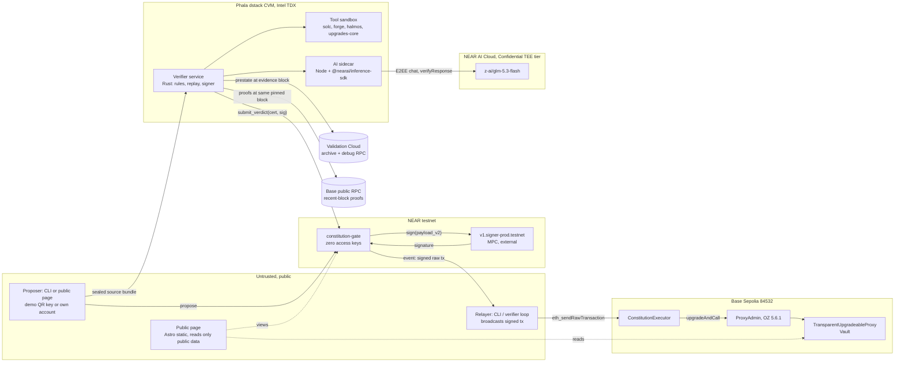
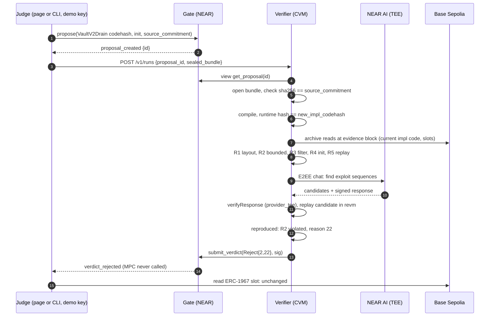
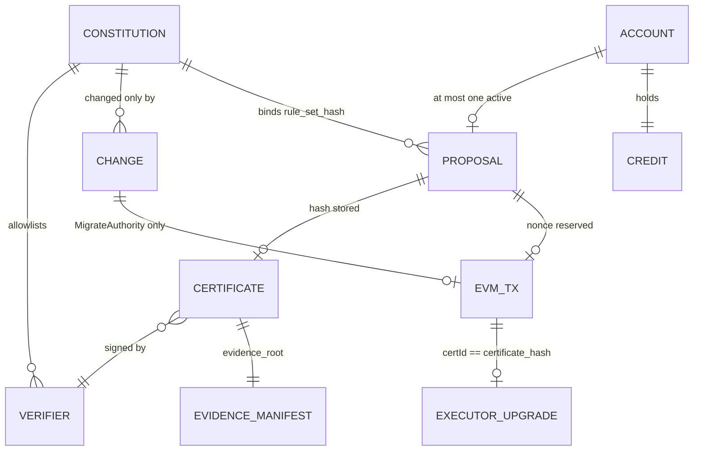

# CONSTITUTION: architecture

## TL;DR and approval

- [V] Stack approved by the founder on 2026-10-26: **Option C**, Phala Cloud dstack Intel TDX CVM verifier + Rust-first operations + Astro static page (OPEN-DECISIONS D1). Verifier host D2, spam control D3, attestation appraisal D5 resolved the same day.
- [I] Core invariant: the Base Sepolia proxy can only change implementation through `ConstitutionExecutor`, which only accepts transactions signed by the MPC key derived for a keyless NEAR gate, and the gate only requests a signature for the exact executor call bound to a valid certificate over the active, timelocked rule set.
- [V] Nothing is built or deployed. Every version below was observed live on 2026-10-26; compatibility between them is proven only by build phase 1 spikes.
- Exact contract interfaces: `docs/technical/SMART-CONTRACT.md`. Setup and accounts: `docs/technical/INTEGRATIONS.md`. Scope: `docs/PRD.md`.

## System diagram and responsibilities



Trust boundaries [I]: NEAR consensus and the MPC network are trusted for signing; the verifier is trusted only through its measured release and allowlisted key; the AI is trusted for nothing except producing candidates that the verifier must reproduce; proposers, relayers, the page, its host, RPC providers and every human key are untrusted for safety.

| Component | Inputs | Outputs | Owned state | Path |
| --- | --- | --- | --- | --- |
| Gate | `propose`, `submit_verdict`, governance calls | MPC sign requests, NEP-297 events, signed raw transactions | Constitution, proposals, changes, credit, EVM nonce | `crates/gate` |
| Shared types | none (library) | Borsh/JSON types, canonical hashing, ABI and transaction encoders, reason codes | none | `crates/constitution-types` |
| Verifier service | Sealed bundle, proposal id, archive RPC, AI sidecar | Signed certificate or rejection, evidence manifest, run status | In-memory runs; ephemeral keys | `crates/verifier`, `verifier-image/` |
| AI sidecar | Source, rule descriptions, nonce | Candidate exploit sequences + verification receipt | none | `verifier-image/ai-sidecar/` |
| Executor | Calls from derived EOA | `upgradeAndCall` on ProxyAdmin | `signer`, `currentImplementation`, used ids | `contracts/src/ConstitutionExecutor.sol` |
| Demo vault | User deposits/withdrawals | Token movements | ERC-7201 vault storage | `contracts/src/demo/` |
| CLI `constitution` | Commands, local keys from NEAR keychain / `.env` | NEAR txs, sealed bundles, relayed EVM txs, receipts, audit report | Local config only | `crates/cli` |
| Public page | Public RPC views, verifier status, demo function-call key | Rendered state, `propose` txs signed with the demo key | none | `web/` |

## Data flow

### Drain proposal (never-cut demo step 2 to 3)



### Honest proposal (step 4)

Steps 1 to 8 as above; all rules pass, AI candidates do not reproduce (recorded), verdict `Pass` with `AiReview::Clean{signature_kind=1}`. Then:

1. Gate validates the certificate (SMART-CONTRACT check order), assigns nonce, builds the EIP-1559 transaction to the executor, emits `sign_requested`, calls MPC `sign`.
2. MPC resumes the gate callback with the signature; gate stores the raw signed transaction and emits `signed {raw_tx, tx_hash}`.
3. Any relayer recovers the sender, confirms it equals the derived EOA, and sends `eth_sendRawTransaction` to `https://sepolia-sequencer.base.org`.
4. Executor checks run and `upgradeAndCall` executes; the proxy emits `Upgraded(VaultV2Honest)`; receipt shows the Base Sepolia transaction.

### Governance (step 5)

`schedule_change` by the governor key creates a change with `eta = now + 7 days`; an immediate `apply_change` fails `E53_TIMELOCK_NOT_ELAPSED`. The receipt for that refusal is real testnet evidence. The matured apply (F11, P1) is shown only if it really matured.

## Approved tech stack

All rows observed 2026-10-26. "Index" = official crates.io sparse index (`https://index.crates.io/...`, latest published non-yanked stable line); the crates.io JSON API returned HTTP 403 to the research agents, so the index and docs.rs manifests are the registry evidence.

| Layer | Choice | Exact stable version | Source | Why / compatibility |
| --- | --- | --- | --- | --- |
| Rust toolchain | rustc | 1.99.1 (2026-10-13); fallback 1.94.1 | static.rust-lang.org stable channel | Meets near-sdk 1.93, revm 1.91.0, alloy 1.94.1 minimums; deployed gate built in cargo-near reproducible image (D15) |
| Gate SDK | near-sdk | 5.29.1 | index; docs.rs manifest | Protocol version 84 build path removes old 1.86 ceiling [V cargo-near source] |
| Gate build | cargo-near | 0.22.0 | GitHub release | `reproducible-wasm` for deployed code |
| Gate tx builder | omni-transaction | 0.5.0, `evm` only | index; docs.rs | `build_for_signing`, `build_with_signature` [V] |
| Gate tests | near-workspaces | 0.23.0 (near-sandbox ^0.3.12) | index; docs.rs | Linux or WSL2 only |
| Serialization | borsh | 1.8.1 | index | Canonical certificate and manifest bytes |
| ABI encoding | alloy-sol-types | 1.7.3 | index | Builds for the gate wasm (spike P1.1, 2026-11-02); hand encoder kept only as a test oracle |
| MPC | Chain Signatures | `v1.signer-prod.testnet`, domain 0 | live views; near/mpc source | External dependency |
| CLI NEAR client | near-api | 0.8.6 | index | Rust NEAR RPC and signing |
| CLI/verifier EVM client | alloy | 2.5.0 (MSRV 1.94.1) | docs.rs manifest | Base reads, prestate fetch, broadcast |
| CLI args | clap | 4.6.7 | index | |
| HTTP | reqwest 0.13.5, axum 0.8.9, tokio 1.54.1 | as listed | index | Verifier API and clients |
| Verifier EVM | revm | 43.0.3 (MSRV 1.91.0) | docs.rs manifest | Native in CVM, default features acceptable outside WASI |
| Verifier signing | ed25519-dalek | 3.0.0 | index | Certificate signatures; gate verifies with `env::ed25519_verify` [V] |
| Bundle sealing | crypto_box | 0.9.1 (sealed box) | index | X25519 transport key bound in quote |
| Quotes | dstack-sdk (Rust) | 0.1.3 | index | `GetQuote` via `/var/run/dstack.sock` [V Phala docs] |
| Hashing off-chain | sha2 | 0.11.1 | index | Gate uses `env::sha256_array` |
| Solidity toolchain | Foundry | v1.8.6 | GitHub release | forge build/test, anvil |
| Compiler | solc | 0.8.38 | GitHub release | EVM version pinned at P1.3 |
| Contracts | @openzeppelin/contracts, -upgradeable | 5.6.1 | `npm view` | Transparent proxy semantics read at tag v5.6.1 |
| Layout check | @openzeppelin/upgrades-core | 1.47.0 | `npm view` | `validate --reference --requireReference` |
| Symbolic | Halmos | 0.3.3; Python 3.12; z3-solver 4.12.6.0; yices 2.6.4.x | PyPI JSON; GitHub release | Bounded; fail closed on incomplete |
| AI SDK | @nearai/inference-sdk | 0.1.0 (Node >= 24) | `npm view` | Official E2EE and `verifyResponse`; run as sidecar instead of re-implementing verification in Rust [I] |
| AI model | `z-ai/glm-5.3-flash` | catalog 2026-10-26, own-fleet Confidential TEE, USD 0.08 / 0.50 per M tokens | cloud-api.near.ai/v1/model/list | Canonical id, aliasing disabled |
| Node runtime | Node.js | 24.22.1 LTS "Krypton" | nodejs.org/dist/index.json | Sidecar, upgrades-core, page tooling |
| Package manager | pnpm | 12.15.0 | `npm view` | Page and sidecar |
| Page | Astro | 7.4.2 (Node >= 22.23.4) | `npm view` | Static output, islands for live status |
| Page language | TypeScript | 7.0.2 | `npm view` | |
| Page EVM reads | viem | 2.57.14 (`npm view viem version`, 2026-11-02; 2.57.11 on 2026-10-26) | `npm view` | Also the independent encoding oracle (T-ENC-1, `tools/vectors-viem`) |
| Page NEAR signing | near-api-js | 7.4.0 (Node >= 22.22.2) | `npm view` | Signs `propose`, preset `schedule_change` and `apply_change` with the demo function-call key |
| Page bundle sealing | libsodium-wrappers | 0.8.4 | `npm view` | `crypto_box_seal`; interop with Rust `crypto_box` proven by T-ENC-3 before use |
| Page QR | qrcode | 1.5.4 (Node >= 10.13.0) | `npm view` | Renders the public demo key; text alternative always shown |
| Page checks | Biome 2.6.3, Vitest 5.0.5, Playwright 1.64.1 | as listed | `npm view` | |
| Attested host | Phala Cloud dstack CVM | instance size from P1.6 | phala.com/pricing | USD 20 verified-account credit (D2) |
| Archive / proof RPC | Validation Cloud Base Sepolia for state/debug; Base public RPC for proofs | free tier / rate-limited public | docs.validationcloud.io; docs.base.org | Separate endpoints, one pinned header and verified account/storage proofs (D10, refined 2026-11-05) |
| NEAR RPC | FastNEAR testnet | `https://test.rpc.fastnear.com` | docs.near.org/api/rpc/providers | near.org RPC deprecated after 2025-08-01 [V] |
| Base RPC | public | read `https://sepolia.base.org`, send `https://sepolia-sequencer.base.org` | docs.base.org | No numeric quota published [U] |

Alternatives, recommendation and the founder's choice are in OPEN-DECISIONS D1. Any additional crate or package is verified live and added here in the commit that introduces it.

## Codebase structure and interfaces

```text
constitution/
  CLAUDE.md
  Makefile                      # attack, upgrade, audit, test, vectors (planned)
  Cargo.toml                    # workspace: crates/*
  rust-toolchain.toml           # 1.99.1, wasm32-unknown-unknown
  crates/
    constitution-types/         # no_std-friendly; depended on by all Rust crates
      src/certificate.rs        # Certificate, AiReview, Verdict, hashing
      src/proposal.rs           # Proposal, ProposeArgs, states
      src/governance.rs         # ChangeKind, Params, Roles
      src/evm.rs                # executor calldata + EIP-1559 preimage (omni)
      src/manifest.rs           # RuleSetManifest, EvidenceManifest
      src/reasons.rs            # rule ids, reason codes
      tests/vectors.rs          # reads vectors/*.json
    gate/                       # cdylib, near-sdk; depends on types only
    verifier/                   # bin: HTTP API, run pipeline, rules, replay, signer
      src/api.rs  src/pipeline.rs  src/rules/{r1,r2,r3,r4,r5}.rs
      src/replay.rs  src/ai.rs  src/identity.rs  src/submit.rs
    cli/                        # bin `constitution`
  contracts/                    # Foundry project
    foundry.toml
    src/ConstitutionExecutor.sol
    src/demo/{MockToken,VaultV1,VaultV2Honest,VaultV2Drain}.sol
    test/  script/Deploy.s.sol
  rules/
    manifest.json               # human-readable; hashed via Borsh of the parsed struct
    r2/SolvencyCheck.t.sol      # Halmos and fuzz harness
    r4/initializers.json
    r5/corpus.json
  verifier-image/
    Dockerfile                  # digest-pinned base and tool binaries
    docker-compose.yml          # dstack compose; its hash is part of release identity
    ai-sidecar/                 # Node 24, @nearai/inference-sdk, localhost only
  fixtures/proposals/{drain,honest}/
  vectors/                      # shared JSON test vectors (T-ENC)
  tools/vectors-viem/           # Node script: viem oracle for T-ENC-1
  web/                          # Astro page
  docs/
```

Import boundaries [I]: `gate` depends only on `constitution-types` and near-sdk; `constitution-types` has no network or filesystem code; `verifier` never imports `cli`; `web` imports nothing from Rust and re-derives hashes independently; the AI sidecar listens on localhost only and has no access to signing keys.

### Verifier HTTP API (served from the CVM)

| Method and path | Request | Response | Errors |
| --- | --- | --- | --- |
| `GET /v1/identity` | none | `{verifier_pubkey, transport_pubkey, release_hash, report_data_preimage, quote_hex, event_log, compose_hash, supported_rule_set_hashes}` hex strings | none |
| `POST /v1/runs` | `{gate, proposal_id, sealed_bundle_b64}` | `202 {run_id}` | `400 bad_bundle` / `wrong_gate` / `unsupported_proposal`, `404 proposal_not_found`, `409 run_in_progress` / `proposal_not_pending` / `not_ready`, `429 rate_limited` / `queue_full` / `cooling_down` / `busy` with `Retry-After`, `502 rpc_unavailable` |
| `GET /v1/runs/{run_id}` | none | `{stage, started_at, stages:[{name, status, detail}], verdict?, certificate_b64?, signature_b64?, near_tx_hash?, evidence_root?}` | `404` |
| `GET /v1/runs/{run_id}/evidence` | none | Evidence manifest JSON (hashes; plaintext only if proposer opted in) | `404` |

CORS: the GET endpoints and the rate-limited `POST /v1/runs` allow the configured page origin (`PAGE_ORIGIN`), no credentials. The page seals fixture bundles in the browser (T-ENC-3) and builds `Observed` receipts from public reads; committed `receipts/*.json` are bundled at build time as `Recorded` receipts.

Stages in order: `queued`, `unsealing`, `compiling`, `r1_layout`, `r2_solvency`, `r3_filter`, `r4_initializer`, `r5_replay`, `ai_review`, `reproducing`, `signing`, `submitting`, `done`. The first deterministic `Fail` stops later stages (recorded `Skipped`); AI review runs only when every deterministic stage passed, otherwise it is recorded `NotRun`.

### Sealed source bundle

`SourceBundle { contract_name: String, files: Vec<(String path, Vec<u8> content)>, foundry_profile: String }` Borsh-encoded; `source_commitment = sha256(borsh(bundle))`; sealed with `crypto_box` sealed box to `transport_pubkey`. Max 2 MiB plaintext [I]. The verifier rejects path traversal, symlinks and files outside `src/`.

### Rule-set manifest

`RuleSetManifest { version: 1, name, solc: "0.8.38", evm_version, optimizer_runs, tools: {foundry, halmos, upgrades_core, z3, yices}, reference: {contract_name, source_sha256s}, r1: {unsafe_allow}, r2: {harness_sha256, invariant_depth, loop_bound, array_lengths, solver_timeout_assertion_s, fuzz_runs, fuzz_depth, fuzz_seed}, r3: {forbidden_opcodes: [0xff, 0xf2, 0xf4], forbidden_constants: [impl_slot, admin_slot, impl_slot-1, impl_slot+1, admin_slot-1, admin_slot+1, foundry_address, halmos_address]}, r4: {allowlist: [{selector: "0x5b4e128c", args: [{type: "uint256", max: "2^128-1"}]}], allow_empty: true}, r5: {corpus_sha256, max_txs, confirmations}, ai: {required: true, model: "z-ai/glm-5.3-flash", signature_kind: "provider_tee", max_candidates, timeout_s}, max_cert_ttl_s }`. `rule_set_hash = sha256(borsh(manifest))`. `constitution rules hash rules/manifest.json` prints it. Every numeric bound is shown on the page.

R2 as committed [I; local measurements in `crates/verifier/evidence/depth/`]: Halmos explores sequences up to `invariant_depth = 4` calls by two fixed actors through `deposit(uint96)` and `withdraw(uint96)` (`rules/r2/Solvency.t.sol`), asserting `totalDeposits() <= token.balanceOf(vault)` and implementation-slot preservation after explored calls; Foundry fuzzes the same invariant (`fuzz_runs` x `fuzz_depth`, fixed seed). Functions other than these two handlers are not explored. The property is **aggregate solvency, not per-depositor withdrawability**; fuzzing did not catch the four-call R2 Fail fixture in earlier measurement, so that catch is the Halmos bound. The attempted additional fixed-victim floor and real withdrawal timed out for both fixtures (154,714 / 154,972 ms locally, 150 s inner budget), so it was reverted rather than widening timeouts or reducing depth; it did not meet the required 20 s margin.

[I] Harness-side definitions are verifier-provided compiled-in copies of `contracts/src/demo/{VaultV1,MockToken}.sol`, with their SHA-256 values in `reference.source_sha256s`. Identical bundle copies are ignored and omitted copies are supplied; any different bytes at either reserved path fail pre-check `Reject(0,4)` before compilation/R2. Their transitive OpenZeppelin imports resolve only to the verifier's read-only dependency mount. R2 requires the deployed candidate's `keccak256(code)` to equal the first compilation's runtime hash, passed in verifier-generated `candidate.sol`, never bundle configuration. The harness sets chain id 84532 and checks the proxy implementation slot after explored calls.

[I] The R3 list is **exactly eight ordered 32-byte values**, with Foundry `0x7109709ecfa91a80626ff3989d68f67f5b1dd12d` and Halmos `0xf3993a62377bcd56ae39d773740a5390411e8bc9` zero-padded to 32 bytes. Numeric PUSH immediates are compared (including Solidity's PUSH20 addresses); both ERC-1967 ASCII labels are rejected anywhere in runtime. Shared `validate_rule_set` enforces the list, so CLI and verifier accept identical inputs. Borsh field order, `Vec<Hex32>` encoding and manifest version 1 are unchanged; this revised supported list and harness produce a new rule-set commitment, not a serialization-format fork. G1 assumes implementations cannot write arbitrary storage: a runtime computing its SSTORE slot from calldata can evade R3, as documented by the filter-limit test. Computed cheatcode addresses, environment fingerprinting beyond chain id, and entry points not explored by R2 remain limits. Filters are filters, not proofs.

[V, local CLI, 2026-11-03] Current rule-set hash:
`0x8060ddbf63635e14a955b4fef81c8e696c01e349c9f959cae135d48056e89455`
(`cargo run -p constitution-cli -- rules hash rules/manifest.json`).

### Evidence manifest

`EvidenceManifest { certificate_fields_digest, compile: {solc, settings_hash, runtime_hash}, current: {address, runtime_hash, reproduced: bool}, r1..r5: {status: Pass|Fail|Incomplete, artifact_sha256, detail_code}, ai: {model, completion_id, request_sha256, response_sha256, signature_kind, signature, preflight_digest, candidates: [{sha256, reproduced}]}, evidence_block: {number, hash}, archive_provider }`. `evidence_root = sha256(borsh(manifest))`.

### Verifier identity

- At boot the verifier generates an Ed25519 signing key and an X25519 transport key from OS randomness, in memory only.
- `report_data = sha256("constitution.v1/key" || ed25519_pubkey || x25519_pubkey || boot_nonce)`, 32 bytes zero-padded to 64, requested via dstack `GetQuote`.
- `release_hash = sha256("constitution.v1/release" || MRTD || RTMR0 || RTMR1 || RTMR2 || compose_hash)`; RTMR3 event-log replay must reproduce `compose_hash`.
- [V] Phala deterministic `GetKey` keys are derived per **application id**, not per measured code (docs.phala.com get-a-key, 2026-10-26). Whoever controls app updates could obtain the same key under different code, so P0 does not use `GetKey` for the certificate key. Consequence: a CVM restart produces a new key that needs a timelocked `AddVerifier` (P0) or, after P1 on-chain DCAP, a permissionless key registration for an already-approved `release_hash`. Budget impact: OPEN-DECISIONS D18.

### AI review

- Sidecar uses `new InferenceClient({ baseUrl: "https://cloud-api.near.ai/v1", apiKey, e2ee: true, gatewayVerification: {policy: {acceptedTcbStatuses: ["UpToDate"]}}, modelVerification: {policy: {acceptedTcbStatuses: ["UpToDate"]}} })` [V option names from the JS SDK doc]; header `x-no-aliasing: true`; model `z-ai/glm-5.3-flash`.
- Output contract requested from the model: JSON `{candidates: [{rule: "R2", rationale, steps: [{from: "attacker"|"victim"|"0x..", call: "<function signature>", args: [...], value: "0"}]}]}`, at most `max_candidates`.
- After the stream completes: `receipt = await client.verifyResponse(completion.id)`; require `receipt.signatureKind === "provider_tee"`; otherwise AI review is `incomplete`.
- The verifier replays each candidate in revm on the evidence-block fork with the new implementation. Only a reproduced R2 violation creates `Reject{2,22}`. Prompt text and model output are untrusted data: nothing from them is executed except as EVM transactions inside the sandboxed replay.

### CLI (planned interface)

| Command | Effect |
| --- | --- |
| `constitution propose --bundle <dir> --contract src/<file>.sol:<Name> --impl <addr> [--init <hex>] [--verifier <url>]` | Reads the gate config and the implementation's live codehash, fetches the verifier transport key before any NEAR write, deposits only the credit shortfall, calls `propose`, seals the canonical bundle and posts the run; prints proposal id, NEAR tx and run id. It does not appraise the verifier identity (D5) |
| `constitution status <id> [--run <run_id>] [--watch <s>]` | Gate state plus verifier stages; polls every 2 s until a terminal gate state, terminal run (`done` or `failed`), or timeout. `failed` exits 1 with the stable code, cause and retry command; the proposal stays Pending. Withheld AI review means no certificate; `submit: Incomplete` retains a certificate and requires inspection of relay transactions before retrying |
| `constitution relay <id> [--change] [--watch <s>]` | Recovers sender, broadcasts the gate's `signed` raw transaction (details below) |
| `constitution receipt <id> [--run <run_id>] [--json] [--network testnet\|local]` | Canonical receipt; certificate facts only after the run's certificate bytes hash to the gate's accepted certificate |
| `constitution audit [--deployment deployments/testnet.json] [--manifest rules/manifest.json] [--executor-artifact contracts/out/ConstitutionExecutor.sol/ConstitutionExecutor.json]` | 11 F7 preconditions plus 3 governance information lines and one line per pending change; FAIL exits 1, WARN exits 0 but prints a loud warning summary |
| `constitution govern [--account <id>] [--key-file <path>] schedule --kind <ChangeKind JSON> / apply <id> / cancel <id>` | Governance; signs with a near-cli legacy key file (default `.secrets/near-credentials/<network>/<account>.json`) through near-api 0.8.6; a gate panic prints its code (for example `E53_TIMELOCK_NOT_ELAPSED`) and the next step |
| `constitution rules hash <manifest>` | Prints rule-set hash |
| `constitution executor-runtime-hash [--executor-artifact <Foundry JSON>]` | Offline helper: keccak256 of executor deployed runtime with compiler-declared immutable regions zeroed; writes no deployment record |
| `constitution verifier appraise <url>` | Off-chain quote appraisal (D5) |
| `constitution verifier run --proposal <id> --bundle <dir\|file> [--contract src/<file>.sol:<Name>] --gate <gate> [--near-rpc <url>] [--verifier-url <url>]` | [I] Read-only retry for an existing Pending proposal: validates the canonical source bundle and compares its SHA-256 to the on-chain source commitment before contacting the verifier, fetches its current transport key, re-seals and POSTs `/v1/runs`. Directory input requires `--contract`; file input is a canonical Borsh `SourceBundle`. Prints the numeric run id and a `status --run --watch` command; identity is not appraised. Admission refusals give a code-specific recovery; 429 honors `Retry-After` seconds. `propose` remains asynchronous; no automatic retry or resubmission |

`make attack` = propose the drain fixture with the demo key and watch; `make upgrade` = propose the honest fixture, watch, relay. Both print receipt paths.

`constitution audit` [I, local implementation; no activated-testnet claim] reads public state at NEAR `final` and EVM `latest` and prints 11 PASS/FAIL preconditions: `gate_has_no_access_keys`, `gate_code_is_committed_build`, `executor_code_is_committed_build`, `gate_binds_this_deployment` (chain, executor, proxy and MPC account match the record and RPC chain), `derived_eoa_is_executor_signer` (MPC derivation equals gate EOA and executor signer), `executor_controls_this_proxy`, `executor_owns_proxy_admin`, `proxy_admin_is_erc1967_admin`, `implementation_tracker_matches_slot`, `active_rule_set_is_committed_manifest`, `verifier_allowlist_is_committed`. The existing ownership and slot checks remain even though the executor constructor deploys the proxy/admin. An unreadable value aborts with named `FAIL read_failed`, exit 1; never a pass.

The planned activation record `deployments/testnet.json` is a strict JSON object (unknown fields rejected): `chain_id` (u64), `gate` (NEAR account), `gate_code_hash` (NEAR base58), `mpc_account` (NEAR account), `executor` and `proxy` (lowercase 0x-prefixed 20-byte hex), **`executor_runtime_hash`** (lowercase 0x-prefixed 32-byte hex), `verifiers` (array of `{pubkey: <32-byte base64>, release_hash: <32-byte lowercase 0x hex>}`), and optional `planned_changes` (default `[]`, array of `{id: <u64>, kind: <exact shared ChangeKind JSON>, eta_ns: <u64>}`). No fixture record is presented as activated. A missing/null executor hash is decoded only to emit named `FAIL executor_code_is_committed_build`, not skipped. Both the deployment hash and the masked observed runtime must equal the local artifact hash; byte lengths must match. Immutable offsets/lengths come exclusively from `deployedBytecode.immutableReferences`, not the deployment or RPC. All other bytes (including Solidity metadata) remain hashed; malformed/missing masking metadata fails closed. Build from the intended committed source with pinned Foundry/solc, then from repo root run exactly `forge build --root contracts --offline && cargo run -p constitution-cli -- executor-runtime-hash --executor-artifact contracts/out/ConstitutionExecutor.sol/ConstitutionExecutor.json`; copy its final 0x hash into `executor_runtime_hash` before committing the activation record. The local artifact and deployment record are trusted audit inputs, not independently authenticated source provenance.

Governance adds three named information lines: `gate_roles` shows the current governor/guardian ids, `signing_paused` shows the actual boolean (WARN when true; signed transactions are not revoked), and `pending_governance_changes` counts pending changes. `get_roles`, `is_signing_paused`, and every page of `list_changes` are read; a missing pause view is `FAIL read_failed` until the gate view lands. Every pending kind (including MigrateAuthority, AddVerifier, SetGuardian, SetGovernor, SetParams, SetRuleSet) is printed as exact ChangeKind JSON with `id`, `eta_ns`, and planned status. Unplanned MigrateAuthority/AddVerifier/SetGuardian/SetGovernor gets named `WARN pending_authority_change` and overall **`audit WARNING: pending authority change`** instead of “audit passed”; only an exact `(id, kind, eta_ns)` match in the committed `planned_changes` suppresses that warning. Other pending changes use `pending_governance_change`. WARN alone exits 0; any FAIL exits 1. RPC and verifier transport errors strip reqwest URLs and redact endpoint userinfo/path/query keys; diagnostics identify hosts only, including relay race errors and receipt JSON failure paths. Read paths use reqwest JSON-RPC; near-api is used only for signed NEAR writes.

`constitution relay` [I, implemented 2026-11-02, local evidence only] reads the proposal (or, with `--change`, an applied `MigrateAuthority` change) and the gate config, decodes the raw EIP-1559 bytes, recovers the sender with k256 and refuses to broadcast unless sender = `derived_eoa`, signing hash = the gate's recorded `signing_hash`, and chain, `to` and nonce match. It sends to `BASE_SEPOLIA_SEND_URL` only if `BASE_SEPOLIA_RPC_URL` does not already know the transaction, so relaying twice is harmless; `--watch` reports inclusion, and a revert (for example `DeadlinePassed`) exits 1 with the next step.

### Receipt JSON

`{schema: "constitution.receipt/1", proposal: {...ProposalView}, rule_set_hash, verifier: {pubkey, release_hash}, verdict: {kind, rule_id?, reason_code?}, evidence_root, ai: {signature_kind, reproduced_candidates}, near: {propose_tx, verdict_tx, sign_tx?}, evm: {nonce?, tx_hash?, status: "not_signed"|"signed"|"pending"|"included"|"reverted", block?, explorer?}, proxy: {implementation_before, implementation_after, observed_at_block}, labels: {network: "testnet"|"local"}}`. Fields absent until observed.

## ERD and data model



| Entity | Lives in | Key fields and units | Sensitivity |
| --- | --- | --- | --- |
| Constitution, Verifier, Change, Proposal, Credit, EvmTx | Gate state (NEAR) | see SMART-CONTRACT; yoctoNEAR u128, wei u128, ns u64 | Public |
| Certificate | Gate (hash) and event payload (full bytes) | Borsh; seconds u64 | Public |
| Evidence manifest | Verifier memory, published by `GET /evidence` and committed into receipts | hashes | Public hashes; plaintext opt-in |
| Source bundle | Verifier memory only, discarded after run | bytes | Private |
| AI transcript | Verifier memory; hashes in manifest | bytes | Private |
| Executor state | Base Sepolia | `signer`, `currentImplementation`, used ids | Public |
| Receipt | Generated on demand from public chain data + evidence | JSON | Public |

Transitions are the state machine in SMART-CONTRACT. No database exists; receipts are recomputed from chain state and evidence.

## Failure modes

| Failure | Detection | User-visible state | Recovery or terminal | Planned test |
| --- | --- | --- | --- | --- |
| Verifier down | `/v1/identity` fails | "Verifier unreachable" | Proposal stays Pending until TTL; Expired releases credit | page e2e offline case |
| CVM restarted (new key) | identity pubkey not in `list_verifiers` | "Verifier key not yet registered" | Timelocked AddVerifier (P0) or P1 DCAP registration | audit check |
| AI timeout, gateway-only signature, malformed output | sidecar status | "AI review incomplete, not certified" | Withheld without certificate accrues a cooldown strike; never Pass | T-AI-1 |
| Solver timeout / unknown | Same-stage canary cache and fresh post-failure check | "R2 incomplete" | Reject reason 23 only with a healthy canary completed before the stage (at most 30 min old) and another after it; otherwise failed | canary tests |
| R5 provider lag, null block, insufficient confirmations, transport glitch, unverifiable provider data | replay `Incomplete` kind Environment; individual RPC calls may retry once, but Environment outcomes are not replayed | Run `failed`/`rpc_unavailable` for transport, otherwise `replay_unavailable` | No certificate; Pending | lag/null/confirmation regressions |
| R5 candidate execution incomplete or witness bound exceeded | replay `Incomplete` kind Contradiction | "R5 witness incomplete" | Signed Reject reason 51 only if observed twice; both observations use the same provider | T-RULE-5 |
| Source compiler diagnostic | canary compile then deterministic pre-check | Reject 0/2 only if honest fixture compiles | Otherwise failed, no certificate | compile and canary tests |
| Compiler output without allowlisted diagnostic | tool output classification | `failed`/`tool_output_invalid` | No certificate; Pending; cooldown and canary apply | compile-text classification test |
| Sealed bundle invalid or plaintext source commitment mismatch | admission before config/Base reads | `400 bad_bundle`; no run or attempt | No certificate/verdict; proposal remains Pending | API precheck regression |
| Request gate differs from required `GATE_ACCOUNT_ID` | admission before RPC | `400 wrong_gate` | Correct gate and retry | gate precheck regression |
| Unauthenticated flood / invalid peer / pre-auth RPC slots busy | limiter before body parsing; explicit `VERIFIER_PEER_SOURCE=socket` or `header:<name>` required in chain mode | `429 rate_limited` / `429 busy` with `Retry-After`, or `400 invalid_peer` | 6 POSTs/10 s per peer; GET run/evidence 60/10 s; 4 concurrent pre-auth RPCs. Trusted ingress must supply the actual final client address | peer-limit and startup tests |
| Authenticated (commitment matched) rate exceeded or worker busy | admission after the commitment check | `429 rate_limited` / `429 queue_full` with `Retry-After`; same active proposal otherwise 409; a busy refusal charges no limiter | Retry after indicated seconds; per proposal one/10 s, global 10/1 s | admission boundary/recovery and no-burn tests |
| Proposal not Pending / unsupported rule set / chain not ready | `get_proposal` and Base reads | `409 proposal_not_pending`, `400 unsupported_proposal`, `409 not_ready` (never `502`) | Terminal for the proposal, or retry later for `not_ready` | typed chain-error tests |
| Failed or withheld run without certificate | outcome-based per-proposal history | `429 cooling_down` with `Retry-After` | 10, 20, 40 min, capped at 1 h; verifier-owned sandbox, panic and RPC transport faults and RPC/AI deadline overruns do not count | cool-down tests |
| Run exceeds the 20 minute deadline | pipeline checks between stages and before signing; replay RPCs use remaining time | Run `failed`/`infrastructure_timeout` | No certificate; Pending, retryable. Blocking sandbox/sidecar calls can overrun the deadline until their own timeouts | deadline tests; hard wall-clock bound unproven |
| Verifier lacks dstack socket without explicit offline flag | startup identity policy | `attestation_required`; refuses chain mode | Restore socket; `--insecure-dev-identity` only selects local registry/no submitter | startup mode tests |
| Sandbox/Docker unavailable, tempdir/disk failure, missing tools | tool execution boundary | Run `failed` with stable error code | No certificate; sandbox_unavailable is exempt from cooldown; storage_error and tool_unavailable count | infrastructure classification tests |
| Tool wall timeout/OOM (exit 124/137) or malformed tool artifacts, unavailable committed harness | tool execution and output validation | Run `failed`/`infrastructure_timeout` or `tool_output_invalid` | No certificate/verdict; Pending, retryable until the canary rule above applies | classification and canary tests |
| Archive RPC transport/HTTP/protocol failure (including malformed/oversized replies), or unavailable/invalid committed verifier data | observation/replay boundary | `502 rpc_unavailable` before queue; otherwise run `failed`/`rpc_unavailable` or `committed_data_unavailable` | No certificate/verdict before signing; Pending, retryable; post-signing submission uncertainty retains the certificate | RPC redaction/fault regression |
| Worker panic / poisoned state lock | RAII worker guard / lock recovery | Run `failed`/`worker_panic`; service remains usable | No panic-produced certificate; retry; newest 64 finished runs retained, never evict unfinished runs, evicted IDs return 404 | panic/poison and 65th-request regressions |
| MPC sign failure / timeout | `on_signed` Err | "Signing failed, retry available" | `retry_sign` same bytes | T-GATE-10 |
| Underpriced EVM tx | not included after N blocks | "Pending on Base" | `bump_fee` | T-GATE-9, testnet rehearsal |
| Deadline passed before inclusion | executor revert `DeadlinePassed` | "Expired on Base, nonce consumed" | New proposal | T-EXE-2 |
| Current implementation changed meanwhile | `CurrentImplementationMismatch` | "Superseded" | New proposal | T-EXE-2 |
| Public RPC rate limit | HTTP 429 | "Network busy, retrying in Ns" with real countdown | Backoff in client only | page test |
| Relayer sends wrong sender signature | sender recovery | refused locally | Investigate; executor would revert `NotSigner` anyway | T-EXE-1 |

## Security model

Assets: the proxy's implementation slot (and therefore vault funds), the constitution, the verifier key, private source code.

Adversaries: holder of any human key (governor, guardian, deployer, Phala account, NEAR AI key, relayer, proposer), malicious proposer code, malicious AI output, malicious RPC, compromised page host.

Authority matrix and on-chain bypass analysis: SMART-CONTRACT "Security and upgrade authority". Off-chain additions [I]:

- **Phala account holder** can stop or redeploy the CVM. Redeployed code has a different `release_hash` and a fresh key, which the gate does not accept until a 7-day public `AddVerifier`. Liveness loss, not a safety bypass. This is why the certificate key is not derived with app-id-bound `GetKey`.
- **Untrusted proposal code inside the verifier**: tools run as an unprivileged user without access to `/var/run/dstack.sock`, signing keys, the AI API key or the network (archive reads happen in the Rust service, not in the sandbox). Foundry FFI disabled. Per-stage CPU and wall-time limits.
- **Prompt injection** in source comments: the model can only emit candidates; candidates are EVM call sequences replayed in revm; nothing else is executed.
- **Malicious RPC**: evidence block hash is bound; `eth_getProof` against the block's state root where the provider supports it; the gate trusts the verifier's evidence, stated as a limit.
- **Page host compromise**: the page holds only the public demo key; it cannot produce certificates or signatures.
- **Verifier key extraction**: residual TEE risk; guardian `remove_verifier_now`, short certificate TTL.

Residual risks are listed in PRD "Risks and guarantees".

## Deployment and verification

| Environment | Purpose | Components |
| --- | --- | --- |
| Local | Unit, sandbox, Foundry tests | near-sandbox (Linux/WSL2), anvil, verifier binary without TEE (`--insecure-dev-identity`, labeled, never registered on testnet) |
| Testnet dev | Spikes and iteration | Gate deployed **with** a developer key (labeled "dev, claim inactive"); audit fails by design |
| Testnet activated | Demo and judging | Fresh gate account, keys deleted, executor + proxy deployed, verifier in Phala CVM |

Compatibility spikes: P1.1 to P1.7 in BUILD-PLAN. Planned verification commands (not run): `cargo test -p constitution-types`, `cargo test -p constitution-gate`, `cargo near build reproducible-wasm` (in `crates/gate`), `forge test` (in `contracts`), `pnpm --dir tools/vectors-viem vectors`, and the audit command in `scripts/activate.md` step 6 (`constitution audit --deployment deployments/testnet.json --manifest ... --executor-artifact ... --near-rpc ... --evm-rpc ...`; the CLI has no `--network` flag). Observed evidence is recorded only in SMART-CONTRACT "Deployment and measured costs".

## Sources

Opened 2026-10-26 unless stated: research notes `scratch/research/A-chain-stack.md` and `scratch/research/B-verifier-ai-integrations.md` (each row cites its primary URL); https://docs.phala.com/phala-cloud/key-management/get-a-key.md ; https://docs.phala.com/dstack/getting-started.md ; https://phala.com/pricing ; https://docs.near.ai/cloud/inference-sdk/javascript.md ; https://docs.near.ai/cloud/verification/cloud-api/response-signatures.md ; https://docs.near.ai/cloud/models.md ; https://cloud-api.near.ai/v1/model/list ; https://docs.validationcloud.io/nodeapi/base/overview ; https://static.rust-lang.org/dist/channel-rust-stable.toml ; https://index.crates.io (near-api, borsh, clap, axum, tokio, ed25519-dalek, crypto_box, sha2, reqwest, dstack-sdk, alloy-sol-types) ; https://docs.rs/near-sdk/5.29.1 .

Unverified prerequisites: OPEN-DECISIONS BLOCKERS B1 to B8; P1 spikes.
