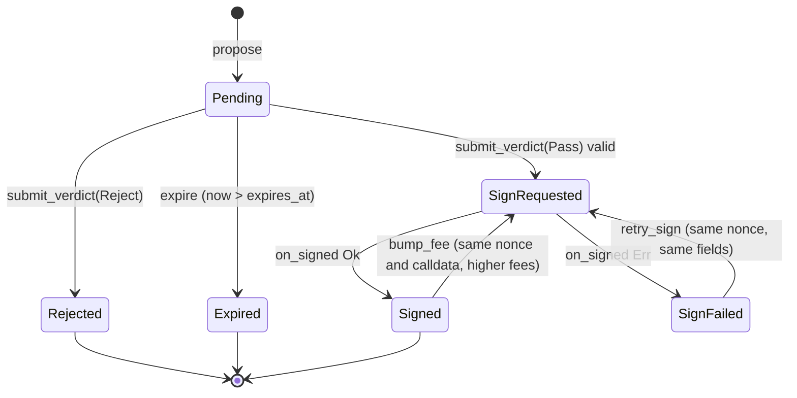

# CONSTITUTION: smart contract specification

**Status: NOT DEPLOYED. Nothing in this document has been compiled, tested or deployed.** This is the protocol contract between the gate, the executor, the verifier, the CLI, the page and the tests. It becomes a deployment record only when the "Deployment and measured costs" section contains observed addresses, transaction hashes and code hashes. Not audited.

Labels: [V] primary source read 2026-10-26 (sources at the end), [I] design decision of this foundation, [U] unverified until the named spike.

## TL;DR and necessity

| Component | Chain | Role |
| --- | --- | --- |
| `constitution-gate` | NEAR testnet | Holds the constitution (rule-set hash, verifier allowlist, parameters, roles, timelock queue) and proposal state; builds the exact EVM transaction; requests the MPC signature |
| `v1.signer-prod.testnet` | NEAR testnet | Chain Signatures MPC contract (external, not ours) |
| `ConstitutionExecutor` | Base Sepolia (84532) | Deploys and owns the demo proxy's ProxyAdmin; only the gate-derived EOA may call it; enforces certificate single use, deadline, code hash and expected current implementation |
| `TransparentUpgradeableProxy` + `ProxyAdmin` | Base Sepolia | OpenZeppelin Contracts 5.6.1, unmodified |
| `VaultV1`, `VaultV2Honest`, `VaultV2Drain`, `MockToken` | Base Sepolia | Demo implementations and test token |

Why on-chain is essential [I]: the signing authority must live where no person holds a key. A NEAR contract with zero access keys can request MPC signatures for its own derived address; no server or person can. The executor makes the EVM side refuse stale or mismatched signatures, which an EOA alone cannot do.

Guarantee and limit: see PRD "Risks and guarantees" (G1 to G4 and trust assumptions). This spec enforces G1 to G4 mechanically; it cannot make declared rules complete.

## Identities and constants

| Name | Value | Status |
| --- | --- | --- |
| MPC contract | `v1.signer-prod.testnet` | [V] live `public_key` and `config` views 2026-10-26 |
| MPC domain | `domain_id = 0` (ECDSA secp256k1) | [V] MPC README example; spike P1.2 confirms |
| Derivation path | `"constitution/base-sepolia/v1"` | [I] fixed forever for one deployment |
| Derivation | `sha3_256("near-mpc-recovery v0.1.0 epsilon derivation:" + gate_account_id + "," + path)` tweak of the MPC root key | [V] near/mpc `kdf.rs` |
| Derived EOA | `keccak256(uncompressed_pubkey[1..65])[12..32]` | [V] chainsig.js EVM adapter; computed in P1.2 |
| EVM chain id | `84532` | [V] docs.base.org and live `eth_chainId` = `0x14a34` |
| Timelock delay | `604_800` s (7 days), compile-time constant | [I] product rule; no method changes it |
| Certificate domain tag | ASCII `constitution.v1\0`, exactly 16 bytes | [I] |
| ERC-1967 implementation slot | `0x360894a13ba1a3210667c828492db98dca3e2076cc3735a920a3ca505d382bbc` | [V] OZ v5.6.1 `ERC1967Utils.sol`; recomputed locally |
| ERC-1967 admin slot | `0xb53127684a568b3173ae13b9f8a6016e243e63b6e8ee1178d6a717850b5d6103` | [V] same |
| `execute(bytes32,address,bytes32,address,uint64,bytes)` selector | `0x90c70cd8` | [I] computed with a keccak implementation validated against two known vectors; re-checked by test vector T-ENC-1 |
| `rotateSigner(address,bytes32,uint64)` selector | `0xfa2e9b8f` | [I] same method |
| `upgradeAndCall(address,address,bytes)` selector | `0x9623609d` | [I] same method; matches OZ ABI |
| `initializeV2(uint256)` selector | `0x5b4e128c` | [I] same method |

## Gate storage and state machine

Rust, near-sdk 5.29.1, Borsh state. Types live in `crates/constitution-types` (shared with verifier and CLI). Amounts in yoctoNEAR are `u128` (JSON `U128` string); EVM wei are `u128` (JSON string); times on NEAR are nanoseconds `u64`, times inside certificates and EVM calls are Unix seconds `u64`.

```rust
pub struct Gate {
    config: Config,                                   // immutable after init
    constitution: Constitution,                       // changes only via timelock
    roles: Roles,                                     // changes only via timelock
    verifiers: IterableMap<[u8; 32], VerifierRecord>, // key = Ed25519 public key
    changes: IterableMap<u64, PendingChange>,
    proposals: LookupMap<u64, Proposal>,
    active_by_account: LookupMap<AccountId, u64>,
    active_by_key: LookupMap<[u8; 32], u64>,         // sha256(new_impl_codehash || init_calldata) of active proposals, for E24
    outstanding_signatures: IterableSet<u64>,         // proposals in SignRequested or Signed; the only set D13 iterates
    credit: LookupMap<AccountId, u128>,               // unreserved yoctoNEAR
    next_proposal_id: u64,
    next_change_id: u64,
    next_evm_nonce: u64,                              // derived EOA nonce the gate will assign next
    signing_paused: bool,
}

pub struct Config {
    chain_id: u64,              // 84532
    executor: [u8; 20],
    proxy: [u8; 20],            // read from executor at deployment, recorded here
    proxy_admin: [u8; 20],
    derived_eoa: [u8; 20],
    mpc_account: AccountId,     // v1.signer-prod.testnet
    mpc_path: String,           // "constitution/base-sepolia/v1"
    mpc_domain_id: u32,         // 0
}

pub struct Constitution {
    rule_set_hash: [u8; 32],    // sha256 of canonical manifest bytes (ARCHITECTURE "Rule-set manifest")
    manifest_uri: String,       // <= 256 bytes, informational
    ai_required: bool,          // true in the demo rule set
    params: Params,
}

pub struct Params {
    proposal_deposit: u128,          // yoctoNEAR reserved per proposal (D3)
    proposal_ttl_s: u64,             // initial 7_200 [I]
    max_cert_ttl_s: u64,             // initial 1_800 [I]
    sign_validity_s: u64,            // EVM deadline window after signing, initial 3_600 [I]
    gas_limit: u64,                  // from spike P1.4 (D14)
    max_fee_per_gas: u128,           // wei, from spike P1.4
    max_priority_fee_per_gas: u128,  // wei, from spike P1.4
    fee_cap: u128,                   // wei, upper bound for bumped max_fee_per_gas
    sign_gas_tgas: u64,              // >= 15 (live MPC config minimum), from spike P1.2
    callback_gas_tgas: u64,          // from spike P1.2
}

pub struct Roles { governor: AccountId, guardian: AccountId }

pub struct VerifierRecord {
    release_hash: [u8; 32],     // sha256 over measured identity (ARCHITECTURE "Verifier identity")
    attestation_uri: String,    // where quote, collateral and event log are published
    added_at_ns: u64,
}

pub enum ProposalState { Pending, Rejected, Expired, SignRequested, Signed, SignFailed }

pub struct Proposal {
    id: u64,
    proposer: AccountId,
    created_at_ns: u64,
    expires_at_ns: u64,               // created_at + proposal_ttl_s
    rule_set_hash: [u8; 32],          // active hash at proposal time
    new_impl: [u8; 20],
    new_impl_codehash: [u8; 32],      // keccak256 of runtime bytecode
    expected_current_impl: [u8; 20],
    init_calldata: Vec<u8>,           // <= 1024 bytes
    source_commitment: [u8; 32],      // sha256 of sealed source bundle plaintext
    reserved: u128,
    state: ProposalState,
    certificate_hash: Option<[u8; 32]>,
    rejection: Option<Rejection>,     // { rule_id: u8, reason_code: u16, evidence_root: [u8; 32] }
    evm: Option<EvmTx>,
}

pub struct EvmTx {
    nonce: u64,
    deadline_s: u64,
    gas_limit: u64,
    max_fee_per_gas: u128,
    max_priority_fee_per_gas: u128,
    signing_hash: [u8; 32],           // keccak256(0x02 || rlp(...)), see "Exact EVM transaction"
    signed_tx: Option<Vec<u8>>,       // raw type-2 bytes once signed
    attempts: u32,
}

pub enum ChangeKind {
    SetRuleSet { rule_set_hash: [u8; 32], manifest_uri: String, ai_required: bool },
    AddVerifier { pubkey: [u8; 32], release_hash: [u8; 32], attestation_uri: String },
    RemoveVerifier { pubkey: [u8; 32] },
    SetParams { params: Params },
    SetGovernor { account: AccountId },
    SetGuardian { account: AccountId },
    MigrateAuthority { new_signer: [u8; 20] },
    Unpause,
}

pub enum ChangeStatus { Pending, Applied, Cancelled }

pub struct PendingChange {
    id: u64, kind: ChangeKind, scheduled_by: AccountId,
    scheduled_at_ns: u64, eta_ns: u64, status: ChangeStatus,
    evm: Option<EvmTx>,               // only for MigrateAuthority
}
```

Proposal transitions (no others exist):



Reservation release: `Rejected`, `Expired` and the first entry into `Signed` return `reserved` to the proposer's credit and clear `active_by_account`. `SignFailed` keeps the proposal active because its EVM nonce is reserved: the nonce must still be filled by a signature of the identical transaction (see "Nonce discipline").

## Public interfaces

All methods are `#[near]`; JSON arguments unless marked Borsh. "Anyone" means any account, including a function-call key with no deposit. Every rejection panics with the listed code prefix so receipts and tests can match exactly.

### Initialization (once)

`#[init] new(config: Config, constitution: Constitution, roles: Roles, verifiers: Vec<(Base64 [u8;32] pubkey, VerifierRecord)>, initial_evm_nonce: u64) -> Self`

- Called in the same batch transaction as the code deploy. Validates `config.chain_id == 84532`, `mpc_account == "v1.signer-prod.testnet"`, non-zero addresses, `params.sign_gas_tgas >= 15`, at least one verifier.
- No method exists to deploy code, add or delete keys, delete the account or call arbitrary functions on itself (D6). The deployer then deletes every access key of the gate account (activation ceremony, BUILD-PLAN P2.8).

### Proposer and credit

| Method | Caller | Effects | Rejections |
| --- | --- | --- | --- |
| `#[payable] deposit_credit(account: Option<AccountId>)` | anyone | Adds attached yoctoNEAR to `credit[account or predecessor]` | `E10_ZERO_DEPOSIT` |
| `withdraw_credit(amount: U128)` | credit owner | Transfers unreserved credit to predecessor | `E11_INSUFFICIENT_CREDIT` |
| `propose(args: ProposeArgs) -> u64` | anyone (allowed while signing is paused) | Reserves `proposal_deposit` from credit; stores `Pending` proposal binding the active `rule_set_hash`; emits `proposal_created` | `E21_ACTIVE_PROPOSAL_EXISTS`; `E11_INSUFFICIENT_CREDIT`; `E22_INIT_CALLDATA_TOO_LONG` (>1024); `E23_ZERO_ADDRESS`; `E24_DUPLICATE_ACTIVE` (same `new_impl_codehash` and `init_calldata` already active) |
| `expire(proposal_id: u64)` | anyone | `Pending` past `expires_at_ns` becomes `Expired`; releases reservation | `E30_NOT_FOUND`; `E31_WRONG_STATE`; `E32_NOT_EXPIRED` |

`ProposeArgs { new_impl: Hex20, new_impl_codehash: Hex32, expected_current_impl: Hex20, init_calldata: Hex, source_commitment: Hex32 }`. Hex fields are lowercase `0x`-prefixed, exact length.

### Verdict delivery and signing

`submit_verdict(certificate: Base64<Borsh Certificate>, signature: Base64 [u8; 64]) -> PromiseOrValue<ProposalView>`, caller: anyone.

Check order (first failure panics, nothing is written):

1. Decode Borsh; trailing bytes rejected. `E40_BAD_ENCODING`.
2. `certificate.domain == b"constitution.v1\0"` and `certificate.gate == env::current_account_id()`. `E41_WRONG_DOMAIN`.
3. `verifiers` contains `verifier_pubkey` and its `release_hash == certificate.verifier_release_hash`. `E42_UNKNOWN_VERIFIER`.
4. `message = env::sha256_array(borsh_bytes)`; `env::ed25519_verify(&signature, message, &verifier_pubkey)`. `E43_BAD_SIGNATURE`.
5. Proposal exists and is `Pending`; `now_ns <= expires_at_ns`. `E30_NOT_FOUND`, `E31_WRONG_STATE`, `E44_PROPOSAL_EXPIRED`.
6. Binding: `chain_id`, `proxy`, `executor` equal `config`; `new_impl`, `new_impl_codehash`, `source_commitment` equal the proposal; `current_impl == proposal.expected_current_impl`; `init_calldata_hash == keccak256(proposal.init_calldata)`; `rule_set_hash == proposal.rule_set_hash == constitution.rule_set_hash`. `E45_BINDING_MISMATCH` with the field name.
7. Time: `issued_at_s <= now_s + 60`, `now_s <= expires_at_s`, `expires_at_s - issued_at_s <= max_cert_ttl_s`. `E46_CERT_TIME`.
8. Verdict:
   - `Reject { rule_id, reason_code }`: store `rejection`, `certificate_hash = message`, state `Rejected`, release reservation, emit `verdict_rejected`. Return. The MPC contract is never called.
   - `Pass`: requires `ai == Clean { .. }` when `constitution.ai_required` (`E47_AI_REVIEW_REQUIRED`), and `!signing_paused` (`E20_SIGNING_PAUSED`). Continue.
9. Assign `nonce = next_evm_nonce; next_evm_nonce += 1`. Build `EvmTx` from params with `deadline_s = min(certificate.expires_at_s, now_s + sign_validity_s)`. Compute `signing_hash` (next section). Store, set `SignRequested`, `certificate_hash = message`, emit `sign_requested`.
10. Return `Promise` to `mpc_account.sign({"request":{"payload_v2":{"Ecdsa":"<hex signing_hash, no 0x>"},"path":"constitution/base-sepolia/v1","domain_id":0}})` with 1 yoctoNEAR from the gate's own balance and `sign_gas_tgas`, `.then(on_signed(proposal_id, attempts))` with `callback_gas_tgas`.

| Method | Caller | Effects | Rejections |
| --- | --- | --- | --- |
| `#[private] on_signed(kind: SignTarget, attempt: u32, #[callback_result] r: Result<SignatureResponse, PromiseError>)` | gate only | Ok: build signed raw tx with the stored fields, store, state `Signed`, release reservation on first success, emit `signed { proposal_id, nonce, tx_hash, raw_tx }`. Err: state `SignFailed`, emit `sign_failed`. Stale `attempt` is ignored with a log | never panics after logging; a panic here would lose the failure record |
| `retry_sign(proposal_id: u64)` | anyone | `SignFailed` to `SignRequested`; signs the identical stored transaction | `E31_WRONG_STATE`, `E20_SIGNING_PAUSED` |
| `bump_fee(proposal_id: u64)` | anyone | `Signed` only; both fee fields `* 5 / 4` rounded up, `max_fee_per_gas <= fee_cap`; same nonce, deadline, calldata; re-signs; at most 8 bumps | `E31_WRONG_STATE`, `E48_FEE_CAP`, `E49_TOO_MANY_BUMPS` |

`SignTarget` is `Proposal(u64)` or `Change(u64)`. `SignatureResponse` accepts exactly the shape observed in spike P1.2 [V, NEAR testnet 2026-11-02, sign tx `FNd6BUDznLA3wwmdtiCE2F8auBaJmfQMTCDS4g4ro6Rz`, captured in `vectors/mpc-response.json`]: `{"scheme":"Secp256k1","big_r":{"affine_point":"<33-byte hex>"},"s":{"scalar":"<32-byte hex>"},"recovery_id":<u8>}`, identical to near/mpc source at commit `b78f4f5b`. The installed `near-smart-contracts` skill shows a different shape and is wrong. Conversion: `r = affine_point[1..33]`, `s = scalar`, `y_parity = recovery_id`; the captured signature recovers to the derived EOA in Rust and Python.

The gate does not re-run `ecrecover` on-chain: [V] `env::ecrecover` in near-sdk 5.29.1 is available only under the `unstable` feature. Safety does not depend on it: the EVM derives the sender from the signature, and the executor rejects any sender other than the derived EOA (`NotSigner`). The relay and `constitution audit` recover the sender off-chain and refuse to broadcast a mismatch.

### Governance

| Method | Caller | Effects | Rejections |
| --- | --- | --- | --- |
| `schedule_change(kind: ChangeKind) -> u64` | governor | Stores `Pending` change with `eta_ns = now_ns + 604_800 * 10^9`; emits `change_scheduled { id, kind, eta_ns }` | `E50_NOT_GOVERNOR`, `E51_INVALID_CHANGE` (e.g. empty URI over 256 bytes, zero address, params violating init rules) |
| `apply_change(change_id: u64)` | anyone | If `now_ns >= eta_ns`: applies; `MigrateAuthority` builds and signs `rotateSigner` (same signing path, `SignTarget::Change`); emits `change_applied` | `E52_NOT_FOUND`, `E53_TIMELOCK_NOT_ELAPSED { eta_ns, now_ns }`, `E54_NOT_PENDING`, `E55_SIGNATURES_OUTSTANDING` for `SetRuleSet` while any proposal is `SignRequested`, or `Signed` with `deadline_s > now_s` (D13) |
| `cancel_change(change_id: u64)` | guardian | `Pending` to `Cancelled`; emits `change_cancelled` | `E56_NOT_GUARDIAN`, `E54_NOT_PENDING` |
| `pause_signing()` | guardian | `signing_paused = true` immediately; only reduces authority | `E56_NOT_GUARDIAN` |
| `remove_verifier_now(pubkey: Base64 [u8;32])` | guardian | Removes immediately; only reduces authority | `E56_NOT_GUARDIAN`, `E57_LAST_VERIFIER` |

Unpausing, adding verifiers, rule changes, parameter changes, role changes and authority migration are timelocked. The governor cannot cancel (D17), so a leaked governor key can only create publicly visible pending changes.

### Views

`get_config`, `get_constitution`, `get_roles`, `list_verifiers`, `get_proposal(id)`, `list_proposals(from_id, limit <= 50)`, `get_change(id)`, `list_changes(from_id, limit <= 50)`, `get_credit(account)`, `get_active(account)`, `signing_preimage(proposal_id) -> Hex` (unsigned RLP bytes, for independent recomputation).

### Events

NEP-297 log lines `EVENT_JSON:{"standard":"constitution","version":"1.0.0","event":<name>,"data":[...]}` with names: `proposal_created`, `verdict_rejected`, `sign_requested`, `signed`, `sign_failed`, `proposal_expired`, `change_scheduled`, `change_applied`, `change_cancelled`, `signing_paused`, `verifier_removed`. Every event carries `proposal_id` or `change_id`; hashes are lowercase hex with `0x`.

## Certificate

```rust
pub struct Certificate {           // Borsh field order is canonical
    pub domain: [u8; 16],          // b"constitution.v1\0"
    pub gate: AccountId,
    pub proposal_id: u64,
    pub attempt: u32,              // verifier run counter for this proposal
    pub chain_id: u64,
    pub proxy: [u8; 20],
    pub executor: [u8; 20],
    pub current_impl: [u8; 20],
    pub current_impl_codehash: [u8; 32],
    pub new_impl: [u8; 20],
    pub new_impl_codehash: [u8; 32],
    pub init_calldata_hash: [u8; 32],   // keccak256(init_calldata)
    pub source_commitment: [u8; 32],
    pub rule_set_hash: [u8; 32],
    pub verifier_pubkey: [u8; 32],
    pub verifier_release_hash: [u8; 32],
    pub evidence_block_number: u64,
    pub evidence_block_hash: [u8; 32],
    pub evidence_root: [u8; 32],        // sha256 of canonical evidence manifest (ARCHITECTURE)
    pub ai: AiReview,
    pub verdict: Verdict,
    pub issued_at_s: u64,
    pub expires_at_s: u64,
}
pub enum AiReview {
    Clean { evidence_hash: [u8; 32], signature_kind: u8 },   // 1 = provider_tee, 2 = gateway
    Vetoed { evidence_hash: [u8; 32], counterexample_hash: [u8; 32] },
    NotRun,
}
pub enum Verdict { Pass, Reject { rule_id: u8, reason_code: u16 } }
```

- `certificate_hash = sha256(borsh(certificate))`; the verifier signs these 32 bytes with Ed25519; the same 32 bytes are the EVM `certId`.
- `AiReview::Clean` with `signature_kind = 2` (gateway only) is recorded as weaker evidence; the demo rule set requires `1` and the verifier refuses to emit `Pass` otherwise (ARCHITECTURE "AI review").
- `Verdict::Pass` with `AiReview::Vetoed` is invalid and the verifier never emits it; the gate additionally rejects it under `E47_AI_REVIEW_REQUIRED` because `Vetoed` is not `Clean`.

Rule ids and reason codes (shared enum in `constitution-types`):

| rule_id | Rule | reason_code examples |
| --- | --- | --- |
| 0 | Pre-check | 1 source hash mismatch, 2 compiled runtime hash != `new_impl_codehash`, 3 current impl on chain != `expected_current_impl`, 4 current impl source does not reproduce on-chain runtime |
| 1 | R1 storage layout | 10 incompatible layout, 11 reference layout missing |
| 2 | R2 solvency property | 20 bounded counterexample found, 21 fuzz counterexample, 22 AI counterexample reproduced, 23 solver incomplete (fails closed) |
| 3 | R3 opcode and slot filter | 30 forbidden opcode, 31 ERC-1967 slot constant present |
| 4 | R4 initializer | 40 selector not allowlisted, 41 argument out of schema |
| 5 | R5 differential replay | 50 behavior diverged, 51 witness incomplete (fails closed) |
| 6 | AI review | none on-chain: an incomplete required review is not a rejection; the verifier emits no certificate and the proposal stays `Pending` until retried or expired |

## Exact EVM transaction

The gate builds, never accepts, every byte. omni-transaction 0.5.0, EVM feature only [V API names]:

```text
TransactionBuilder::new::<EVM>()
  .chain_id(84532)
  .nonce(evm.nonce)
  .max_priority_fee_per_gas(evm.max_priority_fee_per_gas)
  .max_fee_per_gas(evm.max_fee_per_gas)
  .gas_limit(evm.gas_limit as u128)
  .to(config.executor)
  .value(0)
  .input(calldata)
  .access_list(vec![])
  .build()
signing_hash = keccak256(tx.build_for_signing())          // 0x02 || rlp([...]) per EIP-1559
raw          = tx.build_with_signature(&signature)
```

Calldata for a proposal (`0x90c70cd8` = `execute(bytes32,address,bytes32,address,uint64,bytes)`):

```text
execute(
  certId              = certificate_hash,
  newImpl             = proposal.new_impl,
  newImplCodehash     = proposal.new_impl_codehash,
  expectedCurrentImpl = proposal.expected_current_impl,
  deadline            = evm.deadline_s,
  initCalldata        = proposal.init_calldata)
```

Calldata for `MigrateAuthority` (`0xfa2e9b8f` = `rotateSigner(address,bytes32,uint64)`): `rotateSigner(new_signer, changeId = sha256("constitution.v1/change" || borsh(gate account) || change_id_le), deadline)`.

ABI encoding is standard Solidity head/tail encoding via `alloy-sol-types` 1.7.3, which builds for the gate wasm (spike P1.1, 2026-11-02: 137,861-byte spike wasm, no size blocker); a hand encoder exists only as a test oracle and the T-ENC vectors cross-check it against viem.

### Nonce discipline

- The derived EOA is used only by this gate. The gate assigns nonces strictly increasing at first signing request and never assigns a nonce to different calldata.
- An unsigned or unbroadcast nonce blocks later ones. Remedies, all permissionless: `retry_sign` (same bytes), `bump_fee` (same calldata, higher fees), and relaying the emitted raw transaction. An expired executor call still lands and reverts with `DeadlinePassed`, which consumes the nonce safely.
- `initial_evm_nonce` is read from Base Sepolia at activation (must equal the EOA's confirmed nonce, normally 0) and recorded in this document.

## ConstitutionExecutor (Solidity, Base Sepolia)

`pragma solidity 0.8.38;` OpenZeppelin Contracts 5.6.1. Not upgradeable, not Ownable, no `receive`, no `fallback`.

```solidity
contract ConstitutionExecutor {
    ITransparentUpgradeableProxy public immutable proxy;
    ProxyAdmin public immutable proxyAdmin;
    address public signer;                       // gate-derived EOA
    address public currentImplementation;        // tracked, see limits
    mapping(bytes32 => bool) public usedCertificate;
    mapping(bytes32 => bool) public usedChange;

    event UpgradeExecuted(bytes32 indexed certId, address indexed previousImplementation, address indexed newImplementation, bytes32 newImplementationCodehash);
    event SignerRotated(bytes32 indexed changeId, address indexed previousSigner, address indexed newSigner);

    error NotSigner(address caller);
    error CertificateAlreadyUsed(bytes32 certId);
    error ChangeAlreadyUsed(bytes32 changeId);
    error DeadlinePassed(uint64 deadline, uint256 timestamp);
    error ImplementationHasNoCode(address implementation);
    error CodehashMismatch(bytes32 expected, bytes32 actual);
    error CurrentImplementationMismatch(address expected, address actual);
    error ZeroAddress();
    error BootstrapMismatch(address computedAdmin);

    constructor(address signer_, address initialImplementation, bytes memory initData);
    function execute(bytes32 certId, address newImpl, bytes32 newImplCodehash, address expectedCurrentImpl, uint64 deadline, bytes calldata initCalldata) external;
    function rotateSigner(address newSigner, bytes32 changeId, uint64 deadline) external;
}
```

Constructor (atomic bootstrap, no leftover authority):

1. Reject zero `signer_` or `initialImplementation`.
2. `proxy = new TransparentUpgradeableProxy(initialImplementation, address(this), initData)`. [V] OZ 5.6.1: the proxy constructor creates its own `ProxyAdmin(initialOwner)`.
3. `proxyAdmin = address(uint160(uint256(keccak256(abi.encodePacked(bytes1(0xd6), bytes1(0x94), address(proxy), bytes1(0x01))))))`, the CREATE address of the proxy's first deployment (contract nonce starts at 1, EIP-161). Then require `ProxyAdmin(proxyAdmin).owner() == address(this)`, else `BootstrapMismatch`. [I] P1.3 verifies the computation against the `AdminChanged` event.
4. `currentImplementation = initialImplementation`; `signer = signer_`.

`execute` check order: `msg.sender == signer` (`NotSigner`); `!usedCertificate[certId]`; `block.timestamp <= deadline`; `newImpl.code.length > 0`; `newImpl.codehash == newImplCodehash`; `currentImplementation == expectedCurrentImpl`. Effects before interaction: `usedCertificate[certId] = true`, `previous = currentImplementation`, `currentImplementation = newImpl`. Interaction: `proxyAdmin.upgradeAndCall(proxy, newImpl, initCalldata)` with zero value. Emit `UpgradeExecuted`. Any revert undoes everything; an included reverted transaction still consumes the EOA nonce.

`rotateSigner` check order: `msg.sender == signer`; `!usedChange[changeId]`; `block.timestamp <= deadline`; `newSigner != address(0)`. Effects: mark used, set signer, emit `SignerRotated`.

Limits [I]: `currentImplementation` is the executor's record, not a read of the proxy slot (OZ 5.6.1 ProxyAdmin has no implementation getter [V]). It stays correct only if no implementation can write the ERC-1967 slots; R3 rejects implementations that contain those slot constants or `DELEGATECALL`, and `constitution audit` compares the tracker with `eth_getStorageAt(proxy, implementation_slot)` publicly.

## Demo contracts

| Contract | Purpose | Shape |
| --- | --- | --- |
| `MockToken` | Test token `tUSD`, 18 decimals | OZ ERC20; `mint(address,uint256)` open to anyone, amount <= 1_000e18 per call (testnet only) |
| `VaultV1` | Protected vault | OZ Initializable, ERC-7201 namespaced storage `constitution.storage.Vault`; `initialize(IERC20 token)`; `deposit(uint256)`; `withdraw(uint256)`; `balanceOf(address)`; `totalDeposits()`; events `Deposited`, `Withdrawn` |
| `VaultV2Honest` | Legitimate upgrade | Appends `depositCap` to the namespaced struct; `initializeV2(uint256 cap)` `reinitializer(2)`; deposits beyond cap revert `DepositCapExceeded` |
| `VaultV2Drain` | Hidden backdoor | Same public surface and `initializeV2(uint256)` signature as honest V2, framed as a fee setting; a hidden path lets one address withdraw the entire vault after a specific multi-step state sequence |

[I] `VaultV2Drain` is a transparent fixture: its source and the exploit sequence are published in the repo after the demo, and the receipt reports truthfully which layer caught it. The committed R2 bound (invariant depth) is part of the manifest and shown on the page. The drain's minimum sequence depth is chosen in P3.1 and stated next to that bound; R2 is never weakened to make the AI look necessary, and if R2 catches it, the receipt says R2 caught it.

## Security and upgrade authority

| Authority | Who holds it | What a thief can do | What a thief cannot do |
| --- | --- | --- | --- |
| Gate account access keys | nobody after activation | nothing | deploy code, add keys, delete account, transfer gate funds |
| Governor (demo: public QR function-call key) | demo account | schedule public changes visible 7 days | apply early, cancel, sign, propose more than one active proposal |
| Guardian | founder | cancel pending changes, pause signing, remove a verifier | add anything, unpause, apply, sign |
| Verifier Ed25519 key | inside measured CVM | sign certificates for the declared rule set until removed; the rules and AI requirement still bound what passes | change rules, verifier set or gate code |
| Verifier relay NEAR key | CVM env, function-call key | submit verdicts (validity comes from the certificate signature) | anything else |
| Deployer EOA on Base | founder | nothing after constructor | upgrade, rotate signer |
| Derived EOA | MPC network for gate account + path | only via MPC network compromise | n/a |
| Proposer accounts | anyone | spend own credit, occupy one active slot | anything else |

Bypass analysis (each item has a test or audit check in "Test matrix"):

1. Replace gate code at the same account: impossible without access keys and without a deploy method (D6). Audit: `view_access_key_list(gate)` is empty; code hash equals the reproducible build.
2. New verifier or rules: 7-day public queue; guardian can cancel.
3. Verifier key extraction from the TEE: residual risk; mitigations are measurement allowlisting, `remove_verifier_now`, short certificate TTL.
4. Stale signature replay: executor deadline and `usedCertificate`.
5. Wrong chain, proxy or calldata: chain id and every field are inside the signed preimage built by the gate.
6. Caller-supplied hash: no method takes a hash to sign.
7. Callback spoofing: `on_signed` is `#[private]`; `submit_verdict` validity is the Ed25519 signature, not the caller.
8. Initializer abuse: R4 allowlist and R3 slot filter; initializer bytes are certificate-bound.
9. Time-of-check versus time-of-use: `expected_current_impl` and code hash checked at execution; proxy storage between evidence block and execution is not frozen (stated limit).
10. Reorg on Base Sepolia: certificate binds evidence block hash; verifier waits for a confirmation depth set in the manifest before evidence is final [I].
11. Authority migration: `MigrateAuthority` is timelocked like everything else.
12. MPC network compromise: out of scope, stated trust assumption.

## Compiler, target and dependencies

| Item | Exact version | Source, observed 2026-10-26 |
| --- | --- | --- |
| near-sdk | 5.29.1 (MSRV 1.93, protocol version 84) | crates.io sparse index; docs.rs manifest |
| cargo-near | 0.22.0 | GitHub release `cargo-near-v0.22.0` |
| Rust toolchain | 1.99.1 host; deployed wasm via `cargo near build reproducible-wasm` image digest recorded at P1.1 | static.rust-lang.org stable channel (2026-10-13) |
| Wasm target | `wasm32-unknown-unknown` | docs.near.org quickstart; cargo-near README |
| omni-transaction | 0.5.0, `default-features = false`, `evm` | crates.io sparse index |
| near-workspaces | 0.23.0 (Linux/WSL2 sandbox) | crates.io sparse index; docs.rs manifest |
| Foundry | v1.8.6 | GitHub latest release |
| solc | 0.8.38 | GitHub latest release (argotorg/solidity) |
| EVM version | `prague` (D19): Base Sepolia runs Osaka, which executes prague bytecode; Halmos 0.3.3 fails on Osaka CLZ `0x1e` | docs.base.org/upgrades/overview and local Halmos probe, 2026-11-02 |
| OpenZeppelin Contracts / Upgradeable | 5.6.1 / 5.6.1 | `npm view` |
| OZ Upgrades Core | 1.47.0 | `npm view` |
| Halmos | 0.3.3, Python >= 3.11 (3.12 selected), z3-solver 4.12.6.0, yices 2.6.4.x | PyPI JSON; GitHub release |

## Test matrix (planned, not run)

Commands are planned interfaces from BUILD-PLAN; none exists yet.

| Id | Layer | Case | Expected |
| --- | --- | --- | --- |
| T-GATE-1 | gate unit | `propose` happy path, then second `propose` by same account | second fails `E21_ACTIVE_PROPOSAL_EXISTS` |
| T-GATE-2 | gate unit | each binding field of a valid certificate mutated (one test per field) | `E45_BINDING_MISMATCH` naming the field |
| T-GATE-3 | gate unit | wrong domain, unknown key, release hash mismatch, bad signature, expired, issued in future, TTL too long | `E41`, `E42`, `E42`, `E43`, `E46`, `E46`, `E46` |
| T-GATE-4 | gate unit | `Pass` with `NotRun` or `Vetoed` when `ai_required` | `E47_AI_REVIEW_REQUIRED` |
| T-GATE-5 | gate unit | `Reject` verdict | state `Rejected`, no promise created, reservation released |
| T-GATE-6 | gate unit | `apply_change` before eta, at eta minus 1 ns, at eta | refused, refused, applied |
| T-GATE-7 | gate unit | governor calls `cancel_change`; guardian calls `schedule_change` | `E56`, `E50` |
| T-GATE-8 | gate unit | `SetRuleSet` apply while a `Signed` proposal has an unexpired deadline | `E55_SIGNATURES_OUTSTANDING` |
| T-GATE-9 | gate unit | `bump_fee` past cap; ninth bump | `E48`, `E49` |
| T-GATE-10 | gate sandbox | `on_signed` with `PromiseError`, then `retry_sign` | `SignFailed`, then same `signing_hash` re-requested |
| T-GATE-11 | gate sandbox | nonce assignment across two passes and one rejection | nonces n, n+1; rejection consumes none |
| T-ENC-1 | cross-language | gate `signing_preimage` vs viem `serializeTransaction` for 6 vectors (empty init, max-length init, fee bump, nonce 0 and large, rotateSigner) | byte-identical; keccak equal |
| T-ENC-2 | cross-language | certificate Borsh bytes and sha256 from Rust vs an independent decoder in the page code | identical |
| T-ENC-3 | cross-language | bundle sealed in the browser with libsodium-wrappers `crypto_box_seal` opens with Rust `crypto_box` 0.9.1, and the reverse | plaintext identical; tampered ciphertext rejected |
| T-EXE-1 | Foundry | `execute` from non-signer | `NotSigner` |
| T-EXE-2 | Foundry | reused certId, past deadline, no-code impl, wrong codehash, wrong expected current | each named error |
| T-EXE-3 | Foundry | successful execute with empty init and with `initializeV2` | `Upgraded(newImpl)` from proxy, `UpgradeExecuted`, slot equals newImpl |
| T-EXE-4 | Foundry | constructor bootstrap | `ProxyAdmin.owner() == executor`, computed admin equals `AdminChanged` value, deployer has no authority |
| T-EXE-5 | Foundry fuzz | random callers and arguments for `execute`, `rotateSigner` | only signer path can change slot |
| T-RULE-1..5 | verifier | each rule with a passing and a failing fixture | Pass, and Reject with exact rule_id and reason_code |
| T-AI-1 | verifier | AI returns a non-reproducing candidate; returns malformed JSON; times out; returns gateway-only signature | no Reject from AI; `ReviewIncomplete` for the last three; never Pass |
| T-E2E-1 | testnet | drain proposal | `Rejected`, MPC not called (no `sign_requested` event), proxy slot unchanged |
| T-E2E-2 | testnet | honest proposal | `Signed`, Base Sepolia tx success, slot = VaultV2Honest |
| T-E2E-3 | testnet | governor schedules and immediately applies | `E53_TIMELOCK_NOT_ELAPSED` receipt |
| T-AUD-1 | audit | gate with a remaining access key; tracker diverged from slot; ProxyAdmin owner changed | audit fails naming the precondition |

No claim of full formal verification: R2 is bounded symbolic execution plus seeded fuzzing within committed bounds.

## Deployment and measured costs

NOT DEPLOYED. Fill only with observed values:

| Item | Network | Value | Tx / evidence | Date |
| --- | --- | --- | --- | --- |
| Gate account id | NEAR testnet | `constitution-gate.testnet` (created, no code; keys deleted at activation) | `Ehjsjb6HGLcWmg5v2ehGHUgMcSK27LTfN5FFR3G4eErf` | 2026-11-02 |
| Gate wasm code hash | NEAR testnet | not built | | |
| Derived EOA | Base Sepolia | `0x3b20f46860d27d81917a45221c594fc051af7e94` for (`constitution-gate.testnet`, `constitution/base-sepolia/v1`), live `derived_public_key` view at block 275927720 equals the offline derivation (`vectors/mpc-derivation.json`) | view call | 2026-11-02 |
| Executor | Base Sepolia | not deployed | | |
| Proxy / ProxyAdmin | Base Sepolia | not deployed | | |
| Rule-set hash | n/a | not committed | | |
| Verifier public key and release hash | n/a | not generated | | |
| MPC sign gas consumed | NEAR testnet | one spike observation: MPC sign receipt 4.28 Tgas, MPC completion 3.47 Tgas, spike callback 1.36 Tgas burnt, with 15 Tgas + 1 yoctoNEAR attached to `sign` and 20 Tgas to the callback (`spikes/gate-min/online-evidence.json`) | `FNd6BUDznLA3wwmdtiCE2F8auBaJmfQMTCDS4g4ro6Rz` | 2026-11-02 |
| Upgrade gas used | Base Sepolia | not measured | | |

## Sources (all opened 2026-10-26)

- near/mpc: `crates/contract/src/api/sign.rs`, `api/common.rs`, `api/keys.rs`, `config.rs`; `crates/near-mpc-crypto-types/src/sign.rs`, `primitives.rs`, `kdf.rs`; `crates/near-mpc-contract-interface/src/deposits.rs`, `call_args.rs` (raw.githubusercontent.com/near/mpc/main/...). Repository head is not proven identical to deployed wasm.
- Live testnet views `public_key` and `config` on `v1.signer-prod.testnet` (finalized blocks 274744526 and 274744761).
- https://docs.near.org/chain-abstraction/chain-signatures/implementation ; https://docs.near.org/protocol/accounts-contracts/access-keys ; https://docs.near.org/smart-contracts/release/upgrade ; https://docs.near.org/smart-contracts/global-contracts ; https://docs.near.org/smart-contracts/anatomy/yield-resume
- https://docs.rs/near-sdk/5.29.1 (`env::ed25519_verify`, `env::ecrecover` unstable-only, `env::sha256_array`, `env::keccak256_array`)
- https://docs.rs/omni-transaction/0.5.0 ; https://eips.ethereum.org/EIPS/eip-1559 ; https://docs.base.org/specifications/transactions/troubleshooting-transactions
- OpenZeppelin Contracts tag v5.6.1: `TransparentUpgradeableProxy.sol`, `ProxyAdmin.sol`, `ERC1967Utils.sol`, `IERC1967.sol`, `Ownable.sol`, `UUPSUpgradeable.sol`
- Research notes: `scratch/research/A-chain-stack.md`, `scratch/research/B-verifier-ai-integrations.md` (local, gitignored)
