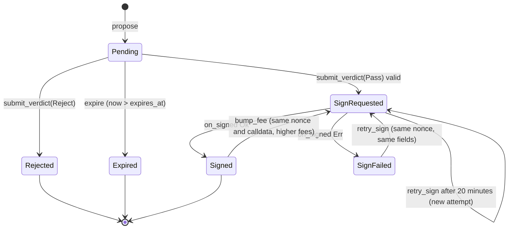

# CONSTITUTION: smart contract specification

**Status: production gate NOT DEPLOYED; not audited.** This is the protocol contract between the gate, executor, verifier, CLI, page and tests. Local and spike-testnet evidence is labeled below; it is not production activation evidence. Production deployment is recorded only after observed addresses, transaction hashes and reproducible code hashes are added.

Labels: [V] primary source read 2026-10-26 (sources at the end), [I] design decision of this foundation, [U] unverified until the named spike.

## TL;DR and necessity

| Component | Chain | Role |
| --- | --- | --- |
| `constitution-gate` | NEAR testnet | Holds the constitution (rule-set hash, verifier allowlist, parameters, roles, timelock queue) and proposal state; builds the exact EVM transaction; requests the MPC signature |
| `v1.signer-prod.testnet` | NEAR testnet | Chain Signatures MPC contract (external, not ours) |
| `ConstitutionExecutor` | Base Sepolia (84532) | Deploys and owns the demo proxy's ProxyAdmin; only the gate-derived EOA may call it; enforces certificate single use, deadline, code hash and expected current implementation |
| `TransparentUpgradeableProxy` + `ProxyAdmin` | Base Sepolia | OpenZeppelin Contracts 5.6.1, unmodified |
| `VaultV1`, `VaultV2Honest`, `VaultV2Drain`, `MockToken` | Base Sepolia | Demo implementations and test token |

Why on-chain is essential [I]: the signing authority must live where no person holds a key. A NEAR contract with zero access keys can request MPC signatures for its own derived address; no server or person can. The executor makes the EVM side refuse stale or mismatched signatures, which an EOA alone cannot do.

Guarantee and limit: see PRD "Risks and guarantees" (G1 to G4 and trust assumptions). This spec enforces G1 to G4 mechanically; it cannot make declared rules complete.

## Identities and constants

| Name | Value | Status |
| --- | --- | --- |
| MPC contract | `v1.signer-prod.testnet` | [V] live `public_key` and `config` views 2026-10-26 |
| MPC domain | `domain_id = 0` (ECDSA secp256k1) | [V] MPC README example; spike P1.2 confirms |
| Derivation path | `"constitution/base-sepolia/v1"` | [I] fixed forever for one deployment |
| Derivation | `sha3_256("near-mpc-recovery v0.1.0 epsilon derivation:" + gate_account_id + "," + path)` tweak of the MPC root key | [V] near/mpc `kdf.rs` |
| Derived EOA | `keccak256(uncompressed_pubkey[1..65])[12..32]` | [V] chainsig.js EVM adapter; computed in P1.2 |
| EVM chain id | `84532` | [V] docs.base.org and live `eth_chainId` = `0x14a34` |
| Timelock delay | `Config.governance_delay_days`: 1–30 whole days, default 3 | [I] selected at initialization; immutable thereafter (D20) |
| Certificate domain tag | ASCII `constitution.v1\0`, exactly 16 bytes | [I] |
| ERC-1967 implementation slot | `0x360894a13ba1a3210667c828492db98dca3e2076cc3735a920a3ca505d382bbc` | [V] OZ v5.6.1 `ERC1967Utils.sol`; recomputed locally |
| ERC-1967 admin slot | `0xb53127684a568b3173ae13b9f8a6016e243e63b6e8ee1178d6a717850b5d6103` | [V] same |
| `execute(bytes32,address,bytes32,address,uint64,bytes)` selector | `0x90c70cd8` | [I] computed with a keccak implementation validated against two known vectors; re-checked by test vector T-ENC-1 |
| `rotateSigner(address,bytes32,uint64)` selector | `0xfa2e9b8f` | [I] same method |
| `upgradeAndCall(address,address,bytes)` selector | `0x9623609d` | [I] same method; matches OZ ABI |
| `initializeV2(uint256)` selector | `0x5b4e128c` | [I] same method |

## Gate storage and state machine

Rust, near-sdk 5.29.1, Borsh state. Types live in `crates/constitution-types` (shared with verifier and CLI). Amounts in yoctoNEAR are `u128` (JSON `U128` string); EVM wei are `u128` (JSON string); times on NEAR are nanoseconds `u64`, times inside certificates and EVM calls are Unix seconds `u64`.

```rust
pub struct Gate {
    config: Config,                                   // immutable after init
    constitution: Constitution,                       // changes only via timelock
    roles: Roles,                                     // changes only via timelock
    verifiers: IterableMap<[u8; 32], VerifierRecord>, // key = Ed25519 public key
    changes: IterableMap<u64, PendingChange>,
    proposals: LookupMap<u64, Proposal>,
    active_by_account: LookupMap<AccountId, u64>,
    active_by_key: LookupMap<[u8; 32], u64>,         // sha256(account_length || proposer || new_impl_codehash || init_calldata), for E24
    outstanding_signatures: IterableSet<u64>,         // proposals in SignRequested, SignFailed or Signed; the only set D13 iterates
    fee_bumps: LookupMap<u64, u8>,                    // per-proposal bump count, independent of retries (cap 8)
    migration_signing: LookupMap<u64, MigrationSigning>, // InFlight | Failed | Signed for applied MigrateAuthority changes
    credit: LookupMap<AccountId, u128>,               // unreserved yoctoNEAR
    total_liabilities: u128,                          // free credit + active reservations; pending transfers are debited, restored on failure
    pending_withdrawals: u128,                        // contingent failed-transfer refunds; reserved until callback settlement
    pending_changes: Vec<u64>,                       // at most 8 Pending changes, no historical scan
    sign_requested_at: LookupMap<u64, u64>,           // latest proposal request timestamp, ns
    migration_requested_at: LookupMap<u64, u64>,       // latest migration request timestamp, ns
    migration_fee_bumps: LookupMap<u64, u8>,           // per-migration cap of 8, independent of retries
    next_proposal_id: u64,
    next_change_id: u64,
    next_evm_nonce: u64,                              // derived EOA nonce the gate will assign next
    signing_paused: bool,
    paused_at_ns: Option<u64>,                        // latest guardian pause or renewal, NEAR nanoseconds
}

pub struct Config {
    chain_id: u64,              // 84532
    executor: [u8; 20],
    proxy: [u8; 20],            // read from executor at deployment, recorded here
    proxy_admin: [u8; 20],
    derived_eoa: [u8; 20],
    mpc_account: AccountId,     // v1.signer-prod.testnet
    mpc_path: String,           // "constitution/base-sepolia/v1"
    mpc_domain_id: u32,         // 0
    governance_delay_days: u32, // 1..=30 whole days; serde omission defaults to 3
}

pub struct Constitution {
    rule_set_hash: [u8; 32],    // sha256 of canonical manifest bytes (ARCHITECTURE "Rule-set manifest")
    manifest_uri: String,       // <= 256 bytes, informational
    ai_required: bool,          // true in the demo rule set
    params: Params,
}

pub struct Params {
    proposal_deposit: u128,          // yoctoNEAR reserved per proposal (D3)
    proposal_ttl_s: u64,             // initial 7_200 [I]
    max_cert_ttl_s: u64,             // initial 1_800 [I]
    sign_validity_s: u64,            // EVM deadline window after signing, initial 3_600 [I]
    gas_limit: u64,                  // from spike P1.4 (D14)
    max_fee_per_gas: u128,           // wei, from spike P1.4
    max_priority_fee_per_gas: u128,  // wei, from spike P1.4
    fee_cap: u128,                   // wei, upper bound for bumped max_fee_per_gas
    sign_gas_tgas: u64,              // >= 15 (live MPC config minimum), from spike P1.2
    callback_gas_tgas: u64,          // from spike P1.2
}

pub struct Roles { governor: AccountId, guardian: AccountId }

pub struct VerifierRecord {
    release_hash: [u8; 32],     // sha256 over measured identity (ARCHITECTURE "Verifier identity")
    attestation_uri: String,    // where quote, collateral and event log are published
    added_at_ns: u64,
}

pub enum ProposalState { Pending, Rejected, Expired, SignRequested, Signed, SignFailed }

pub struct Proposal {
    id: u64,
    proposer: AccountId,
    created_at_ns: u64,
    expires_at_ns: u64,               // created_at + proposal_ttl_s
    rule_set_hash: [u8; 32],          // active hash at proposal time
    new_impl: [u8; 20],
    new_impl_codehash: [u8; 32],      // keccak256 of runtime bytecode
    expected_current_impl: [u8; 20],
    init_calldata: Vec<u8>,           // <= 1024 bytes
    source_commitment: [u8; 32],      // sha256 of sealed source bundle plaintext
    reserved: u128,
    state: ProposalState,
    certificate_hash: Option<[u8; 32]>,
    rejection: Option<Rejection>,     // { rule_id: u8, reason_code: u16, evidence_root: [u8; 32] }
    evm: Option<EvmTx>,
}

pub struct EvmTx {
    nonce: u64,
    deadline_s: u64,
    gas_limit: u64,
    max_fee_per_gas: u128,
    max_priority_fee_per_gas: u128,
    signing_hash: [u8; 32],           // keccak256(0x02 || rlp(...)), see "Exact EVM transaction"
    signed_tx: Option<Vec<u8>>,       // raw type-2 bytes once signed
    attempts: u32,
}

pub enum ChangeKind {
    SetRuleSet { rule_set_hash: [u8; 32], manifest_uri: String, ai_required: bool },
    AddVerifier { pubkey: [u8; 32], release_hash: [u8; 32], attestation_uri: String },
    RemoveVerifier { pubkey: [u8; 32] },
    SetParams { params: Params },
    SetGovernor { account: AccountId },
    SetGuardian { account: AccountId },
    MigrateAuthority { new_signer: [u8; 20] },
    Unpause,
}

pub enum ChangeStatus { Pending, Applied, Cancelled }

pub struct PendingChange {
    id: u64, kind: ChangeKind, scheduled_by: AccountId,
    scheduled_at_ns: u64, eta_ns: u64, status: ChangeStatus,
    evm: Option<EvmTx>,               // only for MigrateAuthority
}
```

Proposal transitions (no others exist):



Reservation release: `Rejected`, `Expired` and the first entry into `Signed` return `reserved` to the proposer's credit and clear `active_by_account`. `SignFailed` keeps the proposal active because its EVM nonce is reserved: the nonce must still be filled by a signature of the identical transaction (see "Nonce discipline").

[I] Storage solvency: `total_liabilities` is exactly free credit plus proposal reservations. Deposits increase it; reservation/release preserve it; the non-refundable proposal storage debit decreases it; withdrawal dispatch decreases it and a failed-transfer callback restores it. `pending_withdrawals` separately reserves a bounded part of each in-flight refund (capped at 16,384 bytes of storage cost, see the tradeoff below) until the transfer callback settles, so unpaid growth cannot consume a refund that arrives before its callback. All storage-growing synchronous methods flush deferred SDK writes and persist the root before checking `account_balance - storage_byte_cost * storage_usage >= total_liabilities + pending_withdrawals`, additionally subtracting outgoing transfer/MPC deposits before dispatch. Insufficient operating funds reject atomically with `E12_STORAGE_INSOLVENT`. Signing callbacks preflight raw transaction growth against the same backing requirement and record SignFailed rather than panic on insufficient storage funds; late callbacks never reallocate a D13 index already pruned after deadline/timeout. Historical proposals remain stored and are paid by the propose fee below; change bodies are deleted when they finish.

[I] Storage metering (security review N2, function-call-key correction 2026-11-05): permanent records are prepaid by their creator. A **new credit entry** costs `(80 + len(account_id)) * storage_byte_cost`, deducted once from that account's first `deposit_credit` (`E61_STORAGE_FEE` unless the deposit exceeds the fee; view `get_credit_entry_fee(account)`); the fee is not credit and not a liability. `propose` requires **zero attached deposit**, so a method-restricted function-call key can use funded credit (`E61_STORAGE_FEE` for nonzero attachment, after other validations). Before mutation, credit must cover the checked sum of `proposal_deposit` plus `4096 * storage_byte_cost` (view `get_proposal_fee`); insufficient credit or arithmetic overflow gives `E11`. The storage fee is permanently debited from free credit and `total_liabilities`; only `proposal_deposit` is reserved and refundable. The fee funds the proposal record (previous measured maximum: 1,421 B Pending, 2,950 B after Signed, within 4,096 B). `get_required_credit` still returns the refundable reservation alone; a caller must add `get_proposal_fee` to determine its funding requirement. Governance changes cost the governor nothing but are bounded: at most 8 Pending in total and, per kind, 1 for MigrateAuthority/SetGuardian/SetGovernor and 2 for every other kind; the body of a change is deleted on `cancel_change` and on a non-migration `apply_change`, so terminal changes leave no storage and `get_change` returns `None` / later calls give `E52_NOT_FOUND`. A migration body is kept because its signed transaction can still be re-requested or fee-bumped.

[I] Operating limit: only plain NEAR transfers can top up the keyless gate; `deposit_credit` is not an operating top-up because credited funds create an equal user liability. `get_operating_surplus()` returns liquid balance (after the storage stake) minus `total_liabilities + pending_withdrawals`, or 0 when exhausted. Unpaid storage growth fails closed with `E12_STORAGE_INSOLVENT`; a prepaid proposal can still succeed at zero prior surplus because its permanent fee debit funds the record. Permissionless writes (deposit, propose, expire, retry, bump) pay their own storage, so an unprivileged loop does not consume the surplus; residual consumers are governor/guardian actions (bounded by the caps above), MPC request deposits of 1 yoctoNEAR, and the conservative withdrawal reserve. The ceremony funds an operating surplus before key deletion and the audit checks it (see Deployment).

[I] Withdrawal reserve tradeoff (review R3-1): `withdraw_credit` first checks `assert_solvent(amount)` against the balance as it is at the call (so a withdrawal at exactly full backing succeeds), and only then adds `min(amount, 16,384 * storage_byte_cost)` to `pending_withdrawals` (0.16 NEAR at 10^19 yoctoNEAR per byte); the callback releases the same capped amount. The reserve only has to cover the unpaid storage growth (governor changes, migration bodies) that could happen between a refund arriving and its callback, so the cap keeps the window from blocking writes: reserving the full amount would let any depositor holding more than the operating surplus open repeated `E12` windows. Consequence: for an in-flight amount above the cap, a refund that arrives before its callback could be partly consumed by unpaid growth in those two blocks (a few hundred bytes of governor changes at most), leaving that much of a refunded credit unbacked; this is a stated limit, bounded far below the 1 NEAR operating minimum. A successful callback releases the reserve; a failed callback converts it back to user liability.

[I] Parameter bounds (enforced by `new`, `schedule_change`, and revalidated at apply): `sign_gas_tgas` 15..=200, `callback_gas_tgas` 10..=100, sum <=250 Tgas (leaves 50 Tgas of a 300-Tgas transaction for gate work); `max_cert_ttl_s` 30..=86,400; `sign_validity_s` 60..=86,400; `proposal_ttl_s` 300..=604,800; `gas_limit > 0`; `max_priority_fee_per_gas <= max_fee_per_gas <= fee_cap`. The 10-Tgas callback floor is conservative headroom over the spike's observed 1.36 Tgas, not a production callback gas measurement; the committed 20 Tgas remains valid. D14 gas/fee values remain valid. Bounded seconds and checked timestamp additions prevent overflow; fee bump arithmetic remains checked.

## Public interfaces

All methods are `#[near]`; JSON arguments unless marked Borsh. "Anyone" means any account, including a function-call key with no deposit. Every rejection panics with the listed code prefix so receipts and tests can match exactly.

### Initialization (once)

`#[init] new(config: Config, constitution: Constitution, roles: Roles, verifiers: Vec<(Base64 [u8;32] pubkey, VerifierRecord)>, initial_evm_nonce: u64) -> Self`

- Called in the same batch transaction as the code deploy. Validates chain/MPC identity, non-zero addresses, parameter bounds above, nonempty verifier set, nonzero verifier `release_hash`, unique verifier keys and URI lengths; invalid input is `E51_INVALID_CHANGE`. Omitted `config.governance_delay_days` defaults to 3; explicit 0 or 31 is rejected with `E51_INVALID_CHANGE`.
- No method exists to deploy code, add or delete keys, delete the account or call arbitrary functions on itself (D6). Rehearse user-facing E2E and audit first; deleting every gate access key requires fresh founder authorization (D21), followed by final audit and essential live checks.

### Proposer and credit

| Method | Caller | Effects | Rejections |
| --- | --- | --- | --- |
| `#[payable] deposit_credit(account: Option<AccountId>)` | anyone | Adds the attached yoctoNEAR to credit and liabilities; on a recipient with no credit entry the entry fee is deducted first and is not credit | `E10_ZERO_DEPOSIT`, `E61_STORAGE_FEE` (first deposit does not exceed the entry fee), `E11_INSUFFICIENT_CREDIT` on arithmetic overflow, `E12_STORAGE_INSOLVENT` |
| `withdraw_credit(amount: U128)` | credit owner | Checks solvency at the call, then debits free credit/liabilities and reserves the in-flight amount before the transfer; private callback restores credit and liabilities if the transfer fails | `E11_INSUFFICIENT_CREDIT`, `E12_STORAGE_INSOLVENT` |
| `#[private] on_withdraw_credit(account: AccountId, amount: U128) -> bool` | gate only | Successful transfer: true, no credit change. Failed transfer: re-credit refunded amount, restore liability, return false | no caller-controlled invocation |
| `#[payable] propose(args: ProposeArgs) -> u64` | anyone (allowed while signing paused) | Requires zero attached deposit; credit covers reservation plus storage fee; permanently debits the fee from credit/liabilities, reserves `proposal_deposit`, stores Pending bound to active rules | `E21_ACTIVE_PROPOSAL_EXISTS`, `E11_INSUFFICIENT_CREDIT` (including checked-sum overflow), `E22_INIT_CALLDATA_TOO_LONG` (>1024), `E23_ZERO_ADDRESS`, `E24_DUPLICATE_ACTIVE` (same proposer, codehash and calldata active), `E61_STORAGE_FEE` (nonzero attached deposit), `E12_STORAGE_INSOLVENT` |
| `expire(proposal_id: u64)` | anyone | Pending past expiry becomes Expired; releases reservation | `E30_NOT_FOUND`, `E31_WRONG_STATE`, `E32_NOT_EXPIRED`, `E12_STORAGE_INSOLVENT` |

`ProposeArgs { new_impl: Hex20, new_impl_codehash: Hex32, expected_current_impl: Hex20, init_calldata: Hex, source_commitment: Hex32 }`. Hex fields are lowercase `0x`-prefixed, exact length.

### Verdict delivery and signing

`submit_verdict(certificate: Base64<Borsh Certificate>, signature: Base64 [u8; 64]) -> PromiseOrValue<ProposalView>`, caller: anyone.

Check order (first failure panics, nothing is written):

1. Decode Borsh; trailing bytes rejected. `E40_BAD_ENCODING`.
2. `certificate.domain == b"constitution.v1\0"` and `certificate.gate == env::current_account_id()`. `E41_WRONG_DOMAIN`.
3. `verifiers` contains `verifier_pubkey` and its `release_hash == certificate.verifier_release_hash`. `E42_UNKNOWN_VERIFIER`.
4. `message = env::sha256_array(borsh_bytes)`; `env::ed25519_verify(&signature, message, &verifier_pubkey)`. `E43_BAD_SIGNATURE`.
5. Proposal exists and is `Pending`; `now_ns <= expires_at_ns`. `E30_NOT_FOUND`, `E31_WRONG_STATE`, `E44_PROPOSAL_EXPIRED`.
6. Binding: `chain_id`, `proxy`, `executor` equal `config`; `new_impl`, `new_impl_codehash`, `source_commitment` equal the proposal; `current_impl == proposal.expected_current_impl`; `init_calldata_hash == keccak256(proposal.init_calldata)`; `rule_set_hash == proposal.rule_set_hash == constitution.rule_set_hash`. `E45_BINDING_MISMATCH` with the field name.
7. Time: `issued_at_s <= now_s + 60`, `now_s <= expires_at_s`, `expires_at_s - issued_at_s <= max_cert_ttl_s`. `E46_CERT_TIME`.
8. Verdict:
   - `Reject { rule_id, reason_code }`: store `rejection`, `certificate_hash = message`, state `Rejected`, release reservation, emit `verdict_rejected`. Return. The MPC contract is never called.
   - `Pass`: requires `ai != Vetoed` always, and `ai == Clean { .. }` when `constitution.ai_required` (`E47_AI_REVIEW_REQUIRED`). Every Clean review must have `signature_kind == 1` (`E58_AI_SIGNATURE_KIND`), even if AI is optional. Requires `!signing_paused` (`E20_SIGNING_PAUSED`). Continue.
9. Assign `nonce = next_evm_nonce; next_evm_nonce += 1`. Build `EvmTx` from params with `deadline_s = min(certificate.expires_at_s, now_s + sign_validity_s)`. Compute `signing_hash` (next section). Store, set `SignRequested`, `certificate_hash = message`, emit `sign_requested`.
10. Return `Promise` to `mpc_account.sign({"request":{"payload_v2":{"Ecdsa":"<hex signing_hash, no 0x>"},"path":"constitution/base-sepolia/v1","domain_id":0}})` with 1 yoctoNEAR from the gate's own balance and `sign_gas_tgas`, `.then(on_signed(proposal_id, attempts))` with `callback_gas_tgas`.

| Method | Caller | Effects | Rejections |
| --- | --- | --- | --- |
| `#[private] on_signed(target: SignTarget, attempt: u32)` | gate only | Reads the raw MPC result (max 4096 bytes) and parses inside the callback. It validates the signature against the reconstructed transaction digest and configured derived EOA before producing raw bytes. Ok: state `Signed`, release the reservation only if `active_by_account[proposer]` still names this proposal, emit `signed`. Err: state `SignFailed`, emit `sign_failed`. Stale `attempt` is ignored with a log | never panics after logging |
| `retry_sign(proposal_id: u64)` | anyone | SignFailed or SignRequested at least 20 minutes after its latest request becomes SignRequested; identical transaction, incremented attempt; late original callback ignored | `E31_WRONG_STATE`, `E20_SIGNING_PAUSED`, `E45_BINDING_MISMATCH rule_set_hash` unless `now_s > stored deadline_s` (equality is still executable on EVM), `E12_STORAGE_INSOLVENT` |
| `bump_fee(target: SignTarget)` | anyone | Signed proposal or migration only, and only once `MIN_BUMP_AGE` = 600 s has passed since its latest signing request (a stuck-transaction proxy; N11); both fees increase by 25% rounded up, max fee <= cap; same nonce/deadline/calldata; at most 8 per target; old raw tx survives failure | `E30_NOT_FOUND` / `E52_NOT_FOUND`, `E31_WRONG_STATE`, `E20_SIGNING_PAUSED`, `E45` for proposals as for retry, `E62_BUMP_TOO_EARLY`, `E48_FEE_CAP`, `E49_TOO_MANY_BUMPS`, `E12_STORAGE_INSOLVENT` |

`SignTarget` is `Proposal(u64)` or `Change(u64)`. [I] The minimal accepted MPC response is `{"scheme":"Secp256k1","big_r":{"affine_point":"<33-byte compressed lowercase hex>"},"s":{"scalar":"<32-byte lowercase hex>"},"recovery_id":<0 or 1>}`; extra fields at the response, `big_r`, and `s` levels are ignored. Required fields, scheme, lengths, scalar ranges, low-s and parity remain strict. The gate recovers secp256k1 over the keccak256 hash of the reconstructed EIP-1559 preimage and requires the resulting address to equal `config.derived_eoa` before emitting or storing a signed transaction. [V, NEAR testnet 2026-11-02] The earlier spike captured this required shape in `vectors/mpc-response.json`; this is not a claim about any later deployed MPC schema.

[I] The pinned MPC account, `payload_v2/Ecdsa` request, domain, path and 1-yocto deposit remain external compatibility and availability dependencies. A change to them, an incompatible response shape or insufficient callback gas can halt both upgrades and authority migration after key deletion. Recovery cost and callback gas for this implementation require measurement before freeze; the historical spike callback cost below does not measure this implementation.

### Governance

| Method | Caller | Effects | Rejections |
| --- | --- | --- | --- |
| `schedule_change(kind: ChangeKind) -> u64` | governor | Pending queue capped at 8 total; per kind at most 1 Pending MigrateAuthority/SetGuardian/SetGovernor and at most 2 Pending of every other kind; `eta_ns` is checked `now_ns + governance_delay_days * 86_400 * 1_000_000_000` | `E50_NOT_GOVERNOR`, `E51_INVALID_CHANGE`, `E59_PENDING_CHANGE_LIMIT`, `E60_DUPLICATE_AUTHORITY_CHANGE` (per-kind cap), `E12_STORAGE_INSOLVENT` |
| `apply_change(change_id: u64)` | anyone | Applies after eta and deletes the change body (a migration body stays for re-request/bump). An Unpause must have been scheduled strictly after the latest guardian pause or renewal; equal timestamps favor the pause. Migration assigns one nonce and signs rotateSigner; applied Failed or timed-out InFlight migration can re-request identical bytes | `E52_NOT_FOUND`, `E53_TIMELOCK_NOT_ELAPSED`, `E54_NOT_PENDING`, `E51_INVALID_CHANGE` (stale Unpause), `E55_SIGNATURES_OUTSTANDING`, `E12_STORAGE_INSOLVENT` |
| `cancel_change(change_id: u64)` | guardian | Deletes a Pending change body; frees queue slot | `E56_NOT_GUARDIAN`, `E52_NOT_FOUND` (also for an already terminal change), `E54_NOT_PENDING` |
| `cancel_changes(ids: Vec<u64>)` | guardian | At most 8 unique IDs; validates entire batch before cancelling; only reduces authority | `E56_NOT_GUARDIAN`, `E59_PENDING_CHANGE_LIMIT`, `E51_INVALID_CHANGE` (duplicate IDs), `E52_NOT_FOUND`, `E54_NOT_PENDING` |
| `pause_signing()` | guardian | `signing_paused = true` immediately and records `paused_at_ns`, including on renewal | `E56_NOT_GUARDIAN` |
| `remove_verifier_now(pubkey: Base64 [u8;32])` | guardian | Removes immediately; only reduces authority | `E56_NOT_GUARDIAN`, `E57_LAST_VERIFIER` |

Unpausing, adding verifiers, rule changes, parameter changes, role changes and authority migration are timelocked. The duration is immutable after initialization, including through `SetParams`; changing it requires a new gate and the existing timelocked authority migration. Ordinary certified vault upgrades do not wait for this delay. The governor cannot cancel (D17), so a leaked governor key can only create publicly visible pending changes.

### Views

`get_config`, `get_constitution`, `get_roles`, `is_signing_paused() -> bool`, `get_total_liabilities() -> U128`, `get_proposal_fee() -> U128`, `get_required_credit() -> U128`, `get_credit_entry_fee(account) -> U128`, `get_operating_surplus() -> U128`, `list_verifiers`, `get_proposal(id)`, `list_proposals(from_id, limit <= 50)`, `get_change(id)`, `list_changes(from_id, limit <= 50)` (live changes in id order; ids are sparse after deletion), `get_credit(account)`, `get_active(account)`, `signing_preimage(proposal_id) -> Hex`. ABI allowlist: 34 methods including generated `contract_source_metadata`; both callbacks are private. Audit uses roles/pause, `get_operating_surplus` and paginated `list_changes` without another authority-expanding method.

### Panic-code table

Codes are stable receipt prefixes; the four new codes are gate-private (the shared types crate is unchanged).

| Code | Meaning |
| --- | --- |
| `E10_ZERO_DEPOSIT` | Credit funding attached zero |
| `E11_INSUFFICIENT_CREDIT` | Insufficient unreserved credit or credit arithmetic overflow |
| `E12_STORAGE_INSOLVENT` | Post-write liquid balance, less outgoing transfer/deposit, cannot cover liabilities plus contingent withdrawal reserves |
| `E20_SIGNING_PAUSED` | Guardian paused a signature-creating action |
| `E21_ACTIVE_PROPOSAL_EXISTS` | This proposer already has an active reservation |
| `E22_INIT_CALLDATA_TOO_LONG` | Initializer exceeds 1,024 bytes |
| `E23_ZERO_ADDRESS` | Proposal implementation address is zero |
| `E24_DUPLICATE_ACTIVE` | This proposer already has this active codehash/calldata key (other proposers cannot squat it) |
| `E30_NOT_FOUND` | Proposal does not exist |
| `E31_WRONG_STATE` | Proposal/target state is invalid for this action, including a retry before request timeout |
| `E32_NOT_EXPIRED` | Proposal expiry has not passed |
| `E40_BAD_ENCODING` | Certificate Borsh is malformed or has trailing bytes |
| `E41_WRONG_DOMAIN` | Certificate domain or gate differs |
| `E42_UNKNOWN_VERIFIER` | Certificate key/release is not registered |
| `E43_BAD_SIGNATURE` | Certificate Ed25519 signature is invalid |
| `E44_PROPOSAL_EXPIRED` | Proposal expired before certificate submission |
| `E45_BINDING_MISMATCH` | Certificate/stored rule or transaction binding differs |
| `E46_CERT_TIME` | Certificate time window or maximum TTL is invalid |
| `E47_AI_REVIEW_REQUIRED` | Required Clean review is absent, or Pass is Vetoed |
| `E48_FEE_CAP` | Fee increase overflows or exceeds the timelocked cap |
| `E49_TOO_MANY_BUMPS` | Eight fee bumps exhausted or attempt counter overflowed |
| `E50_NOT_GOVERNOR` | Scheduler is not governor |
| `E51_INVALID_CHANGE` | Invalid initialization/change/parameter/URI/address, zero release hash, duplicate batch ID, bounded arithmetic overflow, or Unpause scheduled no later than the latest pause |
| `E52_NOT_FOUND` | Governance change does not exist |
| `E53_TIMELOCK_NOT_ELAPSED` | Applying before the selected immutable eta |
| `E54_NOT_PENDING` | Change is not Pending and is not a retryable applied migration |
| `E55_SIGNATURES_OUTSTANDING` | Rule change is unsafe while an upgrade signature deadline/request is outstanding |
| `E56_NOT_GUARDIAN` | Immediate restrictive action caller is not guardian |
| `E57_LAST_VERIFIER` | Would remove the last registered verifier |
| `E58_AI_SIGNATURE_KIND` | Clean review is not provider_tee kind 1 |
| `E59_PENDING_CHANGE_LIMIT` | Eight Pending changes already queued, or cancellation batch exceeds eight |
| `E60_DUPLICATE_AUTHORITY_CHANGE` | Per-kind pending cap reached (1 for an authority kind, 2 for any other kind) |
| `E61_STORAGE_FEE` | Credit entry fee not covered by the first deposit, or `propose` attached a nonzero deposit instead of paying from prepaid credit |
| `E62_BUMP_TOO_EARLY` | Fewer than 600 s since the latest signing request of this target |


### Events

NEP-297 log lines `EVENT_JSON:{"standard":"constitution","version":"1.0.0","event":<name>,"data":[...]}` with names: `proposal_created`, `verdict_rejected`, `sign_requested`, `signed`, `sign_failed`, `proposal_expired`, `change_scheduled`, `change_applied`, `change_cancelled`, `signing_paused`, `verifier_removed`. Every event carries `proposal_id` or `change_id`; hashes are lowercase hex with `0x`.

## Certificate

```rust
pub struct Certificate {           // Borsh field order is canonical
    pub domain: [u8; 16],          // b"constitution.v1\0"
    pub gate: AccountId,
    pub proposal_id: u64,
    pub attempt: u32,              // verifier run counter for this proposal
    pub chain_id: u64,
    pub proxy: [u8; 20],
    pub executor: [u8; 20],
    pub current_impl: [u8; 20],
    pub current_impl_codehash: [u8; 32],
    pub new_impl: [u8; 20],
    pub new_impl_codehash: [u8; 32],
    pub init_calldata_hash: [u8; 32],   // keccak256(init_calldata)
    pub source_commitment: [u8; 32],
    pub rule_set_hash: [u8; 32],
    pub verifier_pubkey: [u8; 32],
    pub verifier_release_hash: [u8; 32],
    pub evidence_block_number: u64,
    pub evidence_block_hash: [u8; 32],
    pub evidence_root: [u8; 32],        // sha256 of canonical evidence manifest (ARCHITECTURE)
    pub ai: AiReview,
    pub verdict: Verdict,
    pub issued_at_s: u64,
    pub expires_at_s: u64,
}
pub enum AiReview {
    Clean { evidence_hash: [u8; 32], signature_kind: u8 },   // 1 = provider_tee, 2 = gateway
    Vetoed { evidence_hash: [u8; 32], counterexample_hash: [u8; 32] },
    NotRun,
}
pub enum Verdict { Pass, Reject { rule_id: u8, reason_code: u16 } }
```

- `certificate_hash = sha256(borsh(certificate))`; the verifier signs these 32 bytes with Ed25519; the same 32 bytes are the EVM `certId`.
- Every `AiReview::Clean` attached to Pass must have `signature_kind = 1` (`provider_tee`); the gate rejects every other kind with `E58_AI_SIGNATURE_KIND`. The verifier separately enforces the committed rule set and verifies provider TEE evidence; the gate checks the authenticated certificate field, not the inference attestation itself.
- `Verdict::Pass` with `AiReview::Vetoed` is invalid and the verifier never emits it; the gate additionally rejects it under `E47_AI_REVIEW_REQUIRED` because `Vetoed` is not `Clean`.

Rule ids and reason codes (shared enum in `constitution-types`):

| rule_id | Rule | reason_code examples |
| --- | --- | --- |
| 0 | Pre-check | 1 source hash mismatch, 2 compiled runtime hash != `new_impl_codehash`, 3 current impl on chain != `expected_current_impl`, 4 reserved harness/reference source modified or missing, or current impl source does not reproduce on-chain runtime |
| 1 | R1 storage layout | 10 incompatible layout, 11 reference layout missing |
| 2 | R2 bounded aggregate solvency and slot preservation | 20 bounded counterexample found, 21 fuzz counterexample, 22 AI counterexample reproduced, 23 explicit solver incomplete (fails closed); verifier/tool faults withhold certificates |
| 3 | R3 opcode, literal slot/address and label filter | 30 forbidden opcode, 31 committed slot/±1 neighbor, Foundry/Halmos cheatcode address, or ERC-1967 ASCII label present |
| 4 | R4 initializer | 40 selector not allowlisted, 41 argument out of schema |
| 5 | R5 differential replay | 50 behavior diverged, 51 witness incomplete (fails closed) |
| 6 | AI review | none on-chain: an incomplete required review is not a rejection; the verifier emits no certificate and the proposal stays `Pending` until retried or expired |

## Exact EVM transaction

The gate builds, never accepts, every byte. omni-transaction 0.5.0, EVM feature only [V API names]:

```text
TransactionBuilder::new::<EVM>()
  .chain_id(84532)
  .nonce(evm.nonce)
  .max_priority_fee_per_gas(evm.max_priority_fee_per_gas)
  .max_fee_per_gas(evm.max_fee_per_gas)
  .gas_limit(evm.gas_limit as u128)
  .to(config.executor)
  .value(0)
  .input(calldata)
  .access_list(vec![])
  .build()
signing_hash = keccak256(tx.build_for_signing())          // 0x02 || rlp([...]) per EIP-1559
raw          = tx.build_with_signature(&signature)
```

Calldata for a proposal (`0x90c70cd8` = `execute(bytes32,address,bytes32,address,uint64,bytes)`):

```text
execute(
  certId              = certificate_hash,
  newImpl             = proposal.new_impl,
  newImplCodehash     = proposal.new_impl_codehash,
  expectedCurrentImpl = proposal.expected_current_impl,
  deadline            = evm.deadline_s,
  initCalldata        = proposal.init_calldata)
```

Calldata for `MigrateAuthority` (`0xfa2e9b8f` = `rotateSigner(address,bytes32,uint64)`): `rotateSigner(new_signer, changeId = sha256("constitution.v1/change" || borsh(gate account) || change_id_le), deadline)`.

ABI encoding is standard Solidity head/tail encoding via `alloy-sol-types` 1.7.3, which builds for the gate wasm (spike P1.1, 2026-11-02: 137,861-byte spike wasm, no size blocker); a hand encoder exists only as a test oracle and the T-ENC vectors cross-check it against viem.

### Nonce discipline

- The derived EOA is used only by this gate. The gate assigns nonces strictly increasing at first signing request and never assigns a nonce to different calldata.
- An unsigned or unbroadcast nonce blocks later ones. Remedies, all permissionless: `retry_sign` (same bytes), `bump_fee` (same calldata, higher fees, after 600 s), and relaying the emitted raw transaction. An expired executor call still lands and reverts with `DeadlinePassed`, which consumes the nonce safely.
- [I] Liveness limit (review N15, stated next to G3): nonces are assigned at certification. If a certified transaction is never mined (nobody relays it, or the derived EOA has no ETH), later nonces stay behind that gap. Relaying is permissionless and a reverted transaction still consumes the nonce, so the project relayer unblocks it while the derived EOA is funded. Nothing here can cause a signature without a certificate; the cost is delay.
- `initial_evm_nonce` is read from Base Sepolia at activation (must equal the EOA's confirmed nonce, normally 0) and recorded in this document.

## ConstitutionExecutor (Solidity, Base Sepolia)

`pragma solidity 0.8.38;` OpenZeppelin Contracts 5.6.1. Not upgradeable, not Ownable, no `receive`, no `fallback`.

```solidity
contract ConstitutionExecutor {
    ITransparentUpgradeableProxy public immutable proxy;
    ProxyAdmin public immutable proxyAdmin;
    address public signer;                       // gate-derived EOA
    address public currentImplementation;        // tracked, see limits
    mapping(bytes32 => bool) public usedCertificate;
    mapping(bytes32 => bool) public usedChange;

    event UpgradeExecuted(bytes32 indexed certId, address indexed previousImplementation, address indexed newImplementation, bytes32 newImplementationCodehash);
    event SignerRotated(bytes32 indexed changeId, address indexed previousSigner, address indexed newSigner);

    error NotSigner(address caller);
    error CertificateAlreadyUsed(bytes32 certId);
    error ChangeAlreadyUsed(bytes32 changeId);
    error DeadlinePassed(uint64 deadline, uint256 timestamp);
    error ImplementationHasNoCode(address implementation);
    error CodehashMismatch(bytes32 expected, bytes32 actual);
    error CurrentImplementationMismatch(address expected, address actual);
    error ZeroAddress();
    error BootstrapMismatch(address computedAdmin);

    constructor(address signer_, address initialImplementation, bytes memory initData);
    function execute(bytes32 certId, address newImpl, bytes32 newImplCodehash, address expectedCurrentImpl, uint64 deadline, bytes calldata initCalldata) external;
    function rotateSigner(address newSigner, bytes32 changeId, uint64 deadline) external;
}
```

Constructor (atomic bootstrap, no leftover authority):

1. Reject zero `signer_` or `initialImplementation`.
2. `proxy = new TransparentUpgradeableProxy(initialImplementation, address(this), initData)`. [V] OZ 5.6.1: the proxy constructor creates its own `ProxyAdmin(initialOwner)`.
3. `proxyAdmin = address(uint160(uint256(keccak256(abi.encodePacked(bytes1(0xd6), bytes1(0x94), address(proxy), bytes1(0x01))))))`, the CREATE address of the proxy's first deployment (contract nonce starts at 1, EIP-161). Then require `ProxyAdmin(proxyAdmin).owner() == address(this)`, else `BootstrapMismatch`. [I] P1.3 verifies the computation against the `AdminChanged` event.
4. `currentImplementation = initialImplementation`; `signer = signer_`.

`execute` check order: `msg.sender == signer` (`NotSigner`); `!usedCertificate[certId]`; `block.timestamp <= deadline`; `newImpl.code.length > 0`; `newImpl.codehash == newImplCodehash`; `currentImplementation == expectedCurrentImpl`. Effects before interaction: `usedCertificate[certId] = true`, `previous = currentImplementation`, `currentImplementation = newImpl`. Interaction: `proxyAdmin.upgradeAndCall(proxy, newImpl, initCalldata)` with zero value. Emit `UpgradeExecuted`. Any revert undoes everything; an included reverted transaction still consumes the EOA nonce.

`rotateSigner` check order: `msg.sender == signer`; `!usedChange[changeId]`; `block.timestamp <= deadline`; `newSigner != address(0)`. Effects: mark used, set signer, emit `SignerRotated`.

Limits [I]: `currentImplementation` is the executor's record, not a read of the proxy slot (OZ 5.6.1 ProxyAdmin has no implementation getter [V]). G1 holds against implementations that cannot write arbitrary proxy storage. R3 rejects committed slot literals/±1 neighbors, ERC-1967 ASCII labels and `DELEGATECALL`; it cannot prove the absence of computed-slot `SSTORE`. R2's slot post-condition covers only its declared bounded handlers. A computed write can change the proxy implementation without changing the executor's tracker; `constitution audit` detects an observed divergence with `eth_getStorageAt(proxy, implementation_slot)` but is not a preventive storage-write guard.

## Demo contracts

| Contract | Purpose | Shape |
| --- | --- | --- |
| `MockToken` | Test token `tUSD`, 18 decimals | OZ ERC20; `mint(address,uint256)` open to anyone, amount <= 1_000e18 per call (testnet only) |
| `VaultV1` | Protected vault | OZ Initializable, ERC-7201 namespaced storage `constitution.storage.Vault`; `initialize(IERC20 token)`; `deposit(uint256)`; `withdraw(uint256)`; `balanceOf(address)`; `totalDeposits()`; events `Deposited`, `Withdrawn` |
| `VaultV2Honest` | Legitimate upgrade | Appends `depositCap` to the namespaced struct; `initializeV2(uint256 cap)` `reinitializer(2)`; deposits beyond cap revert `DepositCapExceeded` |
| `VaultV2Drain` | Hidden backdoor | Same public surface and `initializeV2(uint256)` signature as honest V2, framed as a fee setting; a hidden path lets one address withdraw the entire vault after a specific multi-step state sequence |

[I] `VaultV2Drain` is a transparent fixture: its source and the exploit sequence are published in the repo after the demo, and the receipt reports truthfully which layer caught it. The committed R2 bound (invariant depth) is part of the manifest and shown on the page. The drain's minimum sequence depth is chosen in P3.1 and stated next to that bound; R2 is never weakened to make the AI look necessary, and if R2 catches it, the receipt says R2 caught it.

## Security and upgrade authority

| Authority | Who holds it | What a thief can do | What a thief cannot do |
| --- | --- | --- | --- |
| Gate account access keys | nobody after activation | nothing | deploy code, add keys, delete account, transfer gate funds |
| Governor (demo: public QR function-call key) | demo account | schedule up to 8 Pending changes, at most one per authority kind, visible for the selected delay | apply early, cancel, sign, propose more than one active proposal per account |
| Guardian | founder | cancel one or a bounded batch of Pending changes, pause signing, remove a verifier | add anything, unpause, sign; apply is permissionless but cannot bypass eta |
| Verifier Ed25519 key | inside measured CVM | sign certificates for the declared rule set until removed; the rules and AI requirement still bound what passes | change rules, verifier set or gate code |
| Verifier relay NEAR key | CVM env, function-call key | submit verdicts (validity comes from the certificate signature) | anything else |
| Deployer EOA on Base | founder | nothing after constructor | upgrade, rotate signer |
| Derived EOA | MPC network for gate account + path | only via MPC network compromise | n/a |
| Proposer accounts | anyone | spend own credit, occupy one active slot | anything else |

[I] The guardian key is liveness-critical: a hostile or compromised guardian can repeatedly pause and cancel Unpause and SetGuardian changes, permanently halting signing and preventing its own replacement after key deletion. This restricts authority rather than bypassing certification.

**Founder decision pending [I] (before final key deletion; owner: founder; affects P2.8):** choose whether to accept this trust assumption, bound each pause by a maximum duration, or require governor-delay unpause only. No option is selected here; the latter two alter the veto/liveness trade-off and require a separately approved behavior change.

Bypass analysis (each item has a test or audit check in "Test matrix"):

1. Replace gate code at the same account: impossible without access keys and without a deploy method (D6). Audit: `gate_has_no_access_keys`, `gate_code_is_committed_build`. Substitute executor code: `executor_code_is_committed_build` compares `eth_getCode` against the committed `executor_runtime_hash` and local Foundry artifact, masking only compiler-declared immutable references; ownership/slot checks still apply. `gate_operating_surplus` fails when `get_operating_surplus` is below 1 NEAR (12 preconditions total; schema and exact offline hash command in ARCHITECTURE “CLI”).
2. New verifier or rules: public queue for the selected delay; guardian can cancel. Audit reads roles, pause state and the full pending-change queue with `eta_ns`; an unplanned MigrateAuthority/AddVerifier/RemoveVerifier/SetRuleSet/SetGuardian/SetGovernor prints named `WARN pending_authority_change` and a loud “pending authority change” summary (WARN exits 0, FAIL exits 1). Exact planned change tuples live in the committed deployment record; a missing view fails closed as `read_failed`.
3. Verifier key extraction from the TEE: residual risk; mitigations are measurement allowlisting, `remove_verifier_now`, short certificate TTL.
4. Stale signature replay: executor deadline and `usedCertificate`.
5. Wrong chain, proxy or calldata: chain id and every field are inside the signed preimage built by the gate.
6. Caller-supplied hash: no method takes a hash to sign.
7. Callback spoofing: `on_signed` is `#[private]`; `submit_verdict` validity is the Ed25519 signature, not the caller.
8. Initializer/storage abuse: R4 allowlist and certificate-bound initializer bytes; R3 rejects literal ERC-1967 implementation/admin slots, their ±1 neighbors, the ASCII labels `eip1967.proxy.implementation` / `eip1967.proxy.admin`, literal Foundry/Halmos cheatcode addresses and forbidden opcodes. R2 additionally checks the proxy implementation slot after each bounded explored deposit/withdraw call on chain id 84532. G1 holds only against implementations that cannot write arbitrary storage: computed-slot `SSTORE` and computed cheatcode addresses can evade these filters, and unsearched entry points remain a limit. Filters are filters, not proofs; the executor's tracker is not a write barrier.
9. Time-of-check versus time-of-use: `expected_current_impl` and code hash checked at execution; proxy storage between evidence block and execution is not frozen (stated limit).
10. Reorg on Base Sepolia: certificate binds evidence block hash; verifier waits for a confirmation depth set in the manifest before evidence is final [I].
11. Authority migration: `MigrateAuthority` is timelocked like everything else.
12. MPC network compromise: out of scope, stated trust assumption.

## Compiler, target and dependencies

| Item | Exact version | Source, observed 2026-10-26 |
| --- | --- | --- |
| near-sdk | 5.29.1 (MSRV 1.93, protocol version 84) | crates.io sparse index; docs.rs manifest |
| cargo-near | 0.22.0 | GitHub release `cargo-near-v0.22.0` |
| Rust toolchain | 1.99.1 host; deployed wasm via `cargo near build reproducible-wasm` image digest recorded at P1.1 | static.rust-lang.org stable channel (2026-10-13) |
| Wasm target | `wasm32-unknown-unknown` | docs.near.org quickstart; cargo-near README |
| omni-transaction | 0.5.0, `default-features = false`, `evm` | crates.io sparse index |
| near-workspaces | 0.23.0 (Linux/WSL2 sandbox) | crates.io sparse index; docs.rs manifest |
| Foundry | v1.8.6 | GitHub latest release |
| solc | 0.8.38 | GitHub latest release (argotorg/solidity) |
| EVM version | `prague` (D19): Base Sepolia runs Osaka, which executes prague bytecode; Halmos 0.3.3 fails on Osaka CLZ `0x1e` | docs.base.org/upgrades/overview and local Halmos probe, 2026-11-02 |
| OpenZeppelin Contracts / Upgradeable | 5.6.1 / 5.6.1 | `npm view` |
| OZ Upgrades Core | 1.47.0 | `npm view` |
| Halmos | 0.3.3, Python >= 3.11 (3.12 selected), z3-solver 4.12.6.0, yices 2.6.4.x | PyPI JSON; GitHub release |

## Test matrix (planned, not run)

Commands are planned interfaces from BUILD-PLAN; none exists yet.

| Id | Layer | Case | Expected |
| --- | --- | --- | --- |
| T-GATE-1 | gate unit | `propose` happy path, then second `propose` by same account | second fails `E21_ACTIVE_PROPOSAL_EXISTS` |
| T-GATE-2 | gate unit | each binding field of a valid certificate mutated (one test per field) | `E45_BINDING_MISMATCH` naming the field |
| T-GATE-3 | gate unit | wrong domain, unknown key, release hash mismatch, bad signature, expired, issued in future, TTL too long | `E41`, `E42`, `E42`, `E43`, `E46`, `E46`, `E46` |
| T-GATE-4 | gate unit | `Pass` with `NotRun` or `Vetoed` when `ai_required` | `E47_AI_REVIEW_REQUIRED` |
| T-GATE-5 | gate unit | `Reject` verdict | state `Rejected`, no promise created, reservation released |
| T-GATE-6 | gate unit | `apply_change` before eta, at eta minus 1 ns, at eta | refused, refused, applied |
| T-GATE-7 | gate unit | governor calls `cancel_change`; guardian calls `schedule_change` | `E56`, `E50` |
| T-GATE-8 | gate unit | `SetRuleSet` apply while a `Signed` proposal has an unexpired deadline | `E55_SIGNATURES_OUTSTANDING` |
| T-GATE-9 | gate unit | `bump_fee` past cap; ninth bump | `E48`, `E49` |
| T-GATE-10 | gate sandbox | `on_signed` with `PromiseError`, then `retry_sign` | `SignFailed`, then same `signing_hash` re-requested |
| T-GATE-11 | gate sandbox | nonce assignment across two passes and one rejection | nonces n, n+1; rejection consumes none |
| T-ENC-1 | cross-language | gate `signing_preimage` vs viem `serializeTransaction` for 6 vectors (empty init, max-length init, fee bump, nonce 0 and large, rotateSigner) | byte-identical; keccak equal |
| T-ENC-2 | cross-language | certificate Borsh bytes and sha256 from Rust vs an independent decoder in the page code | identical |
| T-ENC-3 | cross-language | bundle sealed in the browser with libsodium-wrappers `crypto_box_seal` opens with Rust `crypto_box` 0.9.1, and the reverse | plaintext identical; tampered ciphertext rejected |
| T-EXE-1 | Foundry | `execute` from non-signer | `NotSigner` |
| T-EXE-2 | Foundry | reused certId, past deadline, no-code impl, wrong codehash, wrong expected current | each named error |
| T-EXE-3 | Foundry | successful execute with empty init and with `initializeV2` | `Upgraded(newImpl)` from proxy, `UpgradeExecuted`, slot equals newImpl |
| T-EXE-4 | Foundry | constructor bootstrap | `ProxyAdmin.owner() == executor`, computed admin equals `AdminChanged` value, deployer has no authority |
| T-EXE-5 | Foundry fuzz | random callers and arguments for `execute`, `rotateSigner` | only signer path can change slot |
| T-RULE-1..5 | verifier | each rule with a passing and a failing fixture | Pass, and Reject with exact rule_id and reason_code |
| T-AI-1 | verifier | AI returns a non-reproducing candidate; returns malformed JSON; times out; returns gateway-only signature | no Reject from AI; `ReviewIncomplete` for the last three; never Pass |
| T-E2E-1 | testnet | drain proposal | `Rejected`, MPC not called (no `sign_requested` event), proxy slot unchanged |
| T-E2E-2 | testnet | honest proposal | `Signed`, Base Sepolia tx success, slot = VaultV2Honest |
| T-E2E-3 | testnet | governor schedules and immediately applies | `E53_TIMELOCK_NOT_ELAPSED` receipt |
| T-AUD-1 | audit | remaining gate access key; tracker diverged; ProxyAdmin owner changed; missing executor hash; extra-function executor fixture with identical getters | audit fails naming the precondition, honest masked runtime passes (local anvil); governance WARN does not conceal FAIL |

No claim of full formal verification: R2 is bounded symbolic execution plus seeded fuzzing within committed bounds.

## Deployment and measured costs

Retained-key activation candidate, deployed 2026-11-10 on testnet. **The gate still holds one full-access key until the founder authorizes deletion (step 7 of `scripts/activate.md`); nothing below is keyless evidence yet.** The earlier staging gate `constitution-validation-1110.testnet` and its proxy `0x8cb83a61…` are disposable rehearsal infrastructure and are not part of this record. Observed values:

| Item | Network | Value | Tx / evidence | Date |
| --- | --- | --- | --- | --- |
| Gate account id | NEAR testnet | `constitution-gate.testnet` (created 2026-11-02, one full-access key `ed25519:HUnamDE4…WYEn` still present) | `Ehjsjb6HGLcWmg5v2ehGHUgMcSK27LTfN5FFR3G4eErf` | 2026-11-02 |
| Gate wasm code hash | NEAR testnet | `GjPz45TdYvvuVX5k2NtSKDm8gdBt3gvdF7WpUJXZvLGP` (reproducible wasm sha256 `e9bbaf83…c0f0`, 482,835 bytes); audit `gate_code_is_committed_build` PASS | deploy + `new` tx `HtRC4WcD9wr9bhsZVBxLd58VnFk5wR8iPEM7sRbEHt1H` | 2026-11-10 |
| Governance delay | NEAR testnet | 3 days, initialized once; audit compares committed 3 with `get_config` | audit PASS | 2026-11-10 |
| Derived EOA | Base Sepolia | `0x3b20f46860d27d81917a45221c594fc051af7e94` for (`constitution-gate.testnet`, `constitution/base-sepolia/v1`); live MPC view equals the gate record and the executor signer; funded 0.0005 ETH | funding tx `0x6c78ae8ab0e03a1d9e47070a394709cf4c8e2e396592fda27f1b95ae84b2dc24` | 2026-11-10 |
| Executor | Base Sepolia | `0xf997a78d8c84dd07637409bfaf46b627d35ab67b`; masked runtime hash `0x146f314b…a8fc` equals the local artifact (audit PASS) | `deployments/testnet.json`; broadcast kept locally | 2026-11-10 |
| Proxy / ProxyAdmin | Base Sepolia | proxy `0x0b54b582dc5486677622c6fde431716767165e74`, ProxyAdmin `0x7125d3f0f815f646fb3f6a743813a15c6f6b97d0` (owner = executor); token `0x8c64d7347074c4c9a758a734dec1b436a53d7d5c`; original implementation `0xcc6af96372b6cb6c46ff56afef1b87ea4f984c37` (VaultV1) | audit PASS | 2026-11-10 |
| R5 actor seed on this proxy | Base Sepolia | actor `0x289541ff1cd4882653a02b049ebb5d6a06374826`: mint 1000 `0x97e0ad4c2dc2ba0720a6c36cb15c2b570d100a60e3d8737b93a4d6117f464723`, approve 1000 `0x9f38ce9e0a8c9b93fd7ae4e20f020fe7b6f5c6b9c71f902200962702873e8233`, deposit 100 `0x28627d02452406f63d495eccddeb6d30b5334f13c1c421dca71d00b7ffe65ff6`; read back 900 / 900 / 100 | cast reads | 2026-11-10 |
| Rule-set hash | NEAR testnet | `0x1efe635ac3eb0eb59b0df0d56c7243b2728922898b55487bc5cf8063db94a410` at manifest commit `c0971e118295633b18024a80ae0ba43e3f7dde3b` (audit PASS) | audit | 2026-11-10 |
| Verifier public key and release hash | NEAR testnet | pubkey `8oZcQEC13CJkXPXs+iP1wh4/EgeEtHvUGSXi76tqKIE=` (hex `0xf2865c40…2881`), release `0x0bf3f730e77f94ac0aebb6bf5b02c606b235e87fa8864c6c87b0189966bdc98a`, CVM `cvm_2eakrQwn` (Phala `tdx.small`), compose `0x0fa62de4b208959b1acb02efc04949d6495046d9bd1905280d49cdd244f9d81a`; appraisal passed (DCAP chain, TCB UpToDate, RTMR3, compose, report data, release). Service image `ghcr.io/dylansius11/constitution-verifier-service@sha256:aa517bd6…09bea84` | `scratch/phala-small/appraisal-final.json` (local) | 2026-11-10 |
| Relay key | NEAR testnet | restricted function-call key on `constitution-relay.testnet`: receiver = the gate, method `submit_verdict`, allowance 5 NEAR (one submission prepays 300 Tgas = about 0.30 NEAR) | add-key tx `DaLXGPHnxwwdD4LqnmKyRTEtfzqppHQ9GMxXJQXoCkX1` | 2026-11-10 |
| T-E2E-1 attack rejected | NEAR + Base | proposal 0 (VaultV2Drain): R2 Fail reason 20, `Rejected`, nothing signed, proxy implementation unchanged | propose `23jnKgx7pQK3TvW3EKTCXSR8oRcLYtebs3NMYnNmAZec`, verdict `7CmP3rRa3WYNuBa7Me3qJ5BrCBpKTX893GTVueCRJzWv` | 2026-11-10 |
| T-E2E-3 early governance apply | NEAR testnet | F11 `SetParams` change 0 scheduled, early `apply_change` refused `E53_TIMELOCK_NOT_ELAPSED`; planned eta 1794588961716352022 ns (2026-11-13T16:56:01Z) | schedule `2mn9jrjBzAuBHBgc5ExWJMeYLfTdDpvMEUhVfPC5vA6P`, refused apply `AvHkJNNzU7zQvQmncDSUhsXTWM8F5bciHVhZSRDBuHP` | 2026-11-10 |
| T-E2E-2 honest upgrade | NEAR + Base | proposal 1 (VaultV2Honest, `initializeV2(1000)`): R1 to R5 Pass, real NEAR AI review Pass (`provider_tee`, 4 candidates, none reproduced, 419 s), run 515.8 s, Signed, MPC signature, Base tx included block 57042237 status success, gas 105,099, sender = derived EOA nonce 0; proxy implementation now `0x30f885f098f0cc2980308680795ef4bea0603a42` | propose `6XqKZ2ptbcJhBooJMdLfstmKMP1e61DxzU3UKsGRyDwo`, verdict `cMJQU3T4r2jHmvGc3mkYytT2Lah2hV316CNQEaPd9X1`, Base `0xe323d9b9c0169174e2b3895b8bdc41dc81e8e83c1e8cb62fcd51e8f708601da2` | 2026-11-10 |
| Pre-deletion audit | NEAR + Base | `constitution audit --deployment deployments/testnet.json --manifest rules/manifest.json --executor-artifact …`: 15 PASS (including `gate_roles`, `gate_operating_surplus` 5.22 NEAR, `pending_governance_change` id 0 planned=true) and exactly one expected FAIL, `gate_has_no_access_keys` | local audit output | 2026-11-10 |
| MPC sign gas consumed | NEAR testnet | one spike observation: MPC sign receipt 4.28 Tgas, MPC completion 3.47 Tgas, spike callback 1.36 Tgas burnt, with 15 Tgas + 1 yoctoNEAR attached to `sign` and 20 Tgas to the callback (`spikes/gate-min/online-evidence.json`) | `FNd6BUDznLA3wwmdtiCE2F8auBaJmfQMTCDS4g4ro6Rz` | 2026-11-02 |
| Upgrade gas used | Base Sepolia | spike, live: honest `execute` upgrade 105,159 gas at effective gas price 6,000,000 wei (base fee 5,000,000, priority 1,000,000) plus 501 wei L1 data fee; expired-deadline revert 28,900 gas | `0xc232188629763bec4eb9a72be7fd08f66ab5690a2ad997ac6ed20697ff0729d8`, `0x4e095a6be399e32cd5e72dc5140a433c128716e6dfe6f2c92191f4ca2c0afee3` | 2026-11-03 |
| Maximum-calldata Pending proposal storage increment | Local unit host, 2026-11-03 | [V local] 1,421 bytes for 1,024-byte calldata and `alice.testnet`; 0.01421 NEAR at 10^19 yoctoNEAR/byte | `proposal_storage_growth_is_the_solvency_limiter_and_measurement`, `--nocapture` | 2026-11-03 |
| Maximum-calldata Signed proposal storage increment | Local unit host, 2026-11-03 | [V local] 2,950 bytes from funded-credit baseline through first Signed state, including stored raw transaction; captured mock-MPC signature shape, not a testnet signature | `signed_max_calldata_storage_measurement`, `--nocapture` | 2026-11-03 |


[I] Activation operating minimum: top up with a **plain transfer** until `get_operating_surplus` is at least **1 NEAR** (balance at least code/state storage stake + total user liabilities + contingent withdrawal reserves + 1 NEAR). Revised basis after storage metering: proposals and credit entries pay their own records, so the surplus is no longer sized by proposal volume. It covers governor/guardian writes (at most 8 Pending changes, a few hundred bytes each, bodies deleted on completion), MPC 1-yoctoNEAR request deposits, migration bodies, and the conservative withdrawal reserve described above. 1 NEAR is about 100,000 bytes of storage at 10^19 yoctoNEAR/byte and is a margin, not a derived lifetime bound; `get_operating_surplus` is re-read by the audit and monitored. Also provision surplus for the largest aggregate in-flight withdrawal amount, independently of proposal storage. Re-measure with the activation build and actual identities; a reproducible build remains required at activation.

[V local, 2026-11-03] Gate-scoped acceptance: `cargo test -p constitution-gate -- --test-threads=1` passed 52 unit, 15 property/state-machine, 2 sandbox (including exact 30-method ABI and storage-limited atomic rejection), and 3 mock-MPC signing sandbox tests; no failures or ignored tests. `cargo clippy -p constitution-gate --all-targets -- -D warnings` and `cargo fmt -p constitution-gate -- --check` passed. Host wasm rebuilt with `cargo near build non-reproducible-wasm`; this is not reproducible activation evidence. No live-network call was made for this hardening.

## Sources (all opened 2026-10-26)

- near/mpc: `crates/contract/src/api/sign.rs`, `api/common.rs`, `api/keys.rs`, `config.rs`; `crates/near-mpc-crypto-types/src/sign.rs`, `primitives.rs`, `kdf.rs`; `crates/near-mpc-contract-interface/src/deposits.rs`, `call_args.rs` (raw.githubusercontent.com/near/mpc/main/...). Repository head is not proven identical to deployed wasm.
- Live testnet views `public_key` and `config` on `v1.signer-prod.testnet` (finalized blocks 274744526 and 274744761).
- https://docs.near.org/chain-abstraction/chain-signatures/implementation ; https://docs.near.org/protocol/accounts-contracts/access-keys ; https://docs.near.org/smart-contracts/release/upgrade ; https://docs.near.org/smart-contracts/global-contracts ; https://docs.near.org/smart-contracts/anatomy/yield-resume
- https://docs.rs/near-sdk/5.29.1 (`env::ed25519_verify`, `env::ecrecover` unstable-only, `env::sha256_array`, `env::keccak256_array`)
- https://docs.rs/omni-transaction/0.5.0 ; https://eips.ethereum.org/EIPS/eip-1559 ; https://docs.base.org/specifications/transactions/troubleshooting-transactions
- OpenZeppelin Contracts tag v5.6.1: `TransparentUpgradeableProxy.sol`, `ProxyAdmin.sol`, `ERC1967Utils.sol`, `IERC1967.sol`, `Ownable.sol`, `UUPSUpgradeable.sol`
- Research notes: `scratch/research/A-chain-stack.md`, `scratch/research/B-verifier-ai-integrations.md` (local, gitignored)

## Property tests

- [I] `crates/gate/tests/props_state_machine.rs` drives the public Rust API with a small reference model, Borsh reloads after every operation, three funded actors, generated operation vectors (up to 32 operations), and focused generated lifecycle traces. Shrinking prints the operation vector and failing step. Proptest uses 64 cases per property and fixed seed `0x434f4e5354495455`; no network or near-workspaces is involved.
- [I] Conservation means deposited credit = free credit + proposal reservations + successful or in-flight withdrawal transfers (failed transfers restore credit). Model liabilities equal free credit + reservations and never exceed measured liquid balance after each committed call. No slash operation exists. MPC's 1-yocto deposit comes from the gate operating balance. Active keys include proposer identity: another account's identical payload cannot block a proposal.
- [I] Nonce uniqueness binds a nonce to one proposal and immutable executor calldata/deadline. Documented retries may request the identical payload again; fee bumps may change only fees at the same nonce. Duplicate/stale callbacks must not accept another signature or refund twice. Successful local mock callbacks sign each actual digest with a disposable test key; they are not MPC or testnet evidence. Registered release/attestation metadata is exercised, not Intel attestation appraisal.

| Invariant | Enforcing test(s) |
| --- | --- |
| Credit/escrow conservation; reservation released once; at most one active proposal per account | `generated_operations_match_reference_model`, `signing_retries_bumps_and_stale_callbacks_preserve_nonce_and_credit` |
| First-assigned nonces strictly increase across upgrade and authority-migration targets, never move to another calldata payload; retries preserve the signing hash; fee bumps preserve nonce/deadline/inputs | `generated_operations_match_reference_model`, `migration_and_upgrade_nonces_never_collide`, `signing_retries_bumps_and_stale_callbacks_preserve_nonce_and_credit` |
| Only a valid, bound Pass from a registered verifier within TTL requests an upgrade signature; every expected failure asserts the exact documented error code | `certificate_mutations_never_authorize_signing`, `every_certificate_rejection_class_has_exact_error_and_no_effect`, `certificate_time_boundaries_and_terminal_rejections`, `generated_operations_match_reference_model` |
| Rejected, AI-vetoed and Expired proposals never request signatures; stale/duplicate callbacks never accept a second result per attempt; expiry is exclusive and 1,024-byte calldata is accepted | `certificate_time_boundaries_and_terminal_rejections`, `proposal_expiry_and_calldata_boundaries_release_exactly_once`, `timelocked_verifiers_and_guardian_actions_never_expand_authority`, `signing_retries_bumps_and_stale_callbacks_preserve_nonce_and_credit` |
| Guardian actions only pause, cancel or remove verifier authority; adding/removing verifiers and unpause are timelocked; early apply is exactly E53; `SetParams` cannot change the selected delay | `timelocked_verifiers_and_guardian_actions_never_expand_authority`, `generated_operations_match_reference_model` |
| Earlier or simultaneous Unpause cannot override a later pause or renewal; a newly scheduled Unpause waits its full delay | `unpause_requires_a_new_queue_after_latest_pause_including_equal_timestamp`, `guardian_pause_renewal_invalidates_queued_unpause` |
| MPC extra fields are ignored without accepting forged, malformed or wrong-digest signatures | `mpc_extra_fields_are_accepted_for_a_valid_signature`, `mpc_forged_malformed_and_wrong_digest_are_rejected`, `callback_accepts_extra_fields_and_rejects_forged_or_wrong_digest` |
| Rule changes wait for in-flight signatures; retries under superseded rules preserve expired bytes and cannot extend the deadline | `rule_changes_wait_for_inflight_signatures_and_expired_retries_only_fill_nonce` |
| A lost callback is recoverable at the exact 20-minute timeout; a late original callback cannot double-apply | `requested_signature_retries_only_after_timeout_and_ignores_old_attempt` |
| Clean review kind other than provider_tee never authorizes Pass, even when AI is optional | `non_provider_clean_never_authorizes_pass_even_when_ai_optional`, `certificate_mutations_never_authorize_signing` |
| Queue <=8, unique Pending migration/guardian/governor kinds; guardian batch cancellation is atomic and restrictive | `pending_changes_are_bounded_unique_and_batch_cancel_is_atomic`, `generated_operations_match_reference_model` |
| Storage growth/outgoing transfers cannot consume credit/refund backing, including refund-before-callback interleavings | `insolvent_liquid_balance_rejects_credit_growth_and_outgoing_actions`, `generated_operations_match_reference_model`; unit `refunded_withdrawal_cannot_be_spent_before_failure_callback` |
| Migration fee bumps and timeout retries keep nonce/deadline/calldata and preserve the previous signed fallback on failure | `migration_bumps_and_timeout_retries_preserve_nonce_deadline_and_signed_fallback` |
| Failed withdrawal callbacks restore credit and liabilities; success does not re-credit | `withdrawal_callback_preserves_credit_and_liability_conservation` |
| Late failed callbacks after deadline/timeout pruning do not reallocate outstanding-signature storage | unit `late_failed_callback_after_rule_cleanup_does_not_allocate_outstanding_entry` |
| Gate state, every stored proposal and every queued change Borsh round-trip after every model step | All model-driven tests above |

- [V] Pre-hardening local WSL evidence (2026-11-03): original 9/9 tests passed with 64 cases and a 22-mutation matrix. This is historical evidence, not verification of the revised rules above. [I] The current ABI surface test enumerates 34 methods.
- [V local, 2026-11-03] Revised suite passed **15/15**, 64 cases per property, fixed seed `0x434f4e5354495455`, and one fixed 23-mutation rejection matrix; property execution 25.96 s in the gate-wide run. The refund-before-callback unit regression was observed failing before the contingent reserve fix and passing in the final 52-unit run. Two test-harness issues found during verification were corrected: the mocked balance includes attached deposits, and sandbox account patching must preserve the existing code/storage account fields.
